

# AQ MGU — BMW iDrive Games Store

 

**Branches:** [`main` — All & iDrive 7](https://github.com/tiraUnderCode23/AQ_MGU) · [`id8` — iDrive 8](https://github.com/tiraUnderCode23/AQ_MGU/branches) · [`games` — Games](https://github.com/tiraUnderCode23/AQ_MGU/branches) · [`Releases` — Prebuilt Catalog](https://github.com/tiraUnderCode23/AQ_MGU/releases/tag/catalog)

---

<strong>➕ Add AQ MGU (games) to MGU Store</strong>

| Source | URL | Branch / Channel |
|---|---|---|
| **AQ MGU (games)** | `https://github.com/tiraUnderCode23/AQ_MGU` | `games` |
| **AQ Extra Release Catalog** | `https://raw.githubusercontent.com/tiraUnderCode23/AQ_MGU/games/release/catalog.json` | HTTPS |
| **IterioDev Companion** | `https://github.com/IterioDev/car-apps` | `main` |

## Apps

<table><tr>
<td width="64" align="center"></td>
<td><strong>Apex Chase</strong> <code>v1.0.0</code> &nbsp;·&nbsp; <code>ID7</code></td>
</tr><tr>
<td colspan="2"> 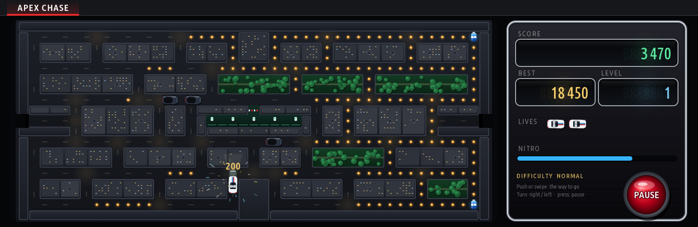</td>
</tr></table>

<table><tr>
<td width="64" align="center"></td>
<td><strong>Blackjack</strong> <code>v1.0.1</code> &nbsp;·&nbsp; <code>ID7</code></td>
</tr><tr>
<td colspan="2"> 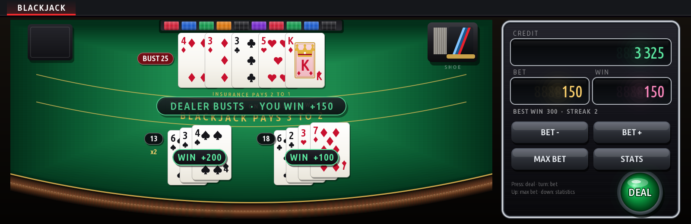</td>
</tr></table>

<table><tr>
<td width="64" align="center"></td>
<td><strong>Doom</strong> <code>v1.7.22</code> &nbsp;·&nbsp; <code>ID7 / ID8</code></td>
</tr><tr>
<td colspan="2"> </td>
</tr></table>

<table><tr>
<td width="64" align="center"></td>
<td><strong>Lap Record</strong> <code>v1.0.0</code> &nbsp;·&nbsp; <code>ID7</code></td>
</tr><tr>
<td colspan="2">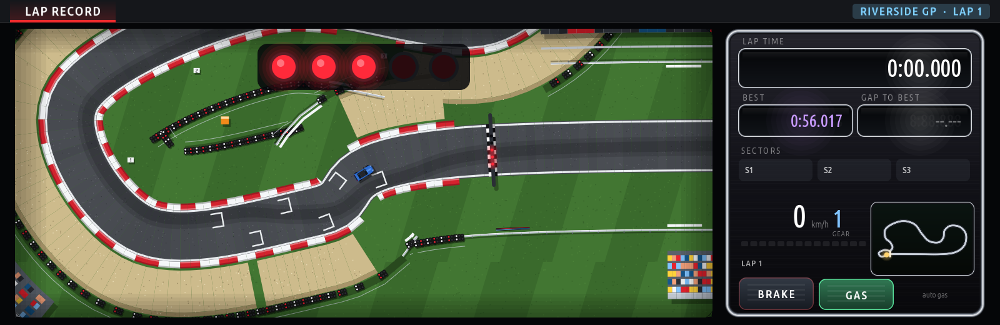 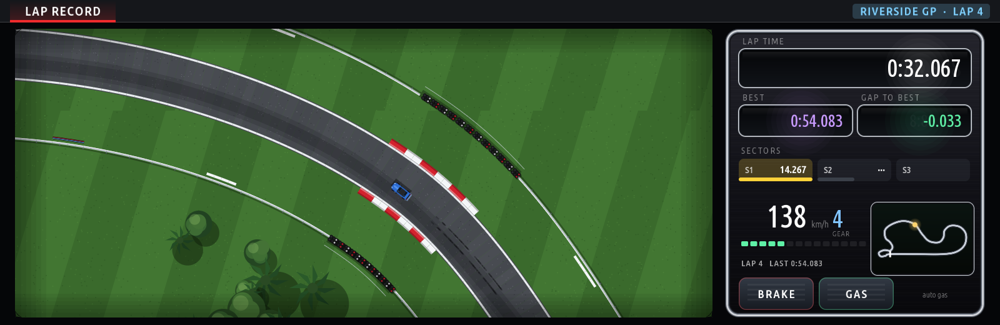</td>
</tr></table>

<table><tr>
<td width="64" align="center"></td>
<td><strong>Lucky Sevens</strong> <code>v1.1.0</code> &nbsp;·&nbsp; <code>ID7</code></td>
</tr><tr>
<td colspan="2">  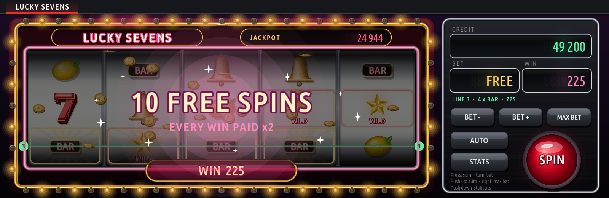</td>
</tr></table>

<table><tr>
<td width="64" align="center"></td>
<td><strong>M Arcade</strong> <code>v0.1.3</code> &nbsp;·&nbsp; <code>ID7</code></td>
</tr><tr>
<td colspan="2">  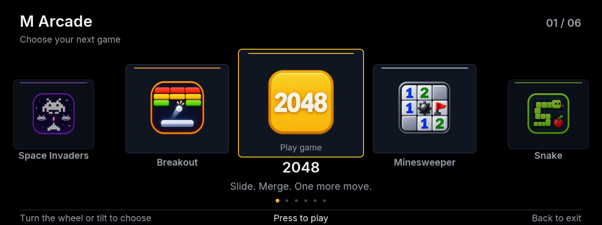</td>
</tr></table>

<table><tr>
<td width="64" align="center"></td>
<td><strong>M Pinball</strong> <code>v1.0.1</code> &nbsp;·&nbsp; <code>ID7</code></td>
</tr><tr>
<td colspan="2">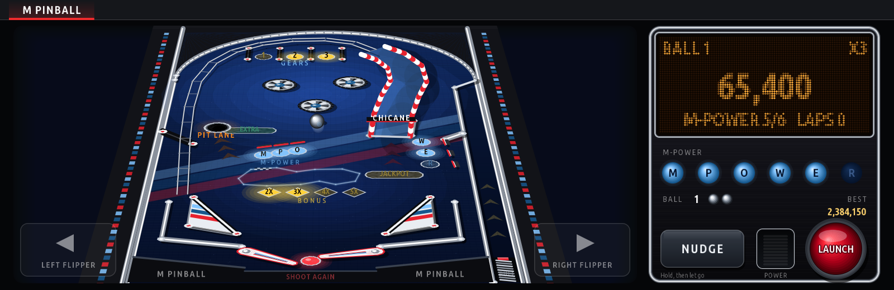 </td>
</tr></table>

<table><tr>
<td width="64" align="center"></td>
<td><strong>Parked Games</strong> <code>v0.2.3</code> &nbsp;·&nbsp; <code>ID7 / ID8</code></td>
</tr><tr>
<td colspan="2">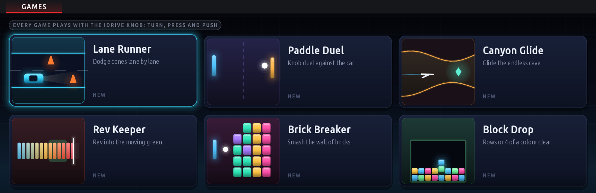 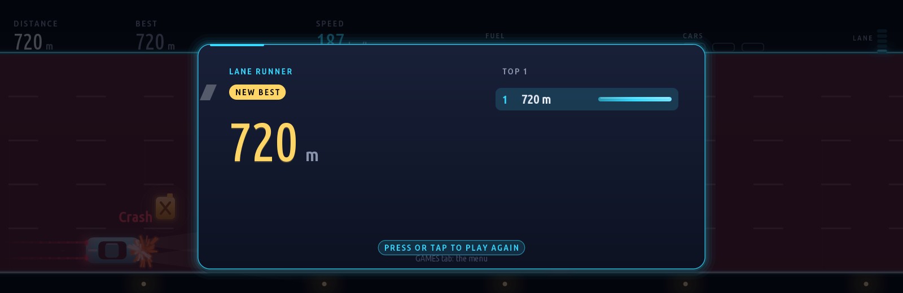</td>
</tr></table>

<table><tr>
<td width="64" align="center"></td>
<td><strong>Pit Wall</strong> <code>v1.0.0</code> &nbsp;·&nbsp; <code>ID7</code></td>
</tr><tr>
<td colspan="2"></td>
</tr></table>

<table><tr>
<td width="64" align="center"></td>
<td><strong>Ridge Duel</strong> <code>v1.0.1</code> &nbsp;·&nbsp; <code>ID7</code></td>
</tr><tr>
<td colspan="2">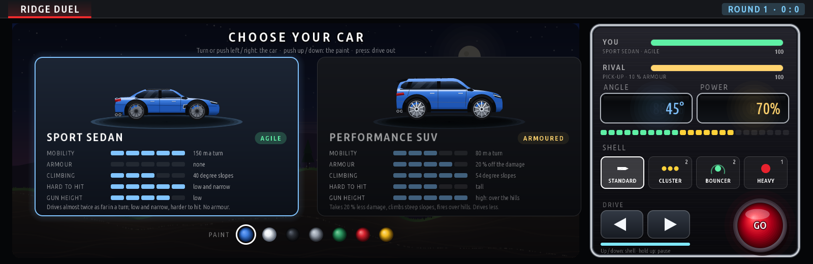  </td>
</tr></table>

<table><tr>
<td width="64" align="center"></td>
<td><strong>Road Hopper</strong> <code>v0.1.1</code> &nbsp;·&nbsp; <code>ID7</code></td>
</tr><tr>
<td colspan="2"></td>
</tr></table>

<table><tr>
<td width="64" align="center"></td>
<td><strong>Snake</strong> <code>v1.0.0</code> &nbsp;·&nbsp; <code>ID7</code></td>
</tr><tr>
<td colspan="2"></td>
</tr></table>

<table><tr>
<td width="64" align="center">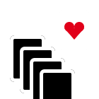</td>
<td><strong>Solitaire</strong> <code>v1.0.0</code> &nbsp;·&nbsp; <code>ID7</code></td>
</tr><tr>
<td colspan="2">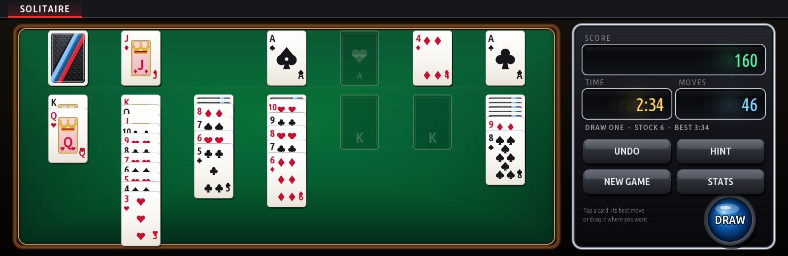 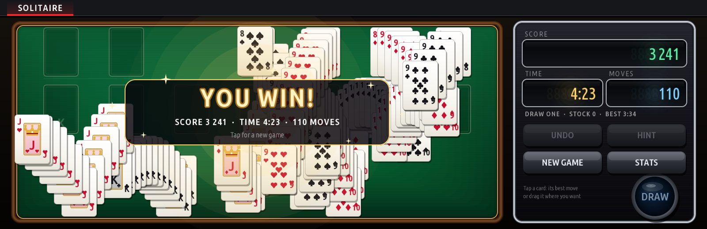</td>
</tr></table>

<table><tr>
<td width="64" align="center"></td>
<td><strong>Street Siege</strong> <code>v1.1.0</code> &nbsp;·&nbsp; <code>ID7</code></td>
</tr><tr>
<td colspan="2">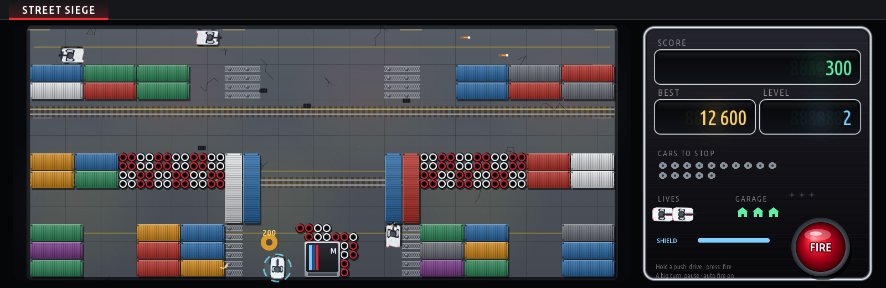 </td>
</tr></table>

<table><tr>
<td width="64" align="center"></td>
<td><strong>Track Defender</strong> <code>v1.0.0</code> &nbsp;·&nbsp; <code>ID7</code></td>
</tr><tr>
<td colspan="2"></td>
</tr></table>

<table>
<tr>
<td width="50%">&nbsp;&nbsp;<strong>Bimmer Blocks</strong> &nbsp;&nbsp;<code>v1.1.1</code> · <code>ID7 / ID8</code></td>
<td width="50%">&nbsp;&nbsp;<strong>Doodle Jump</strong> &nbsp;&nbsp;<code>v0.9.0</code> · <code>ID7</code></td>
</tr>
<tr>
<td width="50%">&nbsp;&nbsp;<strong>MGU GameStation</strong> &nbsp;&nbsp;<code>v0.3.0</code> · <code>ID7</code></td>
<td width="50%">&nbsp;&nbsp;<strong>Нарды</strong> &nbsp;&nbsp;<code>v0.1.1</code> · <code>ID7</code></td>
</tr>
<tr>
<td width="50%">&nbsp;&nbsp;<strong>Тетрис</strong> &nbsp;&nbsp;<code>v0.1.1</code> · <code>ID7</code></td>
<td width="50%"></td>
</tr>
</table>

## Helper Tools

<strong>Show all 8 helper tools</strong>

| Tool | Version | HMI |
|---|---|---|
| **Cluster renderer** (`cluster-render`) | `v0.6.9` | `ID7 / ID8` |
| **Doodle Jump GPU support** (`doodle-gpu`) | `v1.0.0` | `ID7` |
| **GPU renderer** (`idrive7-renderd`) | `v2.1.19` | `ID7 / ID8` |
| **Deploy tool** (`mgu-deploy`) | `v0.8.27` | `ID7 / ID8` |
| **GameStation Phone Port** (`mgu-game-net`) | `v0.1.0` | `ID7` |
| **Controller gate** (`mgu-inputgate`) | `v1.2.2` | `ID7 / ID8` |
| **Python** (`mgu-python`) | `v1.0.3` | `ID7 / ID8` |
| **Renderer** (`mgu-render`) | `v0.6.25` | `ID7 / ID8` |

