

# AQ MGU — iDrive 8 App Store

**Dedicated BMW iDrive 8 (MainApp-21) Apps & Helper Tools**

  

[All (`main`)](https://github.com/tiraUnderCode23/AQ_MGU/tree/main) · [iDrive 7 (`id7`)](https://github.com/tiraUnderCode23/AQ_MGU/tree/id7) · [iDrive 8 (`id8`)](https://github.com/tiraUnderCode23/AQ_MGU/tree/id8) · [Games (`games`)](https://github.com/tiraUnderCode23/AQ_MGU/tree/games)

---

<strong>➕ Add <code>id8</code> to MGU Store</strong>

| Source | URL |
|---|---|
| **AQ `id8` Branch (Apps + Tools)** | `https://github.com/tiraUnderCode23/AQ_MGU/tree/id8` |
| **AQ `id8` Release Catalog (Extra Prebuilt)** | `https://raw.githubusercontent.com/tiraUnderCode23/AQ_MGU/id8/release/catalog.json` |

## Apps (55)

<table><tr>
<td width="64" align="center"></td>
<td><strong>Ambient config</strong> <code>v2.7.13</code> &nbsp;·&nbsp; <code>ID7 · ID8</code></td>
</tr><tr>
<td colspan="2"> </td>
</tr></table>

<table><tr>
<td width="64" align="center"></td>
<td><strong>Ambient Light</strong> <code>v1.4.3</code> &nbsp;·&nbsp; <code>ID7 · ID8</code></td>
</tr><tr>
<td colspan="2">  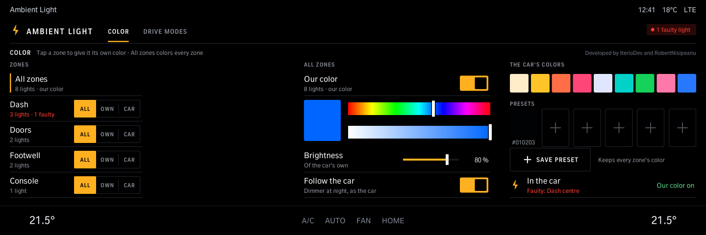</td>
</tr></table>

<table><tr>
<td width="64" align="center"></td>
<td><strong>Brake Test</strong> <code>v1.5.21</code> &nbsp;·&nbsp; <code>ID7 · ID8</code></td>
</tr><tr>
<td colspan="2">  </td>
</tr></table>

<table><tr>
<td width="64" align="center"></td>
<td><strong>Car Data</strong> <code>v1.4.1</code> &nbsp;·&nbsp; <code>ID8</code></td>
</tr><tr>
<td colspan="2">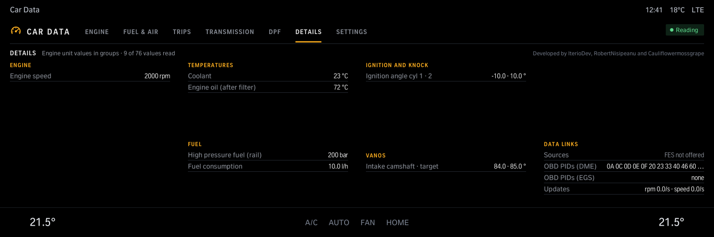  </td>
</tr></table>

<table><tr>
<td width="64" align="center"></td>
<td><strong>Drag Timer</strong> <code>v2.6.0</code> &nbsp;·&nbsp; <code>ID7 · ID8</code></td>
</tr><tr>
<td colspan="2">  </td>
</tr></table>

<table><tr>
<td width="64" align="center">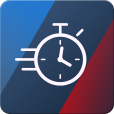</td>
<td><strong>Drag Timer</strong> <code>v1.2.0</code> &nbsp;·&nbsp; <code>ID8</code></td>
</tr><tr>
<td colspan="2">  </td>
</tr></table>

<table><tr>
<td width="64" align="center">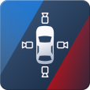</td>
<td><strong>Drive Recorder</strong> <code>v2.5.1</code> &nbsp;·&nbsp; <code>ID7 · ID8</code></td>
</tr><tr>
<td colspan="2">  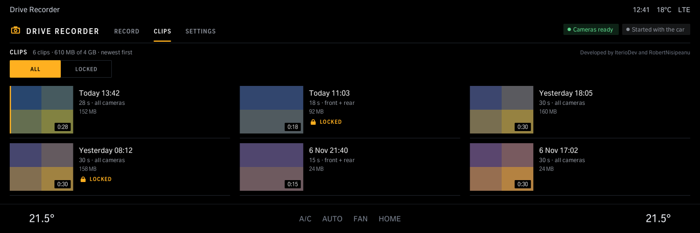</td>
</tr></table>

<table><tr>
<td width="64" align="center"></td>
<td><strong>E85 Blend</strong> <code>v1.2.2</code> &nbsp;·&nbsp; <code>ID7 · ID8</code></td>
</tr><tr>
<td colspan="2">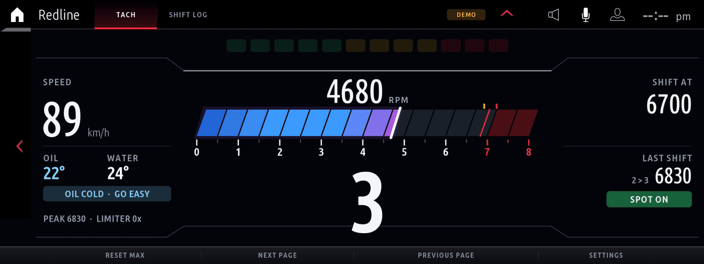  </td>
</tr></table>

<table><tr>
<td width="64" align="center"></td>
<td><strong>eDrive</strong> <code>v2.11.0</code> &nbsp;·&nbsp; <code>ID7 · ID8</code></td>
</tr><tr>
<td colspan="2">  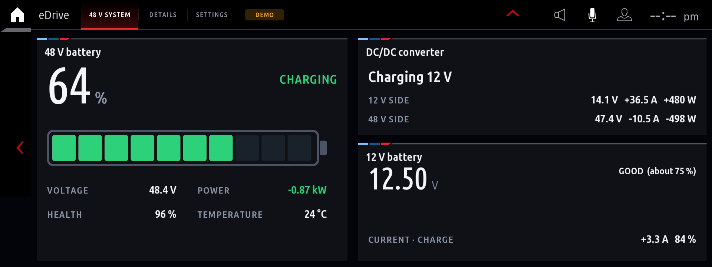</td>
</tr></table>

<table><tr>
<td width="64" align="center">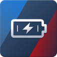</td>
<td><strong>eDrive</strong> <code>v1.1.0</code> &nbsp;·&nbsp; <code>ID8</code></td>
</tr><tr>
<td colspan="2">  </td>
</tr></table>

<table><tr>
<td width="64" align="center"></td>
<td><strong>Engine Config</strong> <code>v0.9.10</code> &nbsp;·&nbsp; <code>ID7 · ID8</code></td>
</tr><tr>
<td colspan="2">  </td>
</tr></table>

<table><tr>
<td width="64" align="center">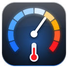</td>
<td><strong>Engine Vitals</strong> <code>v0.2.0</code> &nbsp;·&nbsp; <code>ID7 · ID8</code></td>
</tr><tr>
<td colspan="2"></td>
</tr></table>

<table><tr>
<td width="64" align="center"></td>
<td><strong>Esagono Settings</strong> <code>v0.1.0</code> &nbsp;·&nbsp; <code>ID8</code></td>
</tr><tr>
<td colspan="2">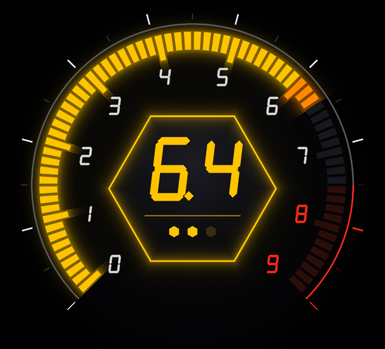</td>
</tr></table>

<table><tr>
<td width="64" align="center"></td>
<td><strong>Fault Codes</strong> <code>v1.2.0</code> &nbsp;·&nbsp; <code>ID8</code></td>
</tr><tr>
<td colspan="2">  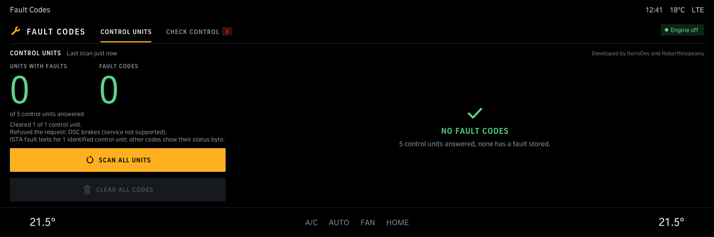</td>
</tr></table>

<table><tr>
<td width="64" align="center"></td>
<td><strong>Fault Scanner</strong> <code>v2.9.8</code> &nbsp;·&nbsp; <code>ID7 · ID8</code></td>
</tr><tr>
<td colspan="2"> 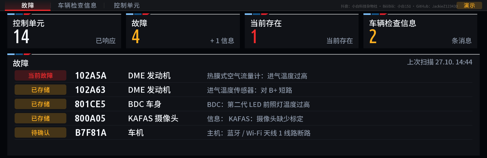 </td>
</tr></table>

<table><tr>
<td width="64" align="center"></td>
<td><strong>G-Force</strong> <code>v1.6.22</code> &nbsp;·&nbsp; <code>ID7 · ID8</code></td>
</tr><tr>
<td colspan="2">  </td>
</tr></table>

<table><tr>
<td width="64" align="center"></td>
<td><strong>Live Adjustments</strong> <code>v1.2.0</code> &nbsp;·&nbsp; <code>ID8</code></td>
</tr><tr>
<td colspan="2">  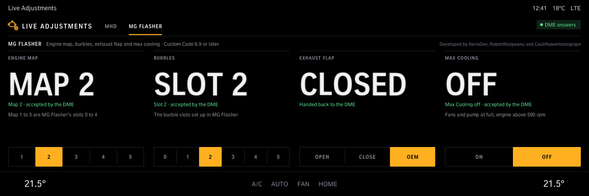</td>
</tr></table>

<table><tr>
<td width="64" align="center"></td>
<td><strong>Live Data</strong> <code>v1.0.18</code> &nbsp;·&nbsp; <code>ID7 · ID8</code></td>
</tr><tr>
<td colspan="2">  </td>
</tr></table>

<table><tr>
<td width="64" align="center"></td>
<td><strong>M Drive</strong> <code>v0.4.0</code> &nbsp;·&nbsp; <code>ID7 · ID8</code></td>
</tr><tr>
<td colspan="2"> </td>
</tr></table>

<table><tr>
<td width="64" align="center"></td>
<td><strong>M Vitals</strong> <code>v2.27.9</code> &nbsp;·&nbsp; <code>ID7 · ID8</code></td>
</tr><tr>
<td colspan="2">  </td>
</tr></table>

<table><tr>
<td width="64" align="center"></td>
<td><strong>M-Copilot</strong> <code>v1.0.31</code> &nbsp;·&nbsp; <code>ID7 · ID8</code></td>
</tr><tr>
<td colspan="2">  </td>
</tr></table>

<table><tr>
<td width="64" align="center"></td>
<td><strong>MGU Bm3 Live Adjustments for IDrive 8</strong> <code>v0.1.1</code> &nbsp;·&nbsp; <code>ID8</code></td>
</tr><tr>
<td colspan="2"> 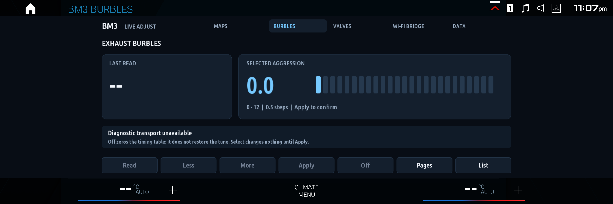 </td>
</tr></table>

<table><tr>
<td width="64" align="center"></td>
<td><strong>Overlays</strong> <code>v1.4.0</code> &nbsp;·&nbsp; <code>ID8</code></td>
</tr><tr>
<td colspan="2">  </td>
</tr></table>

<table><tr>
<td width="64" align="center"></td>
<td><strong>Redline</strong> <code>v2.0.45</code> &nbsp;·&nbsp; <code>ID7 · ID8</code></td>
</tr><tr>
<td colspan="2">  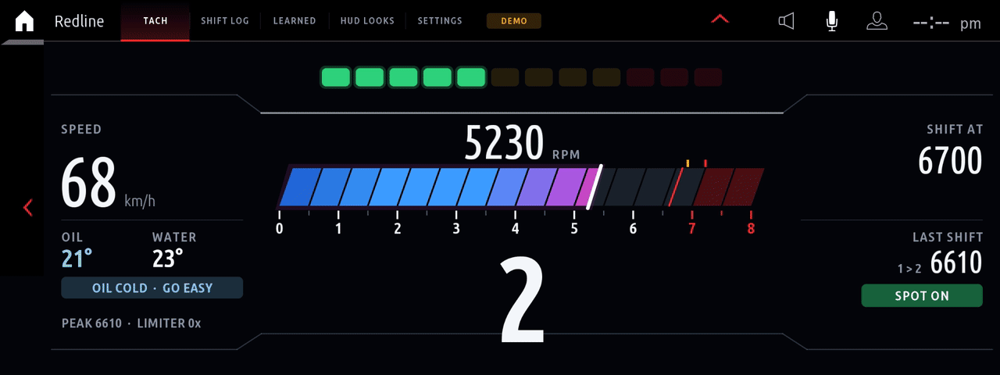</td>
</tr></table>

<table><tr>
<td width="64" align="center"></td>
<td><strong>Seats</strong> <code>v1.6.3</code> &nbsp;·&nbsp; <code>ID7 · ID8</code></td>
</tr><tr>
<td colspan="2">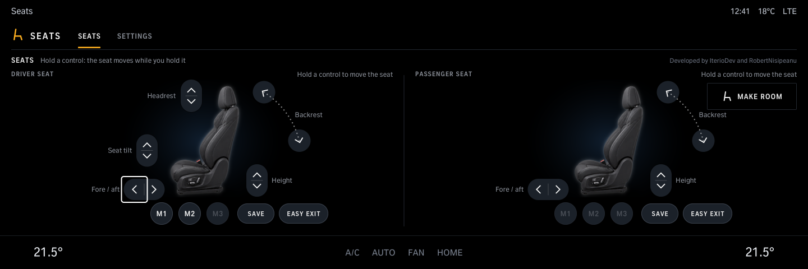  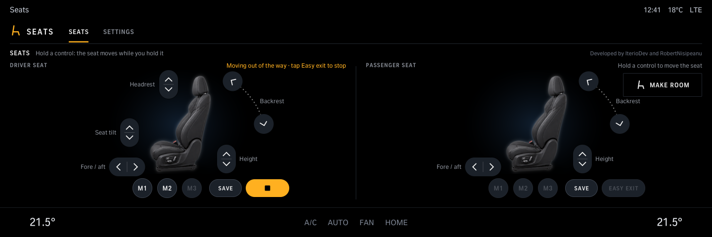</td>
</tr></table>

<table><tr>
<td width="64" align="center"></td>
<td><strong>Service</strong> <code>v1.0.0</code> &nbsp;·&nbsp; <code>ID8</code></td>
</tr><tr>
<td colspan="2">  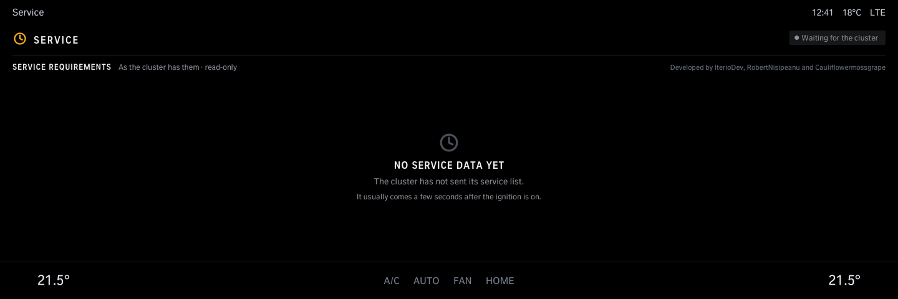</td>
</tr></table>

<table><tr>
<td width="64" align="center"></td>
<td><strong>Service</strong> <code>v1.6.3</code> &nbsp;·&nbsp; <code>ID7 · ID8</code></td>
</tr><tr>
<td colspan="2"> </td>
</tr></table>

<table><tr>
<td width="64" align="center"></td>
<td><strong>Spotify</strong> <code>v1.0.30</code> &nbsp;·&nbsp; <code>ID7 · ID8</code></td>
</tr><tr>
<td colspan="2">  </td>
</tr></table>

<table><tr>
<td width="64" align="center"></td>
<td><strong>Store</strong> <code>v0.9.41</code> &nbsp;·&nbsp; <code>ID7 · ID8</code></td>
</tr><tr>
<td colspan="2"> 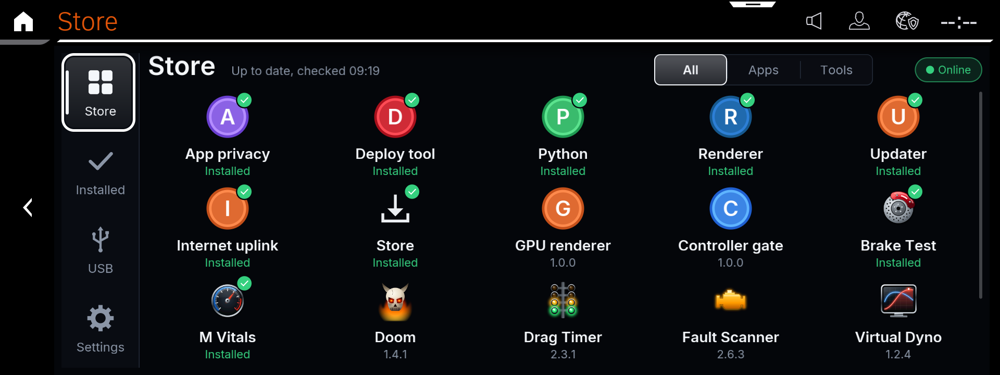 </td>
</tr></table>

<table><tr>
<td width="64" align="center"></td>
<td><strong>System Monitor</strong> <code>v1.0.4</code> &nbsp;·&nbsp; <code>ID7 · ID8</code></td>
</tr><tr>
<td colspan="2">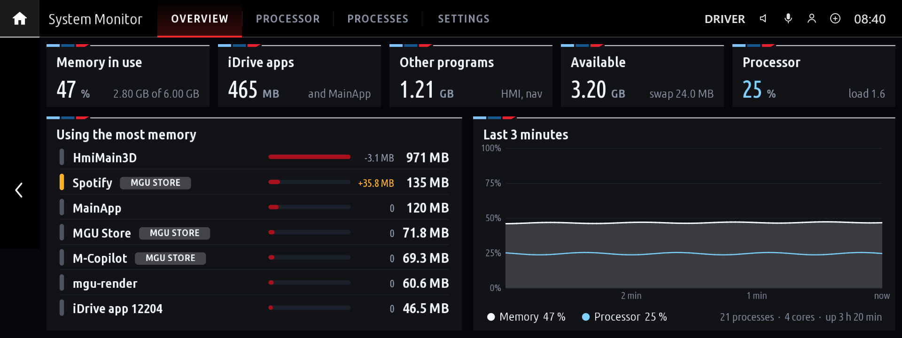  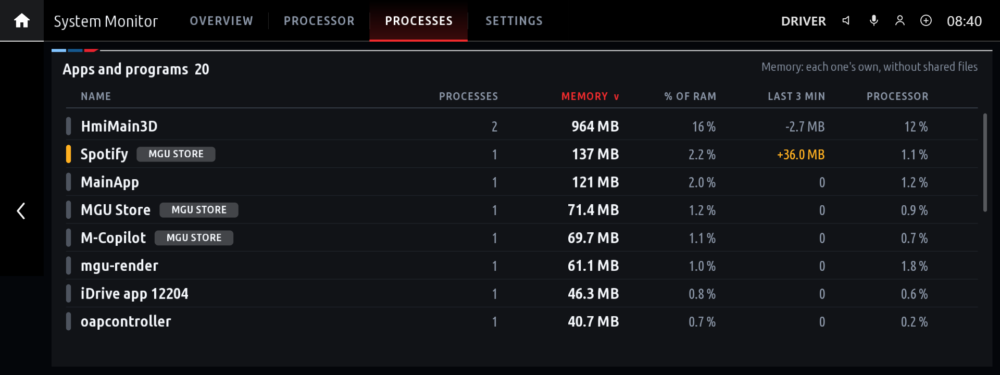</td>
</tr></table>

<table><tr>
<td width="64" align="center"></td>
<td><strong>Tailscale</strong> <code>v1.2.0</code> &nbsp;·&nbsp; <code>ID7 · ID8</code></td>
</tr><tr>
<td colspan="2">  </td>
</tr></table>

<table><tr>
<td width="64" align="center"></td>
<td><strong>Transmission Config</strong> <code>v1.5.8</code> &nbsp;·&nbsp; <code>ID7 · ID8</code></td>
</tr><tr>
<td colspan="2">  </td>
</tr></table>

<table><tr>
<td width="64" align="center"></td>
<td><strong>Turn View</strong> <code>v1.6.0</code> &nbsp;·&nbsp; <code>ID7 · ID8</code></td>
</tr><tr>
<td colspan="2">  </td>
</tr></table>

<table><tr>
<td width="64" align="center"></td>
<td><strong>Virtual Dyno</strong> <code>v1.6.3</code> &nbsp;·&nbsp; <code>ID7 · ID8</code></td>
</tr><tr>
<td colspan="2"> </td>
</tr></table>

<table><tr>
<td width="64" align="center"></td>
<td><strong>Vitals</strong> <code>v1.3.1</code> &nbsp;·&nbsp; <code>ID8</code></td>
</tr><tr>
<td colspan="2"></td>
</tr></table>

<table><tr>
<td width="64" align="center"></td>
<td><strong>Warm-Up</strong> <code>v1.9.0</code> &nbsp;·&nbsp; <code>ID7 · ID8</code></td>
</tr><tr>
<td colspan="2">  </td>
</tr></table>

<table>
<tr>
<td width="25%" align="center" valign="top"> <strong>Bimmer Pass</strong> <code>v1.1.1</code> · <code>ID7 · ID8</code></td>
<td width="25%" align="center" valign="top"> <strong>Car Care</strong> <code>v0.2.4</code> · <code>ID7 · ID8</code></td>
<td width="25%" align="center" valign="top"> <strong>Car Explorer</strong> <code>v0.2.3</code> · <code>ID7 · ID8</code></td>
<td width="25%" align="center" valign="top"> <strong>Car Lyrics</strong> <code>v0.3.10</code> · <code>ID7 · ID8</code></td>
</tr>
<tr>
<td width="25%" align="center" valign="top"> <strong>DPF Monitoring</strong> <code>v1.0.0</code> · <code>ID8</code></td>
<td width="25%" align="center" valign="top"> <strong>Drive</strong> <code>v1.9.3</code> · <code>ID7 · ID8</code></td>
<td width="25%" align="center" valign="top"> <strong>ECU Live Data</strong> <code>v1.0.0</code> · <code>ID8</code></td>
<td width="25%" align="center" valign="top">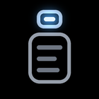 <strong>Light Logger</strong> <code>v1.3.1</code> · <code>ID8</code></td>
</tr>
<tr>
<td width="25%" align="center" valign="top"> <strong>mazzahaker_xdrive_remover</strong> <code>v0.1.26</code> · <code>ID7 · ID8</code></td>
<td width="25%" align="center" valign="top"> <strong>MGU Storage Monitor</strong> <code>v1.2.4</code> · <code>ID7 · ID8</code></td>
<td width="25%" align="center" valign="top"> <strong>Motordaten</strong> <code>v0.4.1</code> · <code>ID7 · ID8</code></td>
<td width="25%" align="center" valign="top"> <strong>Proven Gauges</strong> <code>v1.0.3</code> · <code>ID7 · ID8</code></td>
</tr>
<tr>
<td width="25%" align="center" valign="top"> <strong>Proven Warm-Up</strong> <code>v1.2.1</code> · <code>ID7 · ID8</code></td>
<td width="25%" align="center" valign="top"> <strong>Seat Lights</strong> <code>v1.3.2</code> · <code>ID8</code></td>
<td width="25%" align="center" valign="top"> <strong>Shift Lights</strong> <code>v0.4.6</code> · <code>ID7 · ID8</code></td>
<td width="25%" align="center" valign="top"> <strong>Store</strong> <code>v3.4.5</code> · <code>ID7 · ID8</code></td>
</tr>
<tr>
<td width="25%" align="center" valign="top"> <strong>Track Mode</strong> <code>v1.0.1</code> · <code>ID7 · ID8</code></td>
<td width="25%" align="center" valign="top">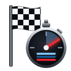 <strong>True Time</strong> <code>v1.0.0</code> · <code>ID8</code></td>
<td width="25%" align="center" valign="top"> <strong>TurnKey E Blend</strong> <code>v0.5.0</code> · <code>ID8</code></td>
<td width="25%"></td>
</tr>
</table>

## Helper Tools (11)

<strong>View all 11 Helper Tools</strong>

| Tool | ID | Version | HMI |
|---|---|---|---|
| **App privacy** | `app-privacy` | `v1.7.2` | `ID7 · ID8` |
| **Cluster renderer** | `cluster-render` | `v0.6.9` | `ID7 · ID8` |
| **Esagono Cluster** | `esagono-cluster` | `v0.2.1` | `ID8` |
| **Vitals Cluster** | `ida-vitals-cluster` | `v1.3.3` | `ID8` |
| **GPU renderer** | `idrive7-renderd` | `v2.1.19` | `ID7 · ID8` |
| **Deploy tool** | `mgu-deploy` | `v0.8.27` | `ID7 · ID8` |
| **Controller gate** | `mgu-inputgate` | `v1.2.2` | `ID7 · ID8` |
| **Python** | `mgu-python` | `v1.0.3` | `ID7 · ID8` |
| **Renderer** | `mgu-render` | `v0.6.25` | `ID7 · ID8` |
| **Updater** | `mgu-updater` | `v0.8.51` | `ID7 · ID8` |
| **Internet uplink** | `mgu-uplink` | `v0.7.13` | `ID7 · ID8` |

