# AQ_MGU — BMW MGU Apps & Tools

A single, source-attributed catalog of open-source BMW iDrive 7/8 MGU applications, games and Store components. Application images are copied from the pinned upstream repositories and organized by app.

**36 apps · 1 game · 24 Store tools · 61 installable components**<br>
Last source and release review: 2026-11-17.

## Use AQ_MGU with MGU Store

Add the same GitHub repository twice in the Store's source settings: once for source-built apps and once for the release packages. This matches the Store's native repository-tree and `catalog` release channels.

```json
{
  "schema": 1,
  "sources": [
    { "id": "aq-mgu-apps", "type": "github", "repo": "tiraUnderCode23/AQ_MGU", "channel": "branch" },
    { "id": "aq-mgu-catalog", "type": "github", "repo": "tiraUnderCode23/AQ_MGU", "channel": "releases" }
  ]
}
```

The branch feed is [`mgu-repo.json`](mgu-repo.json). The release feed is [`release/catalog.json`](release/catalog.json), published with the package assets under the GitHub Release named `catalog`. The ready-to-copy source settings are in [`data/store-sources.json`](data/store-sources.json).

## Apps

Each entry shows its upstream title, current pinned version, a short description, published icon/screenshots when available, supported HMI and license/source link. Open an entry for the gallery.

<details>
<summary><strong>AirPlay</strong> <code>apm_airplay</code> — v1.0.6</summary>

<em>No standalone icon published</em>

Your iPhone&#x27;s screen on the central display by AirPlay screen mirroring, parked only. Sound stays on Bluetooth. In Apps and Communication.

**Supported:** ID7 · **License:** Mixed GPL/MIT by component · **Source:** [noth4m4d/mgu-hamadstools](https://github.com/noth4m4d/mgu-hamadstools/tree/e327b30e48019eab79ace5fb7d610610d0e96d92/apps/_sources/noth4m4d-mgu-hamadstools) · No upstream image files found in the pinned source.
</details>

<details>
<summary><strong>Ambient config</strong> <code>ambient_config</code> — v2.6.2</summary>

 <a href="docs/assets/apps/ambient_config/preview-01.png"></a>

Any colour on the ambient light, animations, and a look for each driving mode

**Supported:** ID7 · **License:** MIT; retain per-component and third-party notices · **Source:** [cauliflowermossgrape/idrive7-apps](https://github.com/cauliflowermossgrape/idrive7-apps/tree/422957a85461826c1e8654d37c8ec66a94849f9c/apps/_sources/idrive7-apps/apps/ambient_config) · <a href="https://github.com/tiraUnderCode23/AQ_MGU/tree/main/docs/assets/apps/ambient_config">All 2 published images</a>
</details>

<details>
<summary><strong>Brake Test</strong> <code>brake_test</code> — v1.5.21</summary>

 <a href="docs/assets/apps/brake_test/preview-01.png">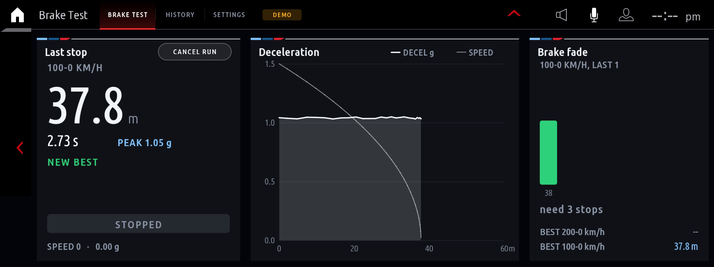</a> <a href="docs/assets/apps/brake_test/preview-02.gif"></a>

100-0 and 200-0 braking distance, peak decel and brake-fade tracking

**Supported:** ID7 · **License:** MIT; retain per-component and third-party notices · **Source:** [cauliflowermossgrape/idrive7-apps](https://github.com/cauliflowermossgrape/idrive7-apps/tree/422957a85461826c1e8654d37c8ec66a94849f9c/apps/_sources/idrive7-apps/apps/brake_test) · <a href="https://github.com/tiraUnderCode23/AQ_MGU/tree/main/docs/assets/apps/brake_test">All 3 published images</a>
</details>

<details>
<summary><strong>Browser</strong> <code>vizualyse_chromium</code> — v0.3.1</summary>


Browser: shows the phone link and QR code for the vizualyse-chromium web browser, what its GPU offers (WebGPU, WebGL 2, JSPI), and shows or hides the browser on the central screen

**Supported:** ID7 · **License:** GPL-3.0-or-later with third-party notices · **Source:** [Vizualyse/idrive-apps](https://github.com/Vizualyse/idrive-apps/tree/13a766b520f17d7871fb9bb0713f658e5e14641b/apps/_sources/vizualyse-idrive-apps/apps/vizualyse_chromium) · <a href="https://github.com/tiraUnderCode23/AQ_MGU/tree/main/docs/assets/apps/vizualyse_chromium">All 1 published images</a>
</details>

<details>
<summary><strong>CarPlay Map Mirror</strong> <code>vlad_carplay_mirror</code> — v0.1.3</summary>


Waze / Apple Maps / Google Maps from CarPlay Dashboard to the cluster. Experimental on X3.

**Supported:** ID7 · **License:** Mixed GPL/MPL/MIT; see component files · **Source:** [Impossible43/vlad-mgu-apps](https://github.com/Impossible43/vlad-mgu-apps/tree/c3e18eb45969122a377ec93e728d6a1d11eeaa7b/apps/_sources/vlad-mgu-apps/apps/vlad_carplay_mirror) · <a href="https://github.com/tiraUnderCode23/AQ_MGU/tree/main/docs/assets/apps/vlad_carplay_mirror">All 1 published images</a>
</details>

<details>
<summary><strong>CarPlay Map Toggle</strong> <code>carplay_map_toggle</code> — v0.1.0</summary>

 <a href="docs/assets/apps/carplay_map_toggle/preview-01.webp">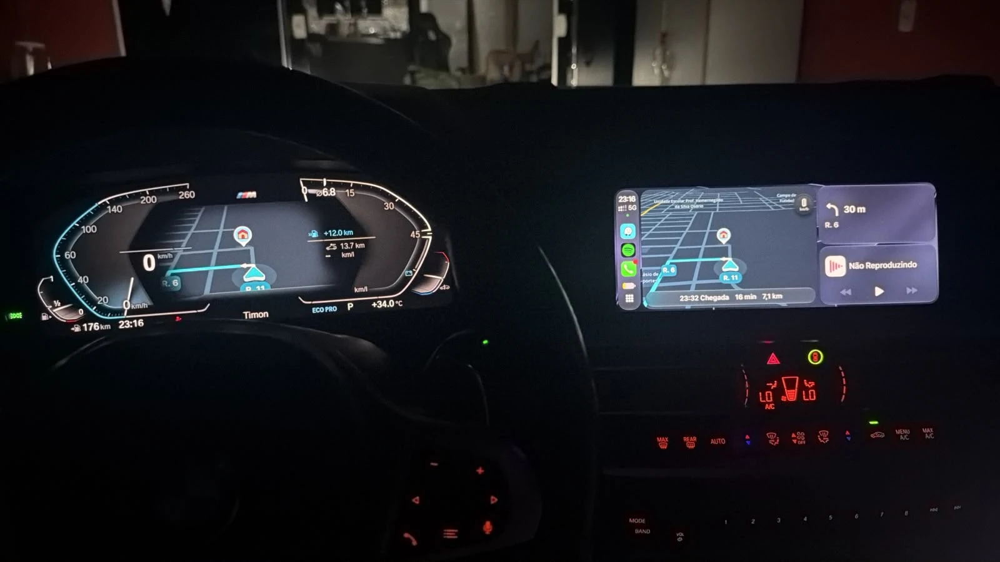</a>

Enables or disables the CarPlay map stream on the instrument cluster for compatible ID7 systems.

**Supported:** ID7 · **License:** MPL-2.0; component file notices retained · **Source:** [isaakbruno2/carplay-map-cluster](https://github.com/isaakbruno2/carplay-map-cluster/tree/2ab4318d6fcc981ffc647597ae91c7d6405de4ec/apps/_sources/isaak-carplay-map-cluster/app/carplay_map_toggle) · <a href="https://github.com/tiraUnderCode23/AQ_MGU/tree/main/docs/assets/apps/carplay_map_toggle">All 2 published images</a>
</details>

<details>
<summary><strong>Cast</strong> <code>vizualyse_cast</code> — v0.4.1</summary>


Cast to cluster: shows the phone link and QR code for the cast service, its status, and replays the last stream on the cluster, the HUD or the media console

**Supported:** ID7 · **License:** GPL-3.0-or-later with third-party notices · **Source:** [Vizualyse/idrive-apps](https://github.com/Vizualyse/idrive-apps/tree/13a766b520f17d7871fb9bb0713f658e5e14641b/apps/_sources/vizualyse-idrive-apps/apps/vizualyse_cast) · <a href="https://github.com/tiraUnderCode23/AQ_MGU/tree/main/docs/assets/apps/vizualyse_cast">All 1 published images</a>
</details>

<details>
<summary><strong>Cluster Themes</strong> <code>cluster_themes</code> — v0.19.0</summary>

 <a href="docs/assets/apps/cluster_themes/preview-01.png">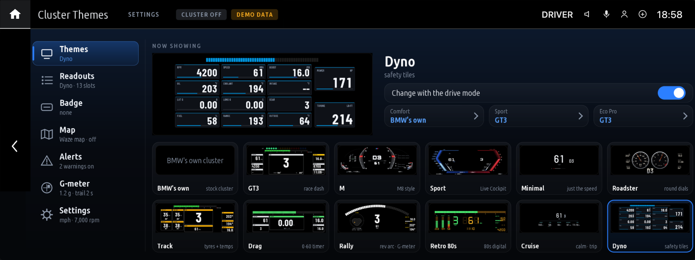</a> <a href="docs/assets/apps/cluster_themes/preview-02.png"></a>

Redraws the instrument cluster: GT3 race dash, M-style, M view, Vector (with a music panel), Sport, Minimal, Track, Drag, Rally, Retro 80s, Cruise, Dyno (BMW-coloured readout tiles) or Ribbon (with holiday editions), with shift lights, boost, temps, tyres, a G-meter and a 0-60 timer

**Supported:** ID7 · **License:** MIT; retain component notices · **Source:** [bimmer-lab/apps](https://github.com/bimmer-lab/apps/tree/ab81cee4d77859b531b21a118772c6b031455b78/apps/_sources/bimmer-lab-apps/apps/cluster_themes) · <a href="https://github.com/tiraUnderCode23/AQ_MGU/tree/main/docs/assets/apps/cluster_themes">All 20 published images</a>
</details>

<details>
<summary><strong>Cluster themes</strong> <code>vizualyse_cluster</code> — v0.3.1</summary>


Cluster themes: chooses the instrument cluster theme (the vizualyse-cluster tool): a picker on the central screen with a preview of every theme, touched, a Try on the cluster while parked, Sport or Comfort, on or off

**Supported:** ID7 · **License:** GPL-3.0-or-later with third-party notices · **Source:** [Vizualyse/idrive-apps](https://github.com/Vizualyse/idrive-apps/tree/13a766b520f17d7871fb9bb0713f658e5e14641b/apps/_sources/vizualyse-idrive-apps/apps/vizualyse_cluster) · <a href="https://github.com/tiraUnderCode23/AQ_MGU/tree/main/docs/assets/apps/vizualyse_cluster">All 1 published images</a>
</details>

<details>
<summary><strong>Drag Timer</strong> <code>draggy</code> — v2.6.0</summary>

 <a href="docs/assets/apps/draggy/preview-01.png"></a> <a href="docs/assets/apps/draggy/preview-02.gif"></a>

0-100, 100-200 and 1/4 mile timer with best times

**Supported:** ID7 · **License:** MIT; retain per-component and third-party notices · **Source:** [cauliflowermossgrape/idrive7-apps](https://github.com/cauliflowermossgrape/idrive7-apps/tree/422957a85461826c1e8654d37c8ec66a94849f9c/apps/_sources/idrive7-apps/apps/draggy) · <a href="https://github.com/tiraUnderCode23/AQ_MGU/tree/main/docs/assets/apps/draggy">All 3 published images</a>
</details>

<details>
<summary><strong>eDrive</strong> <code>edrive</code> — v2.10.1</summary>

 <a href="docs/assets/apps/edrive/preview-01.png"></a> <a href="docs/assets/apps/edrive/preview-02.png"></a>

Real electric range (plug-in hybrids and fully electric cars such as the iX3), live battery power, cells and climate power, HV battery health (SOH) and energy, last charge, charge log, the 12 V battery (charge, voltage, what it does, regen, history) and a home-screen widget; on a 48 V mild hybrid its 48 V battery and DC/DC converter

**Supported:** ID7 · **License:** MIT; retain per-component and third-party notices · **Source:** [cauliflowermossgrape/idrive7-apps](https://github.com/cauliflowermossgrape/idrive7-apps/tree/422957a85461826c1e8654d37c8ec66a94849f9c/apps/_sources/idrive7-apps/apps/edrive) · <a href="https://github.com/tiraUnderCode23/AQ_MGU/tree/main/docs/assets/apps/edrive">All 8 published images</a>
</details>

<details>
<summary><strong>Engine Config</strong> <code>live_adjustments</code> — v0.9.8</summary>

 <a href="docs/assets/apps/live_adjustments/preview-01.png">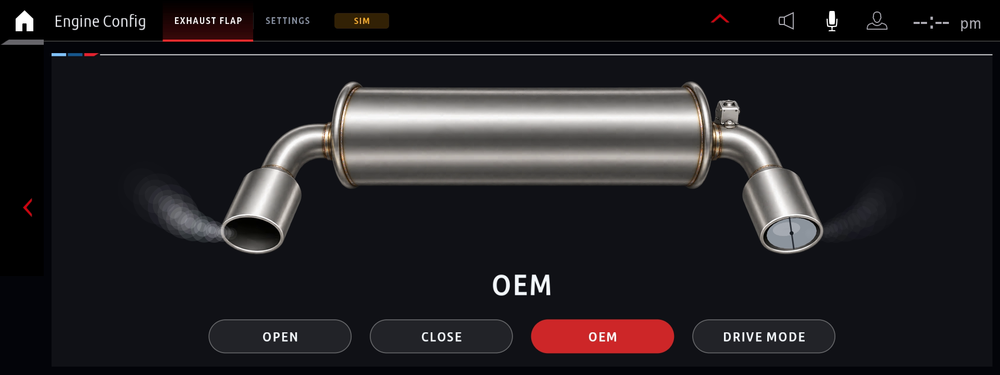</a> <a href="docs/assets/apps/live_adjustments/preview-02.png"></a>

Engine Config for BMW MGU ID7. Exhaust Flap: OEM, OPEN and CLOSE over the car&#x27;s own diagnostic link, or following the driving mode (Sport open, Eco Pro closed); held against the DME&#x27;s timeout, Close handed back above a set engine speed. With BM3 or MHD picked in Settings: engine map switching, burbles, ASD and Max Cooling. Experimental: xDrive off until the ignition cycle (DSC LMV_FUNKTION), behind its own setting

**Supported:** ID7 · **License:** MIT; retain per-component and third-party notices · **Source:** [cauliflowermossgrape/idrive7-apps](https://github.com/cauliflowermossgrape/idrive7-apps/tree/422957a85461826c1e8654d37c8ec66a94849f9c/apps/_sources/idrive7-apps/apps/live_adjustments) · <a href="https://github.com/tiraUnderCode23/AQ_MGU/tree/main/docs/assets/apps/live_adjustments">All 15 published images</a>
</details>

<details>
<summary><strong>Fault Scanner</strong> <code>dtc_scanner</code> — v2.9.8</summary>

 <a href="docs/assets/apps/dtc_scanner/preview-01.png">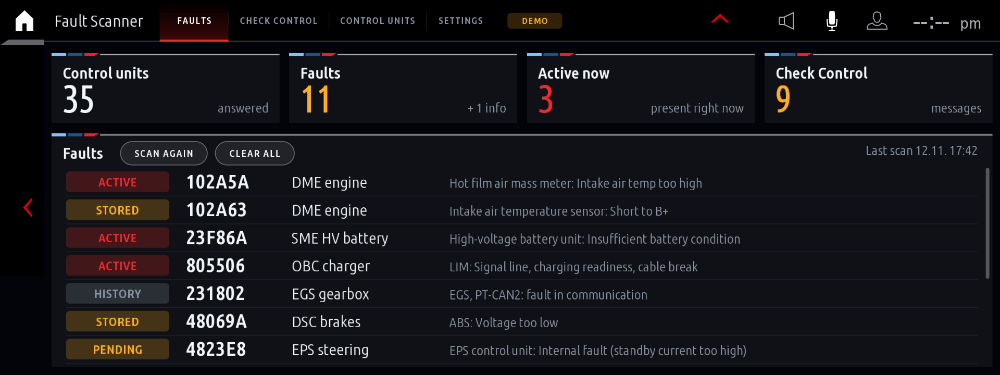</a> <a href="docs/assets/apps/dtc_scanner/preview-02.png"></a>

Read and clear fault memory of every control unit, plus active Check Control messages

**Supported:** ID7 · **License:** MIT; retain per-component and third-party notices · **Source:** [cauliflowermossgrape/idrive7-apps](https://github.com/cauliflowermossgrape/idrive7-apps/tree/422957a85461826c1e8654d37c8ec66a94849f9c/apps/_sources/idrive7-apps/apps/dtc_scanner) · <a href="https://github.com/tiraUnderCode23/AQ_MGU/tree/main/docs/assets/apps/dtc_scanner">All 3 published images</a>
</details>

<details>
<summary><strong>Flex Fuel</strong> <code>perea_mhd_flex</code> — v1.6.0</summary>

 <a href="docs/assets/apps/perea_mhd_flex/preview-01.png"></a> <a href="docs/assets/apps/perea_mhd_flex/preview-02.png">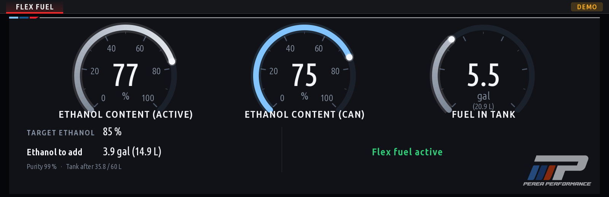</a>

Ethanol content (Active and CAN) read from an MHD-flashed DME over the car&#x27;s own diagnostic link, the fuel in the tank (the DME&#x27;s tank halves or the cluster), and how much ethanol to add to reach a target blend; the Active dial can also show the DME&#x27;s own alcohol percentage (22 550D). Read-only; the addresses come from a profile per DME program family

**Supported:** ID7, ID8 · **License:** MIT · **Source:** [alexpereap/pereaperformance-idrive7-apps](https://github.com/alexpereap/pereaperformance-idrive7-apps/tree/5b758fad17761b8696989e2a4ffbfbfab4926b6f/apps/_sources/alexpereap-idrive7-apps/apps/perea_mhd_flex) · <a href="https://github.com/tiraUnderCode23/AQ_MGU/tree/main/docs/assets/apps/perea_mhd_flex">All 3 published images</a>
</details>

<details>
<summary><strong>FSC Patch</strong> <code>noahg_fscpatcher</code> — v1.0.0</summary>


Patch or restore the FSC verifier.

**Supported:** ID7 · **License:** MIT · **Source:** [Noahbg/mgu-apps](https://github.com/Noahbg/mgu-apps/tree/3853c99c99c1e610ae0dee3547a1429b0c097300/apps/_sources/noahg-mgu-apps/apps/noahg_fscpatcher) · <a href="https://github.com/tiraUnderCode23/AQ_MGU/tree/main/docs/assets/apps/noahg_fscpatcher">All 1 published images</a>
</details>

<details>
<summary><strong>G-Force</strong> <code>gforce</code> — v1.6.22</summary>

 <a href="docs/assets/apps/gforce/preview-01.png"></a> <a href="docs/assets/apps/gforce/preview-02.gif"></a>

Friction circle with grip envelope, peak g per direction and session records

**Supported:** ID7 · **License:** MIT; retain per-component and third-party notices · **Source:** [cauliflowermossgrape/idrive7-apps](https://github.com/cauliflowermossgrape/idrive7-apps/tree/422957a85461826c1e8654d37c8ec66a94849f9c/apps/_sources/idrive7-apps/apps/gforce) · <a href="https://github.com/tiraUnderCode23/AQ_MGU/tree/main/docs/assets/apps/gforce">All 3 published images</a>
</details>

<details>
<summary><strong>HUD Widgets</strong> <code>idrive_hud_widgets</code> — v0.15.0</summary>

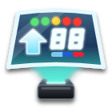 <a href="docs/assets/apps/idrive_hud_widgets/preview-01.png"></a> <a href="docs/assets/apps/idrive_hud_widgets/preview-02.png">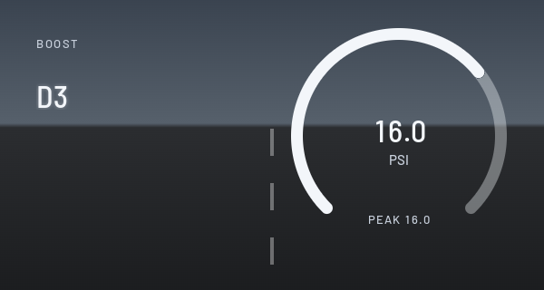</a>

Gear, shift lights, boost, oil, coolant and intake temperatures, a G-meter, trip figures and the song playing on the windshield HUD, in Classic, M or Night themes

**Supported:** ID7 · **License:** MIT; retain component notices · **Source:** [bimmer-lab/apps](https://github.com/bimmer-lab/apps/tree/ab81cee4d77859b531b21a118772c6b031455b78/apps/_sources/bimmer-lab-apps/apps/idrive_hud_widgets) · <a href="https://github.com/tiraUnderCode23/AQ_MGU/tree/main/docs/assets/apps/idrive_hud_widgets">All 18 published images</a>
</details>

<details>
<summary><strong>idv7lol</strong> <code>idv7lol</code> — v0.2.14</summary>

 <a href="docs/assets/apps/idv7lol/preview-01.jpg">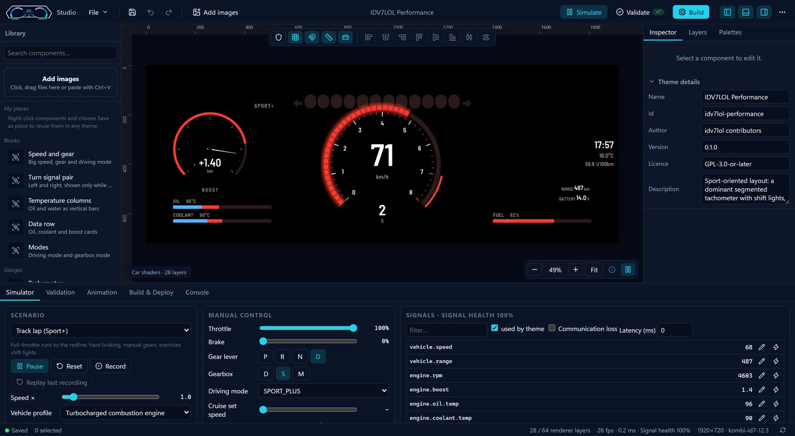</a> <a href="docs/assets/apps/idv7lol/preview-02.jpg"></a>

Your own layout on the whole instrument cluster: themes made with idv7lol Studio, drawn by the cluster itself

**Supported:** ID7 · **License:** GPL-3.0-or-later with third-party notices · **Source:** [ALMSTRA/idv7lol](https://github.com/ALMSTRA/idv7lol/tree/ff54c2cabd465eea1521770573701f26c36f880b/apps/_sources/idv7lol/apps/idv7lol) · <a href="https://github.com/tiraUnderCode23/AQ_MGU/tree/main/docs/assets/apps/idv7lol">All 12 published images</a>
</details>

<details>
<summary><strong>Live Data</strong> <code>live_data</code> — v1.0.16</summary>

 <a href="docs/assets/apps/live_data/preview-01.png"></a> <a href="docs/assets/apps/live_data/preview-02.png"></a>

Read-only live values from the car and its control units, a trip computer with fuel cost, and gauge screens of your own, one of them as the home-screen widget

**Supported:** ID7 · **License:** MIT; retain per-component and third-party notices · **Source:** [cauliflowermossgrape/idrive7-apps](https://github.com/cauliflowermossgrape/idrive7-apps/tree/422957a85461826c1e8654d37c8ec66a94849f9c/apps/_sources/idrive7-apps/apps/live_data) · <a href="https://github.com/tiraUnderCode23/AQ_MGU/tree/main/docs/assets/apps/live_data">All 13 published images</a>
</details>

<details>
<summary><strong>M Vitals</strong> <code>car_vitals</code> — v2.27.6</summary>

 <a href="docs/assets/apps/car_vitals/preview-01.png">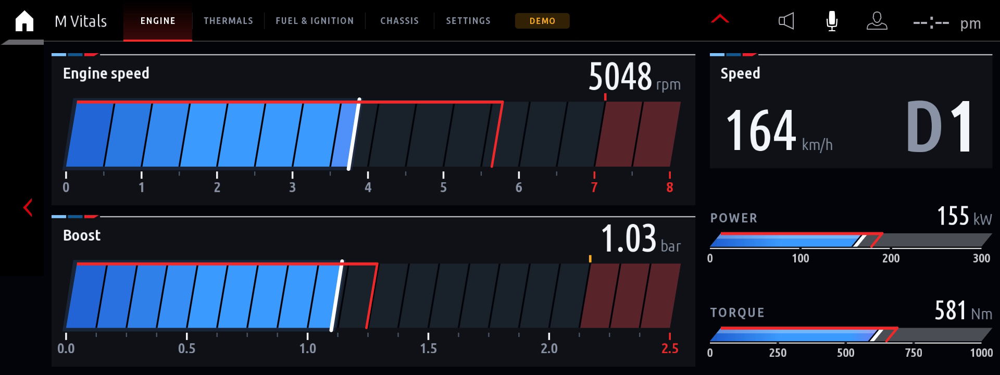</a> <a href="docs/assets/apps/car_vitals/preview-02.png"></a>

Live engine, thermal, intake / fuel / ignition, tyre and chassis gauges

**Supported:** ID7 · **License:** MIT; retain per-component and third-party notices · **Source:** [cauliflowermossgrape/idrive7-apps](https://github.com/cauliflowermossgrape/idrive7-apps/tree/422957a85461826c1e8654d37c8ec66a94849f9c/apps/_sources/idrive7-apps/apps/car_vitals) · <a href="https://github.com/tiraUnderCode23/AQ_MGU/tree/main/docs/assets/apps/car_vitals">All 7 published images</a>
</details>

<details>
<summary><strong>M-Copilot</strong> <code>m_copilot</code> — v1.0.31</summary>

 <a href="docs/assets/apps/m_copilot/preview-01.png"></a> <a href="docs/assets/apps/m_copilot/preview-02.png">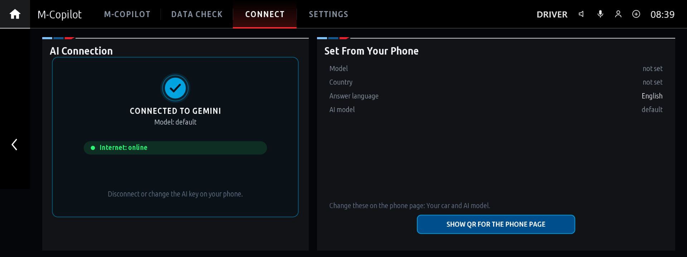</a>

Displays vehicle readings, service information, fault memory and vehicle details alongside tune and modification notes.

**Supported:** ID7 · **License:** GPL-3.0-or-later; retain third-party notices · **Source:** [hexlay/idrive7-custom-apps](https://github.com/hexlay/idrive7-custom-apps/tree/04a42559a6d94d52d5a17bb2a7231e2142b26079/apps/_sources/hexlay-idrive7-apps/apps/m_copilot) · <a href="https://github.com/tiraUnderCode23/AQ_MGU/tree/main/docs/assets/apps/m_copilot">All 6 published images</a>
</details>

<details>
<summary><strong>Moonlight</strong> <code>vizualyse_moonlight</code> — v0.3.1</summary>


Moonlight: shows the phone link and QR code for the Moonlight game streaming service, its status, and stops, quits or resumes the game streamed from a PC running Sunshine

**Supported:** ID7 · **License:** GPL-3.0-or-later with third-party notices · **Source:** [Vizualyse/idrive-apps](https://github.com/Vizualyse/idrive-apps/tree/13a766b520f17d7871fb9bb0713f658e5e14641b/apps/_sources/vizualyse-idrive-apps/apps/vizualyse_moonlight) · <a href="https://github.com/tiraUnderCode23/AQ_MGU/tree/main/docs/assets/apps/vizualyse_moonlight">All 1 published images</a>
</details>

<details>
<summary><strong>OBD Bridge</strong> <code>noahg_obdbridge</code> — v1.0.0</summary>


BM3 diagnostic protocol bridge over the car hotspot.

**Supported:** ID7 · **License:** MIT · **Source:** [Noahbg/mgu-apps](https://github.com/Noahbg/mgu-apps/tree/3853c99c99c1e610ae0dee3547a1429b0c097300/apps/_sources/noahg-mgu-apps/apps/noahg_obdbridge) · <a href="https://github.com/tiraUnderCode23/AQ_MGU/tree/main/docs/assets/apps/noahg_obdbridge">All 1 published images</a>
</details>

<details>
<summary><strong>Redline</strong> <code>redline</code> — v2.0.44</summary>

 <a href="docs/assets/apps/redline/preview-01.png">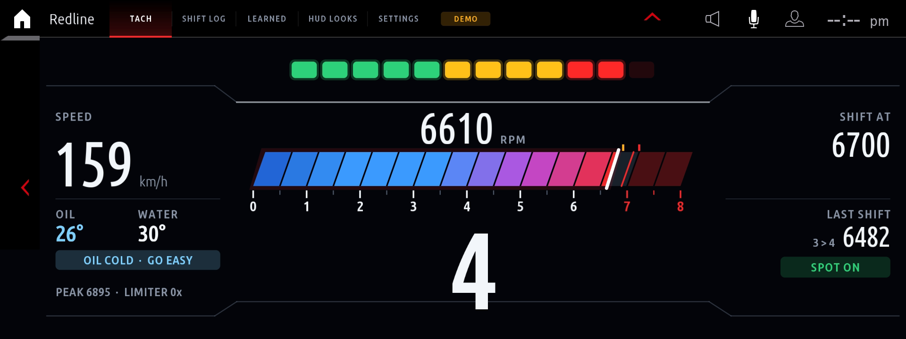</a> <a href="docs/assets/apps/redline/preview-02.png">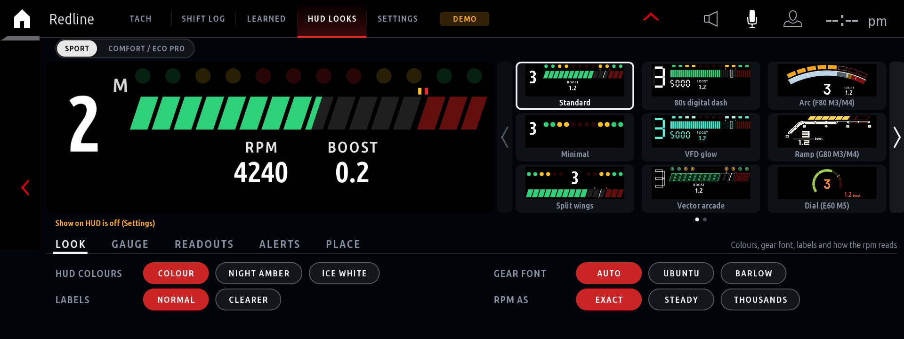</a>

Full-screen rev tach with shift lights, gear, shift scoring and cold-engine rev guard; HUD by @biscotit

**Supported:** ID7 · **License:** MIT; retain per-component and third-party notices · **Source:** [cauliflowermossgrape/idrive7-apps](https://github.com/cauliflowermossgrape/idrive7-apps/tree/422957a85461826c1e8654d37c8ec66a94849f9c/apps/_sources/idrive7-apps/apps/redline) · <a href="https://github.com/tiraUnderCode23/AQ_MGU/tree/main/docs/assets/apps/redline">All 7 published images</a>
</details>

<details>
<summary><strong>Service</strong> <code>service</code> — v1.6.2</summary>

 <a href="docs/assets/apps/service/preview-01.png"></a>

Service requirements from the instrument cluster: oil, brakes, brake fluid, vehicle check, inspection - distance, date, details; brake fluid and vehicle check reset

**Supported:** ID7 · **License:** MIT; retain per-component and third-party notices · **Source:** [cauliflowermossgrape/idrive7-apps](https://github.com/cauliflowermossgrape/idrive7-apps/tree/422957a85461826c1e8654d37c8ec66a94849f9c/apps/_sources/idrive7-apps/apps/service) · <a href="https://github.com/tiraUnderCode23/AQ_MGU/tree/main/docs/assets/apps/service">All 2 published images</a>
</details>

<details>
<summary><strong>Spotify</strong> <code>spotify</code> — v1.0.30</summary>

 <a href="docs/assets/apps/spotify/preview-01.png"></a> <a href="docs/assets/apps/spotify/preview-02.png"></a>

Spotify Connect cockpit player and library browser for BMW iDrive 7

**Supported:** ID7 · **License:** GPL-3.0-or-later; retain third-party notices · **Source:** [hexlay/idrive7-custom-apps](https://github.com/hexlay/idrive7-custom-apps/tree/04a42559a6d94d52d5a17bb2a7231e2142b26079/apps/_sources/hexlay-idrive7-apps/apps/spotify) · <a href="https://github.com/tiraUnderCode23/AQ_MGU/tree/main/docs/assets/apps/spotify">All 7 published images</a>
</details>

<details>
<summary><strong>Steam</strong> <code>vizualyse_steam</code> — v0.2.1</summary>


Steam: plays Windows games from your Steam library on the car (the vizualyse-steam tool), shows the phone link and QR code for signing in and installing, and shows or hides the game on the central screen

**Supported:** ID7 · **License:** GPL-3.0-or-later with third-party notices · **Source:** [Vizualyse/idrive-apps](https://github.com/Vizualyse/idrive-apps/tree/13a766b520f17d7871fb9bb0713f658e5e14641b/apps/_sources/vizualyse-idrive-apps/apps/vizualyse_steam) · <a href="https://github.com/tiraUnderCode23/AQ_MGU/tree/main/docs/assets/apps/vizualyse_steam">All 1 published images</a>
</details>

<details>
<summary><strong>Store</strong> <code>robertn_store</code> — v0.9.40</summary>

 <a href="docs/assets/apps/robertn_store/preview-01.png"></a>

MGU Store app for browsing, installing and updating compatible MGU apps and components.

**Supported:** ID7, ID8 · **License:** GPL-3.0-or-later · **Source:** [robertnisipeanu/mgu-store](https://github.com/robertnisipeanu/mgu-store/tree/7956321fd40bceafffa8842719155e6176652720/tools/_sources/mgu-store/apps/robertn_store) · <a href="https://github.com/tiraUnderCode23/AQ_MGU/tree/main/docs/assets/apps/robertn_store">All 2 published images</a>
</details>

<details>
<summary><strong>System Monitor</strong> <code>sys_monitor</code> — v1.0.4</summary>

<em>No standalone icon published</em> <a href="docs/assets/apps/sys_monitor/preview-01.png"></a> <a href="docs/assets/apps/sys_monitor/preview-02.png">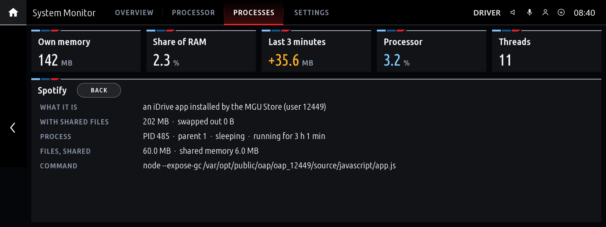</a>

What uses the head unit&#x27;s memory and processor: free RAM, a live history, and every app and program with the memory it takes. Read only.

**Supported:** ID7 · **License:** GPL-3.0-or-later; retain third-party notices · **Source:** [hexlay/idrive7-custom-apps](https://github.com/hexlay/idrive7-custom-apps/tree/04a42559a6d94d52d5a17bb2a7231e2142b26079/apps/_sources/hexlay-idrive7-apps/apps/sys_monitor) · <a href="https://github.com/tiraUnderCode23/AQ_MGU/tree/main/docs/assets/apps/sys_monitor">All 4 published images</a>
</details>

<details>
<summary><strong>Transmission Config</strong> <code>zf8hp</code> — v1.5.7</summary>

 <a href="docs/assets/apps/zf8hp/preview-01.png">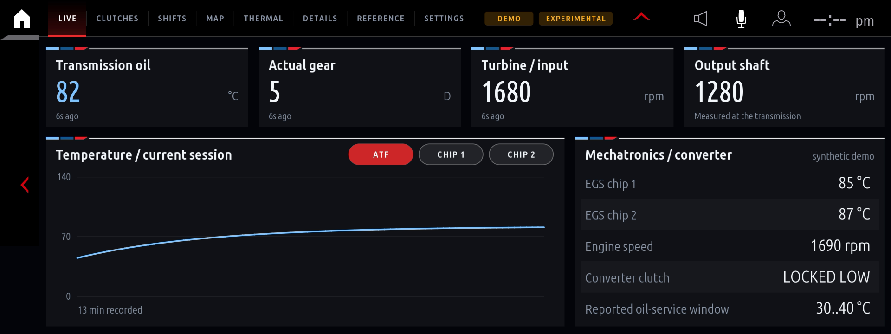</a> <a href="docs/assets/apps/zf8hp/preview-02.png">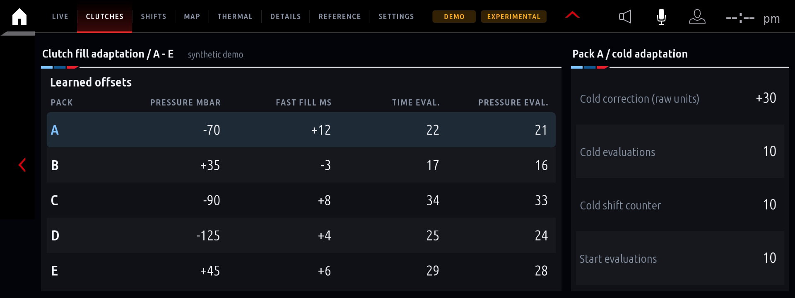</a>

Transmission Config, experimental ZF 8HP monitor: live data, clutch fill adaptations, shift maps and temperature history

**Supported:** ID7 · **License:** MIT; retain per-component and third-party notices · **Source:** [cauliflowermossgrape/idrive7-apps](https://github.com/cauliflowermossgrape/idrive7-apps/tree/422957a85461826c1e8654d37c8ec66a94849f9c/apps/_sources/idrive7-apps/apps/zf8hp) · <a href="https://github.com/tiraUnderCode23/AQ_MGU/tree/main/docs/assets/apps/zf8hp">All 4 published images</a>
</details>

<details>
<summary><strong>TurnKey E Blend</strong> <code>ethanol_mix</code> — v0.1.5</summary>

 <a href="docs/assets/apps/ethanol_mix/preview-01.png"></a> <a href="docs/assets/apps/ethanol_mix/preview-02.png"></a>

Original v0.1.5 interface; live ethanol/fuel readouts and blend-to-full calculator. Tested only on the original 2023 X3M calibration.

**Supported:** ID7 · **License:** MIT with included notices · **Source:** [HasMan/turnkey-ethanol-blend](https://github.com/HasMan/turnkey-ethanol-blend/tree/a378719e9c858ef4693949c3a7bca68bd5f9cafb/apps/_sources/turnkey-ethanol-blend/apps/ethanol_mix) · <a href="https://github.com/tiraUnderCode23/AQ_MGU/tree/main/docs/assets/apps/ethanol_mix">All 4 published images</a>
</details>

<details>
<summary><strong>Virtual Dyno</strong> <code>dyno</code> — v1.6.3</summary>

 <a href="docs/assets/apps/dyno/preview-01.png"></a>

Power and torque curves from a full-throttle pull, saved and compared

**Supported:** ID7 · **License:** MIT; retain per-component and third-party notices · **Source:** [cauliflowermossgrape/idrive7-apps](https://github.com/cauliflowermossgrape/idrive7-apps/tree/422957a85461826c1e8654d37c8ec66a94849f9c/apps/_sources/idrive7-apps/apps/dyno) · <a href="https://github.com/tiraUnderCode23/AQ_MGU/tree/main/docs/assets/apps/dyno">All 2 published images</a>
</details>

<details>
<summary><strong>Warm-Up</strong> <code>warmup</code> — v1.9.0</summary>

 <a href="docs/assets/apps/warmup/preview-01.png">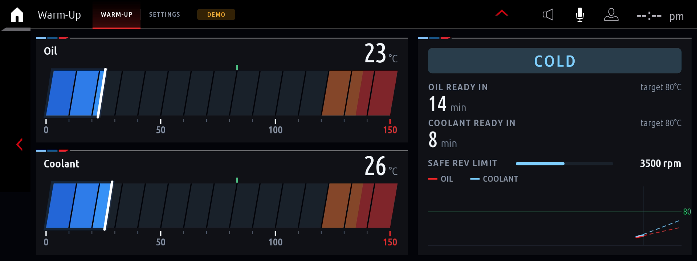</a> <a href="docs/assets/apps/warmup/preview-02.gif"></a>

Oil and coolant warm-up calculator (time to ready), safe rev limit, turbo cool-down and a cold start counter

**Supported:** ID7 · **License:** MIT; retain per-component and third-party notices · **Source:** [cauliflowermossgrape/idrive7-apps](https://github.com/cauliflowermossgrape/idrive7-apps/tree/422957a85461826c1e8654d37c8ec66a94849f9c/apps/_sources/idrive7-apps/apps/warmup) · <a href="https://github.com/tiraUnderCode23/AQ_MGU/tree/main/docs/assets/apps/warmup">All 4 published images</a>
</details>

<details>
<summary><strong>Waze Cards</strong> <code>wzc_wazecards</code> — v1.0.1</summary>

<em>No standalone icon published</em>

Waze&#x27;s turn and arrival cards, or Waze&#x27;s map, on the instrument cluster while Waze guides in CarPlay.

**Supported:** ID7 · **License:** Mixed GPL/MIT by component · **Source:** [noth4m4d/mgu-hamadstools](https://github.com/noth4m4d/mgu-hamadstools/tree/e327b30e48019eab79ace5fb7d610610d0e96d92/apps/_sources/noth4m4d-mgu-hamadstools) · No upstream image files found in the pinned source.
</details>

<details>
<summary><strong>Waze HUD</strong> <code>jap_waze_cluster</code> — v1.0.2</summary>


Puts the CarPlay Waze map on the instrument cluster and Waze&#x27;s turns on BMW&#x27;s HUD: enable the patch from the HMI and the map follows CarPlay

**Supported:** ID7 · **License:** GPL-3.0-or-later · **Source:** [JustAnotherPU/waze-hud](https://github.com/JustAnotherPU/waze-hud/tree/6e9046f7f3de493f826896a0a6c17f1d335ca472/apps/_sources/waze-hud/apps/jap_waze_cluster) · <a href="https://github.com/tiraUnderCode23/AQ_MGU/tree/main/docs/assets/apps/jap_waze_cluster">All 1 published images</a>
</details>

<details>
<summary><strong>Waze on cluster</strong> <code>robertn_waze_cluster</code> — v0.6.12</summary>

 <a href="docs/assets/apps/robertn_waze_cluster/preview-01.jpg">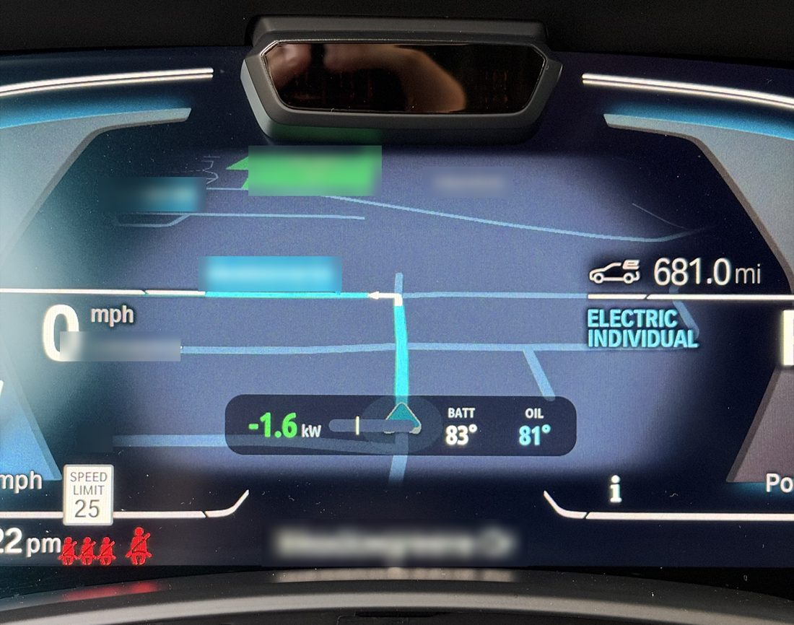</a> <a href="docs/assets/apps/robertn_waze_cluster/preview-02.jpg">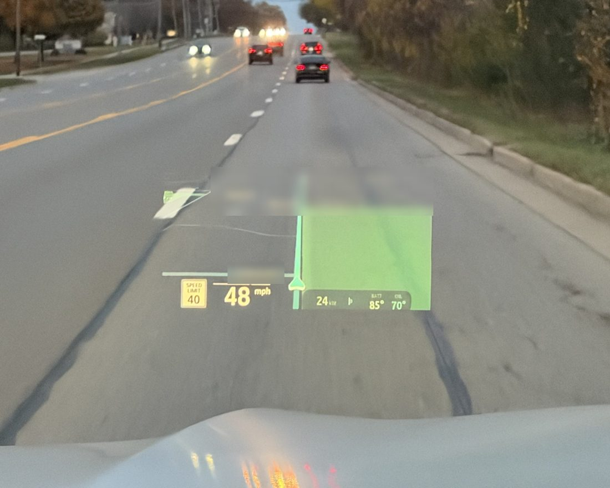</a>


**Supported:** ID7 · **License:** GPL-3.0-or-later with per-file/component notices · **Source:** [robertnisipeanu/idrive-apps](https://github.com/robertnisipeanu/idrive-apps/tree/59140a978e3d5e2c8c183bdd2fbb9a4682be466a/apps/_sources/idrive-apps/apps/robertn_waze_cluster) · <a href="https://github.com/tiraUnderCode23/AQ_MGU/tree/main/docs/assets/apps/robertn_waze_cluster">All 23 published images</a>
</details>


## Games

<details>
<summary><strong>Doom</strong> <code>doom</code> — v1.7.22</summary>

 <a href="docs/assets/apps/doom/preview-01.png"></a>

Doom (Freedoom: Phase 1) on the iDrive. Main menu with all settings; the game drawn in full resolution across the whole screen, on the controller; BACK returns to the menu and saves

**Supported:** ID7 · **License:** MIT; retain per-component and third-party notices · **Source:** [cauliflowermossgrape/idrive7-apps](https://github.com/cauliflowermossgrape/idrive7-apps/tree/422957a85461826c1e8654d37c8ec66a94849f9c/apps/_sources/idrive7-apps/apps/doom) · <a href="https://github.com/tiraUnderCode23/AQ_MGU/tree/main/docs/assets/apps/doom">All 2 published images</a>
</details>


## Store tools

Tools are listed once across the branch and release feed; package source, version and dependencies are recorded in [`data/components.json`](data/components.json).

| Tool | Version | Purpose | Source | Delivery |
|---|---:|---|---|---|
| [AirPlay receiver](https://github.com/noth4m4d/mgu-hamadstools) (`airplay-rx`) | 1.0.0 | Needed by the AirPlay app: receives the iPhone&#x27;s screen (AirPlay screen mirroring). | `noth4m4d/mgu-hamadstools` | Release catalog |
| [App privacy](https://github.com/robertnisipeanu/mgu-store) (`app-privacy`) | 1.7.2 | Keeps our apps out of the head unit&#x27;s backend app reporting and restarts them after a crash | `robertnisipeanu/mgu-store` | Release catalog |
| [Browser](https://github.com/Vizualyse/idrive-apps) (`vizualyse-chromium`) | 0.3.1 | EXPERIMENTAL. A web browser (Chromium 156) running on the car, with WebGL 2, WebGPU (on the CPU; WebGL on the car&#x27;s own GPU driver in an experimental GPU mode) and WebAssembly JSPI, shown on the central screen while parked and driven by touch, with its controls on a touch screen, parked or driving (Show on the screen, Back, Reload, Home, the resolution, GPU and game mode). Type addresses on the phone page: scan the QR code on the Browser app&#x27;s touch screen or iDrive page. About 181 MB to download, 420 MB on the unit. | `Vizualyse/idrive-apps` | Release catalog |
| [CarPlay cluster map (stream 111)](https://github.com/Vizualyse/idrive-apps) (`hook111`) | 0.1.6 | EXPERIMENTAL. Preloads a hook into carplay 20.40.2 that adds CarPlay&#x27;s second screen (stream 111, the phone&#x27;s cluster map) and hands it out as H.264 on 127.0.0.1:6111, for Cast to cluster. Installs in mode off (answers as stock); hook111-arm.sh mode alt turns the second screen on. Armed per start; carplay starts stock after two failed starts. Streamed on one car by hand (0.0.6); this install from the Store is new. | `Vizualyse/idrive-apps` | Release catalog |
| [CarPlay Map Mirror service](https://github.com/Impossible43/vlad-mgu-apps) (`vlad-carplay-mirror`) | 0.1.3 | Mirrors the CarPlay Dashboard map; no CarPlay firmware patch. Enable from its companion app. | `Impossible43/vlad-mgu-apps` | Branch source |
| [CarPlay Map Producer](https://github.com/isaakbruno2/carplay-map-cluster) (`carplay-map`) | 0.2.0 | Captures the CarPlay map stream and sends it to cluster-render for display on a compatible instrument cluster. | `isaakbruno2/carplay-map-cluster` | Release catalog |
| [Cast to cluster](https://github.com/Vizualyse/idrive-apps) (`vizualyse-cast`) | 0.4.1 | Plays a stream URL from your phone on the instrument cluster, the HUD or the media console, with its sound through the speakers: scan the QR code, paste a URL, pick where it goes. With hook111 armed, also CarPlay&#x27;s own second screen (its cluster map) on the cluster or the HUD. Controlled by touch on the central screen too, parked or driving, where mgu-render is installed | `Vizualyse/idrive-apps` | Release catalog |
| [Cluster renderer](https://github.com/robertnisipeanu/idrive-apps) (`cluster-render`) | 0.6.7 | Draws every app&#x27;s layers on the instrument cluster and the HUD, sharing the display slots and one upload budget | `robertnisipeanu/idrive-apps` | Release catalog |
| [Cluster themes](https://github.com/Vizualyse/idrive-apps) (`vizualyse-cluster`) | 0.4.1 | EXPERIMENTAL, NOT YET TRIED ON A CAR. Whole-cluster themes drawn over the instrument cluster through cluster-render&#x27;s panel target, under the car&#x27;s own warning lights: eight families (G20 inspired 1 and 2, LCI inspired 1 and 2, Three-dial 1 and 2, Performance 1 and 2), each a Sport and a Comfort theme switched by the drive mode. Drawn by small shaders on the cluster with textures sent once (about 1.7-3.1 MB at start), so only a few KB/s of numbers cross the link while driving. Readings the car does not give show as --. Chosen on the central screen by touch, with a preview of each theme and a 10 s try on the cluster while parked (the Cluster themes iDrive app). About 12 MB. | `Vizualyse/idrive-apps` | Release catalog |
| [Controller gate](https://github.com/cauliflowermossgrape/idrive7-apps) (`mgu-inputgate`) | 1.2.0 | Lets the apps have the iDrive controller (tabs, page buttons, settings, Doom); loads into the HMI at the next start (iDrive 7 and iDrive 8) | `cauliflowermossgrape/idrive7-apps` | Branch source |
| [Deploy tool](https://github.com/robertnisipeanu/mgu-store) (`mgu-deploy`) | 0.8.22 | Installs, updates, rolls back and removes our tools and apps on the head unit, with a snapshot before every change | `robertnisipeanu/mgu-store` | Release catalog |
| [FSC patch service](https://github.com/Noahbg/mgu-apps) (`mgu-fscpatch`) | 1.0.0 | FSC verifier patch service. | `Noahbg/mgu-apps` | Branch source |
| [GPU renderer](https://github.com/cauliflowermossgrape/idrive7-apps) (`idrive7-renderd`) | 2.1.19 | The apps&#x27; own GPU renderer (mgu-render): draws them at 60 fps, beside the MGU Store&#x27;s Renderer; installed with the apps (iDrive 7 and iDrive 8) | `cauliflowermossgrape/idrive7-apps` | Branch source |
| [Internet uplink](https://github.com/robertnisipeanu/mgu-store) (`mgu-uplink`) | 0.7.12 | Internet for selected apps through a USB network adapter, an LTE stick, a USB-tethered phone or Wi-Fi | `robertnisipeanu/mgu-store` | Release catalog |
| [Maps on cluster](https://github.com/robertnisipeanu/idrive-apps) (`waze-on-cluster`) | 0.10.8 | Runs the cluster map in the background. It is installed with the Maps on cluster app, which you use to control it. | `robertnisipeanu/idrive-apps` | Release catalog |
| [Moonlight](https://github.com/Vizualyse/idrive-apps) (`vizualyse-moonlight`) | 0.3.1 | EXPERIMENTAL. Streams games from a PC running Sunshine (GameStream) to the central screen (or the cluster or the HUD) while parked, decoded on the car&#x27;s GPU, with the sound through the speakers and game controllers (a wired Xbox 360-style USB pad, or the phone as a pad; no Bluetooth pads). Pair the PC and pick a game on the phone page: scan the QR code on the iDrive Moonlight page. | `Vizualyse/idrive-apps` | Release catalog |
| [OBD Bridge service](https://github.com/Noahbg/mgu-apps) (`mgu-obd-adapter`) | 1.0.0 | BM3 diagnostic protocol bridge on the existing car hotspot. | `Noahbg/mgu-apps` | Branch source |
| [Python](https://github.com/robertnisipeanu/mgu-store) (`mgu-python`) | 1.0.3 | Python 3.12 for apps that build on the head unit with Python | `robertnisipeanu/mgu-store` | Release catalog |
| [Renderer](https://github.com/robertnisipeanu/mgu-store) (`mgu-render`) | 0.6.23 | Draws apps&#x27; screens on the GPU, over the HMI or inside the app&#x27;s page | `robertnisipeanu/mgu-store` | Release catalog |
| [Steam](https://github.com/Vizualyse/idrive-apps) (`vizualyse-steam`) | 0.3.2 | EXPERIMENTAL. Windows games from your Steam library running on the car through Proton (Wine), on the car&#x27;s own graphics drivers (64-bit Direct3D 9-11 games on Vulkan through DXVK by default, the rest on OpenGL), shown on the central screen while parked, with sound. Sign in to Steam and install games on the phone page (scan the QR code on the iDrive Steam page); play them from the iDrive or the phone. Touch is the mouse (a tap clicks); wired Xbox 360-style (XInput) USB controllers, up to four; no keyboard yet. Games that need the Steam client get an optional Run without Steam (gbe_fork). About 440 MB to download, 1.35 GB on the unit, plus the games. | `Vizualyse/idrive-apps` | Release catalog |
| [Updater](https://github.com/robertnisipeanu/mgu-store) (`mgu-updater`) | 0.8.47 | Installs, updates and removes apps and head-unit tools from its sources | `robertnisipeanu/mgu-store` | Release catalog |
| [Vizualyse bus](https://github.com/Vizualyse/idrive-apps) (`vizualyse-bus`) | 0.1.0 | EXPERIMENTAL. The shared bus the Vizualyse tools use to ask each other to switch things off while they need the car&#x27;s resources (Steam pauses Cast&#x27;s cluster and HUD video while a game runs). Mosquitto 2.0.21 (MQTT) on a Unix socket only root&#x27;s tools can reach; no network listener. Installed with the tools that use it; about 0.2 MB. | `Vizualyse/idrive-apps` | Release catalog |
| [Waze Cards service](https://github.com/noth4m4d/mgu-hamadstools) (`wazecard`) | 1.0.0 | Needed by the Waze Cards app: draws Waze&#x27;s cards or map on the instrument cluster. | `noth4m4d/mgu-hamadstools` | Release catalog |
| [Waze HUD on cluster](https://github.com/JustAnotherPU/waze-hud) (`jap-waze-on-cluster`) | 1.2.0 | Shows the CarPlay or Android Auto map on the instrument cluster and Waze&#x27;s next turn on BMW&#x27;s own HUD arrows: a root helper applies the reversible carplay and aapd patches where each is supported, and the capture, running from boot, decodes the map&#x27;s H.264 and draws it through the cluster renderer whenever the stream flows. Stays off while robertnisipeanu&#x27;s Waze on cluster is installed | `JustAnotherPU/waze-hud` | Release catalog |

## Desktop utilities

These open-source setup utilities are included for reference but are **not** installed by MGU Store. Their pinned source commits and licenses are listed in [`data/desktop-tools.json`](data/desktop-tools.json).

| Utility | Source | License |
|---|---|---|
| [`deathwalker80/mgu-plus`](https://github.com/deathwalker80/mgu-plus) | `tools/_sources/mgu-plus` · `0f75e9abdc` | Unlicense |
| [`cauliflowermossgrape/idrive7-8-ssh-root`](https://github.com/cauliflowermossgrape/idrive7-8-ssh-root) | `tools/_sources/idrive7-8-ssh-root` · `6d4928e6dc` | Unlicense |

## Licensing and scope

AQ_MGU is an aggregation of separately licensed projects; it does not replace or override their licenses. Each source snapshot retains its own license and third-party notices. Components with restrictive or unclear redistribution terms are excluded from the current feed and recorded in [`data/external-sources.json`](data/external-sources.json). No BMW proprietary OAP SDK, private signing keys or vehicle data are included; some upstream build instructions may require an SDK donor already available to the vehicle owner.

The review covered MGU Store's checked default sources, the connected GitHub repository list, 20 candidate repositories and public GitLab searches. This is a documented best-effort snapshot, not a claim that every app ever published anywhere has been found. See [`docs/SOURCE-AUDIT.md`](docs/SOURCE-AUDIT.md), [`data/sources.json`](data/sources.json) and [`LICENSES/README.md`](LICENSES/README.md) for source commits, licensing notes and exclusions.
