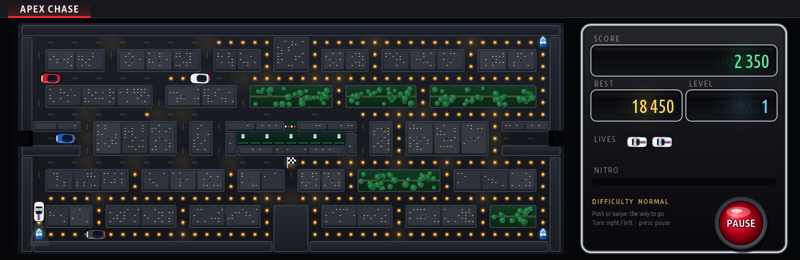
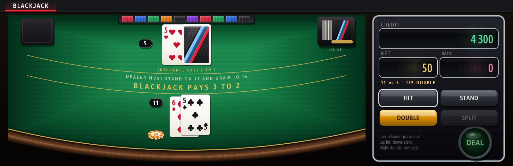
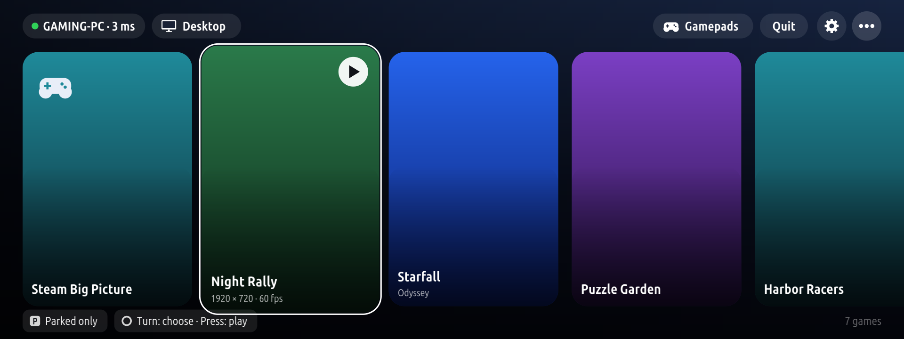
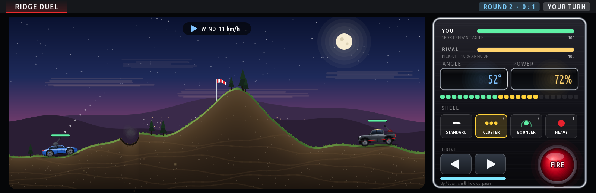
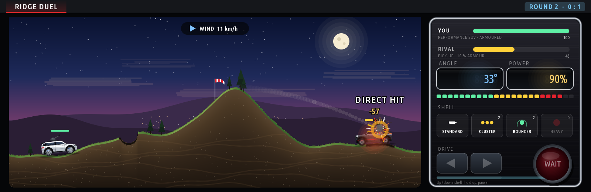
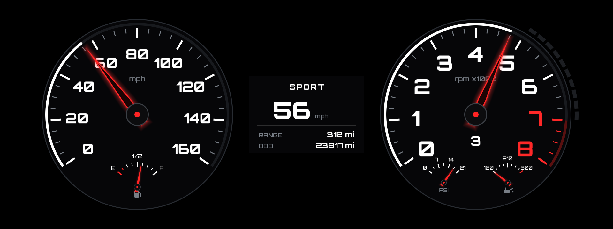

# AQ MGU — BMW MGU Games Store

**Dedicated BMW iDrive 7 & iDrive 8 Games & Game Runtimes**

  

[All (`main`)](https://github.com/tiraUnderCode23/AQ_MGU/tree/main) · [iDrive 7 (`id7`)](https://github.com/tiraUnderCode23/AQ_MGU/tree/id7) · [iDrive 8 (`id8`)](https://github.com/tiraUnderCode23/AQ_MGU/tree/id8) · [Games (`games`)](https://github.com/tiraUnderCode23/AQ_MGU/tree/games)

---

<strong>➕ Add <code>games</code> to MGU Store</strong>

| Source | URL |
|---|---|
| **AQ `games` Branch (Apps + Tools)** | `https://github.com/tiraUnderCode23/AQ_MGU/tree/games` |
| **AQ `games` Release Catalog (Extra Prebuilt)** | `https://raw.githubusercontent.com/tiraUnderCode23/AQ_MGU/games/release/catalog.json` |

## Apps (23)

<table><tr>
<td width="64" align="center"></td>
<td><strong>Apex Chase</strong> <code>v1.0.0</code> &nbsp;·&nbsp; <code>ID7</code></td>
</tr><tr>
<td colspan="2"> </td>
</tr></table>

<table><tr>
<td width="64" align="center"></td>
<td><strong>Blackjack</strong> <code>v1.0.1</code> &nbsp;·&nbsp; <code>ID7</code></td>
</tr><tr>
<td colspan="2"> </td>
</tr></table>

<table><tr>
<td width="64" align="center"></td>
<td><strong>Doom</strong> <code>v1.7.22</code> &nbsp;·&nbsp; <code>ID7 · ID8</code></td>
</tr><tr>
<td colspan="2"> </td>
</tr></table>

<table><tr>
<td width="64" align="center"></td>
<td><strong>Lap Record</strong> <code>v1.0.0</code> &nbsp;·&nbsp; <code>ID7</code></td>
</tr><tr>
<td colspan="2"> </td>
</tr></table>

<table><tr>
<td width="64" align="center"></td>
<td><strong>Lucky Sevens</strong> <code>v1.1.0</code> &nbsp;·&nbsp; <code>ID7</code></td>
</tr><tr>
<td colspan="2">  </td>
</tr></table>

<table><tr>
<td width="64" align="center"></td>
<td><strong>M Arcade</strong> <code>v0.1.3</code> &nbsp;·&nbsp; <code>ID7</code></td>
</tr><tr>
<td colspan="2">  </td>
</tr></table>

<table><tr>
<td width="64" align="center"></td>
<td><strong>M Pinball</strong> <code>v1.0.1</code> &nbsp;·&nbsp; <code>ID7</code></td>
</tr><tr>
<td colspan="2"> </td>
</tr></table>

<table><tr>
<td width="64" align="center"></td>
<td><strong>Moonride</strong> <code>v0.3.4</code> &nbsp;·&nbsp; <code>ID7</code></td>
</tr><tr>
<td colspan="2">  </td>
</tr></table>

<table><tr>
<td width="64" align="center"></td>
<td><strong>Parked Games</strong> <code>v0.2.3</code> &nbsp;·&nbsp; <code>ID7 · ID8</code></td>
</tr><tr>
<td colspan="2"> </td>
</tr></table>

<table><tr>
<td width="64" align="center"></td>
<td><strong>Pit Wall</strong> <code>v1.0.0</code> &nbsp;·&nbsp; <code>ID7</code></td>
</tr><tr>
<td colspan="2"></td>
</tr></table>

<table><tr>
<td width="64" align="center"></td>
<td><strong>Ridge Duel</strong> <code>v1.0.1</code> &nbsp;·&nbsp; <code>ID7</code></td>
</tr><tr>
<td colspan="2">  </td>
</tr></table>

<table><tr>
<td width="64" align="center"></td>
<td><strong>Road Hopper</strong> <code>v0.1.1</code> &nbsp;·&nbsp; <code>ID7</code></td>
</tr><tr>
<td colspan="2"></td>
</tr></table>

<table><tr>
<td width="64" align="center"></td>
<td><strong>Snake</strong> <code>v1.0.0</code> &nbsp;·&nbsp; <code>ID7</code></td>
</tr><tr>
<td colspan="2"></td>
</tr></table>

<table><tr>
<td width="64" align="center"></td>
<td><strong>Solitaire</strong> <code>v1.0.0</code> &nbsp;·&nbsp; <code>ID7</code></td>
</tr><tr>
<td colspan="2"> </td>
</tr></table>

<table><tr>
<td width="64" align="center"></td>
<td><strong>Street Siege</strong> <code>v1.1.0</code> &nbsp;·&nbsp; <code>ID7</code></td>
</tr><tr>
<td colspan="2"> </td>
</tr></table>

<table><tr>
<td width="64" align="center"></td>
<td><strong>Track Defender</strong> <code>v1.0.0</code> &nbsp;·&nbsp; <code>ID7</code></td>
</tr><tr>
<td colspan="2"></td>
</tr></table>

<table>
<tr>
<td width="25%" align="center" valign="top"> <strong>Bimmer Blocks</strong> <code>v1.1.1</code> · <code>ID7 · ID8</code></td>
<td width="25%" align="center" valign="top"> <strong>Doodle Jump</strong> <code>v0.9.0</code> · <code>ID7</code></td>
<td width="25%" align="center" valign="top"> <strong>MGU GameStation</strong> <code>v0.3.0</code> · <code>ID7</code></td>
<td width="25%" align="center" valign="top"> <strong>Moonlight</strong> <code>v0.3.1</code> · <code>ID7</code></td>
</tr>
<tr>
<td width="25%" align="center" valign="top"> <strong>Steam</strong> <code>v0.2.1</code> · <code>ID7</code></td>
<td width="25%" align="center" valign="top"> <strong>Нарды</strong> <code>v0.1.1</code> · <code>ID7</code></td>
<td width="25%" align="center" valign="top"> <strong>Тетрис</strong> <code>v0.1.1</code> · <code>ID7</code></td>
<td width="25%"></td>
</tr>
</table>

## Helper Tools (17)

<strong>View all 17 Helper Tools</strong>

| Tool | ID | Version | HMI |
|---|---|---|---|
| **App privacy** | `app-privacy` | `v1.7.2` | `ID7 · ID8` |
| **Cluster renderer** | `cluster-render` | `v0.6.9` | `ID7 · ID8` |
| **Doodle Jump GPU support** | `doodle-gpu` | `v1.0.0` | `ID7` |
| **GPU renderer** | `idrive7-renderd` | `v2.1.19` | `ID7 · ID8` |
| **Moonride streaming service** | `jap-moonride` | `v0.3.4` | `ID7` |
| **Node.js 22** | `jap-node22` | `v22.23.4` | `ID7` |
| **Deploy tool** | `mgu-deploy` | `v0.8.27` | `ID7 · ID8` |
| **GameStation Phone Port** | `mgu-game-net` | `v0.1.0` | `ID7` |
| **Controller gate** | `mgu-inputgate` | `v1.2.2` | `ID7 · ID8` |
| **Python** | `mgu-python` | `v1.0.3` | `ID7 · ID8` |
| **Renderer** | `mgu-render` | `v0.6.25` | `ID7 · ID8` |
| **Full-width touch** | `mgu-render-id7-touch` | `v1.4.0` | `ID7` |
| **Updater** | `mgu-updater` | `v0.8.51` | `ID7 · ID8` |
| **Internet uplink** | `mgu-uplink` | `v0.7.13` | `ID7 · ID8` |
| **Vizualyse bus** | `vizualyse-bus` | `v0.1.0` | `ID7` |
| **Moonlight** | `vizualyse-moonlight` | `v0.3.1` | `ID7` |
| **Steam** | `vizualyse-steam` | `v0.4.0` | `ID7` |

