# id8 distribution

Canonical source commit: `714b2edb37f1bac811444ead348509b2b2836745`
Target HMI: ID8
Eligibility policy: strict

The file export copies selected committed files and validates their static
identities, dependencies, and file checksums. It does not build packages,
execute target code, download artifacts, or install software.

Runtime / physical installation: **NOT OBSERVED**. HMI labels and screenshots
describe the reviewed source metadata; they are not proof of an installed result.

[Applications](#applications) · [Helper tools](#helper-tools) · [Sources and installation](#sources-and-installation)

## Sources and installation

| Channel | Applications | Helper tools | Delivery |
|---|---:|---:|---|
| source | 45 | 5 | [Source recipes](mgu-repo.json); selected source files are included. |
| release | 13 | 6 | [Publisher artifact references](release/catalog.json); artifact payloads are not downloaded by this export. |
| external | 0 | 6 | [Pinned original sources](.distribution/external-dependencies.json); retain their configured origin and channel. |

### Add this distribution to MGU Store

Configure **both AQ entries** below: the GitHub branch supplies source recipes,
and the HTTPS catalog supplies the selected released apps and helpers.
Keep the companion-source entries so their original external tools remain available.

[Exact Store source configuration](data/store-sources.json)

```json
{
  "schema": 1,
  "sources": [
    {
      "channel": "branch:id8",
      "id": "aq-mgu-apps",
      "repo": "tiraUnderCode23/AQ_MGU",
      "type": "github"
    },
    {
      "id": "aq-mgu-catalog",
      "type": "https",
      "url": "https://raw.githubusercontent.com/tiraUnderCode23/AQ_MGU/id8/release/catalog.json"
    },
    {
      "channel": "branch:main",
      "id": "aq-mgu-iteriodev",
      "repo": "IterioDev/car-apps",
      "type": "github"
    }
  ]
}
```

Use each entry's original README for its installation procedure and prerequisites.
[Preserved original repository README](.distribution/original/README.md)

External dependencies retain their original repository, channel, and commit below.
Their payloads are not bundled or automatically downloaded.

Target-derived SDK inputs remain external build requirements;
they were not read, extracted, or included here.

## Applications

58 selected app entries.

<a id="component-61625f73746f72616765"></a>

### MGU Storage Monitor

`ab_storage@1.2.4` · **source** · app


Read-only MGU filesystem space monitor

Declared evidence HMI: ID7, ID8 · Review: `eligible_static`.

Runtime dependencies: [mgu-render &gt;=0.6.24 (selected 0.6.25; release)](#component-6d67752d72656e646572)
Build prerequisites: [mgu-deploy &gt;=0.3.2 (selected 0.8.27; release)](#component-6d67752d6465706c6f79); [mgu-python &gt;=1.0.2 (selected 1.0.3; release)](#component-6d67752d707974686f6e)

[Original README / installation](apps/_sources/bmwenthusiast-storage-monitor/README.md) · [Source directory](apps/_ports/bmwenthusiast-idrive8/apps/ab_storage)

<a id="component-6164616d5f73686966746c6967687473"></a>

### Shift Lights

`adam_shiftlights@0.4.6` · **source** · app


RPM shift lights on the instrument cluster and HUD, with per-drive-mode thresholds and a cold-engine limit

Declared evidence HMI: ID7, ID8 · Review: `eligible_static`.

Runtime dependencies: [cluster-render &gt;=0.6.9 (selected 0.6.9; source)](#component-636c75737465722d72656e646572); [mgu-inputgate &gt;=1.0.0 (selected 1.2.2; source)](#component-6d67752d696e70757467617465); [mgu-render &gt;=0.6.24 (selected 0.6.25; release)](#component-6d67752d72656e646572)
Build prerequisites: [mgu-deploy &gt;=0.3.2 (selected 0.8.27; release)](#component-6d67752d6465706c6f79); [mgu-python &gt;=1.0.2 (selected 1.0.3; release)](#component-6d67752d707974686f6e)

[Original README / installation](apps/_sources/pinguinooo-idrive7-apps/apps/adam_shiftlights/README.md) · [Source directory](apps/_ports/pinguinooo-idrive8/apps/adam_shiftlights)

<a id="component-6164616d5f766974616c73"></a>

### Engine Vitals

`adam_vitals@0.2.0` · **source** · app


Boost, power, torque, gear, oil, coolant and transmission temperatures, with a warm-up guide and turbo cool-down

Declared evidence HMI: ID7, ID8 · Review: `eligible_static`.

Runtime dependencies: [mgu-render &gt;=0.6.24 (selected 0.6.25; release)](#component-6d67752d72656e646572)
Build prerequisites: [mgu-deploy &gt;=0.3.2 (selected 0.8.27; release)](#component-6d67752d6465706c6f79); [mgu-python &gt;=1.0.2 (selected 1.0.3; release)](#component-6d67752d707974686f6e)

[Original README / installation](apps/_sources/pinguinooo-idrive7-apps/apps/adam_vitals/README.md) · [Source directory](apps/_ports/pinguinooo-idrive8/apps/adam_vitals)

#### Declared screenshots

<p>
<a href="docs/assets/apps/adam_vitals/screen_1.png"></a>
</p>

<a id="component-616d6269656e745f636f6e666967"></a>

### Ambient config

`ambient_config@2.7.13` · **source** · app


Any colour on the ambient light, animations, and a look for each driving mode

Declared evidence HMI: ID7, ID8 · Review: `eligible_static`.

Runtime dependencies: [idrive7-renderd &gt;=2.1.18 (selected 2.1.19; source)](#component-696472697665372d72656e64657264); [mgu-inputgate &gt;=1.1.0 (selected 1.2.2; source)](#component-6d67752d696e70757467617465)
Build prerequisites: [mgu-deploy &gt;=0.3.2 (selected 0.8.27; release)](#component-6d67752d6465706c6f79); [mgu-python &gt;=1.0.2 (selected 1.0.3; release)](#component-6d67752d707974686f6e)

[Original README / installation](apps/_sources/idrive7-apps/README.md) · [Source directory](apps/_sources/idrive7-apps/apps/ambient_config)

#### Declared screenshots

<p>
<a href="docs/assets/apps/ambient_config/preview-01.png"></a>
<a href="docs/assets/apps/ambient_config/screen_2.png"></a>
</p>

<a id="component-616e647265695f6d6472697665"></a>

### M Drive

`andrei_mdrive@0.4.0` · **source** · app


Motorsport RPM strip, MHD controls, four temperature gauges and turbo pressure in bar.

Declared evidence HMI: ID7, ID8 · Review: `eligible_static`.

Runtime dependencies: [idrive7-renderd &gt;=2.1.18 (selected 2.1.19; source)](#component-696472697665372d72656e64657264); [mgu-inputgate &gt;=1.1.0 (selected 1.2.2; source)](#component-6d67752d696e70757467617465)
Build prerequisites: [mgu-deploy &gt;=0.3.2 (selected 0.8.27; release)](#component-6d67752d6465706c6f79); [mgu-python &gt;=1.0.2 (selected 1.0.3; release)](#component-6d67752d707974686f6e)

[Original README / installation](apps/_sources/grabandrey-m-drive-control/README.md) · [Source directory](apps/_sources/grabandrey-m-drive-control/apps/andrei_mdrive)

#### Declared screenshots

<p>
<a href="docs/assets/apps/andrei_mdrive/screen_1.png"></a>
<a href="docs/assets/apps/andrei_mdrive/screen_2.png">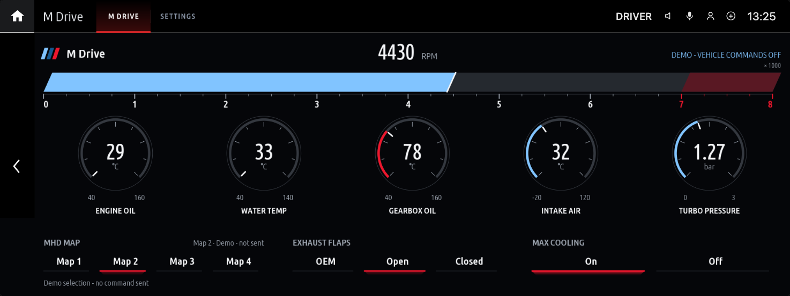</a>
</p>

<a id="component-617265665f63617263617265"></a>

### Car Care

`aref_carcare@0.2.4` · **source** · app


Your own service intervals, apart from BMW's: engine oil (3,000 mi by default), spark plugs, coils, diff, transfer case and transmission fluid, brake fluid, air and cabin filters, each with how much is left. Done today records the odometer and the date; Done earlier sets a service from before. It never resets BMW's own service reminders, so a dealer's free service still comes due on BMW's schedule. Read-only toward the car.

Declared evidence HMI: ID7, ID8 · Review: `eligible_static`.

Runtime dependencies: [mgu-render &gt;=0.6.24 (selected 0.6.25; release)](#component-6d67752d72656e646572)
Build prerequisites: [mgu-deploy &gt;=0.3.2 (selected 0.8.27; release)](#component-6d67752d6465706c6f79); [mgu-python &gt;=1.0.2 (selected 1.0.3; release)](#component-6d67752d707974686f6e)

[Original README / installation](apps/_sources/arefahmad-idrive7-apps/apps/aref_carcare/README.md) · [Source directory](apps/_ports/arefahmad-idrive8/apps/aref_carcare)

<a id="component-617265665f6361726c7972696373"></a>

### Car Lyrics

`aref_carlyrics@0.3.10` · **source** · app


Synced lyrics for whatever the car plays: Apple Music over CarPlay, Bluetooth or USB, no Spotify needed. A full-screen page drawn like Apple Music's: the album art blurred behind, the cover and a progress line on the left, and the lyrics gliding line by line on the right, timed to the song from the car's own clock. Lyrics from LRCLIB, artwork from Apple's iTunes search. A Probe tab shows what the car reports. Read-only toward the car. Needs internet through the Store's uplink.

Declared evidence HMI: ID7, ID8 · Review: `eligible_static`.

Runtime dependencies: [mgu-render &gt;=0.6.24 (selected 0.6.25; release)](#component-6d67752d72656e646572)
Build prerequisites: [mgu-deploy &gt;=0.3.2 (selected 0.8.27; release)](#component-6d67752d6465706c6f79); [mgu-python &gt;=1.0.2 (selected 1.0.3; release)](#component-6d67752d707974686f6e)

[Original README / installation](apps/_sources/arefahmad-idrive7-apps/apps/aref_carlyrics/README.md) · [Source directory](apps/_ports/arefahmad-idrive8/apps/aref_carlyrics)

<a id="component-617265665f6578706c6f726572"></a>

### Car Explorer

`aref_explorer@0.2.3` · **source** · app


Finds the head unit's services behind a car feature (ambient light, route guidance and ETA, GPS position, now playing, climate, lights, doors, fuel) in its interface catalog and shows what each offers. Writes everything to explorer-report.txt, which new apps are designed from. Read-only: it reads two platform files and sends nothing to the car. For developers and curious owners.

Declared evidence HMI: ID7, ID8 · Review: `eligible_static`.

Runtime dependencies: [mgu-render &gt;=0.6.24 (selected 0.6.25; release)](#component-6d67752d72656e646572)
Build prerequisites: [mgu-deploy &gt;=0.3.2 (selected 0.8.27; release)](#component-6d67752d6465706c6f79); [mgu-python &gt;=1.0.2 (selected 1.0.3; release)](#component-6d67752d707974686f6e)

[Original README / installation](apps/_sources/arefahmad-idrive7-apps/apps/aref_explorer/README.md) · [Source directory](apps/_ports/arefahmad-idrive8/apps/aref_explorer)

<a id="component-6263735f73746f7265"></a>

### Store

`bcs_store@3.4.5` · **release** · app


BCS Automotive Solutions: apps and head-unit tools for the BMW MGU, from BCS and community sources

Declared evidence HMI: ID7, ID8 · Review: `eligible_static`.

Runtime dependencies: [mgu-deploy &gt;=0.8.12 (selected 0.8.27; release)](#component-6d67752d6465706c6f79); [mgu-render &gt;=0.3.1 (selected 0.6.25; release)](#component-6d67752d72656e646572); [mgu-updater &gt;=0.8.28 (selected 0.8.51; release)](#component-6d67752d75706461746572)

Publisher artifact: 4,729,989 bytes; SHA-256 `656f3bd8cee577d531680cc399d13e4218a4e0e0eec3ac3d876dc265a4374dc8`.

[Original README / installation](https://github.com/bcs-asia/app-store/blob/87b8d423854a39089809f360072057903a8ea3b5/README.md) · [Original publisher artifact](https://github.com/bcs-asia/app-store/releases/download/catalog/bcs_store%403.4.5.tgz)

<a id="component-62696d6d65725f626c6f636b73"></a>

### Bimmer Blocks

`bimmer_blocks@1.1.1` · **source** · app


Falling-block puzzle. Play only while stationary. Manual pause, next piece, ghost and local high score.

Declared evidence HMI: ID7, ID8 · Review: `eligible_static`.

Runtime dependencies: [mgu-render &gt;=0.6.24 (selected 0.6.25; release)](#component-6d67752d72656e646572)
Build prerequisites: [mgu-deploy &gt;=0.3.2 (selected 0.8.27; release)](#component-6d67752d6465706c6f79); [mgu-python &gt;=1.0.2 (selected 1.0.3; release)](#component-6d67752d707974686f6e)

[Original README / installation](apps/_sources/app-studio-custom/README-DE-EN.txt) · [Source directory](apps/_ports/appstudio-idrive8/apps/bimmer_blocks)

<a id="component-626d335f6c6976655f696438"></a>

### MGU Bm3 Live Adjustments for IDrive 8

`bm3_live_id8@0.1.1` · **source** · app


Map switching, burble adjustments and vehicle data for supported BM3 CustomROM vehicles with iDrive 8.

Declared evidence HMI: ID8 · Review: `eligible_static`.

Runtime dependencies: [mgu-deploy &gt;=0.6.9 (selected 0.8.27; release)](#component-6d67752d6465706c6f79); [mgu-render &gt;=0.6.12 (selected 0.6.25; release)](#component-6d67752d72656e646572)

[Original README / installation](https://github.com/danny67999/mgu-bm3-live-adjustments-idrive-8/blob/ddabe74bab848aadabba349c6991ed4db0a824c2/README.md) · [Source directory](apps/_prebuilt/bm3_live_id8)

#### Declared screenshots

<p>
<a href="docs/assets/apps/bm3_live_id8/screen_1.png"></a>
<a href="docs/assets/apps/bm3_live_id8/screen_2.png"></a>
<a href="docs/assets/apps/bm3_live_id8/screen_3.png"></a>
</p>

<a id="component-626f6f73746c696e655f696438"></a>

### ECU Live Data (iDrive 8, untested)

`boostline_id8@1.0.0` · **source** · app


NOT YET TESTED ON AN iDRIVE 8 CAR. Needs the MGU Store's Renderer (mgu-render): the Store installs it first if it is missing. Live engine data from the DDE (diesel) or DME (petrol), CSV logs, road dyno and drag timer. Read-only: it never writes to a control unit.

Declared evidence HMI: ID8 · Review: `eligible_static`.

Runtime dependencies: [mgu-render &gt;=0.3.1 (selected 0.6.25; release)](#component-6d67752d72656e646572)
Build prerequisites: [mgu-deploy &gt;=0.3.2 (selected 0.8.27; release)](#component-6d67752d6465706c6f79); [mgu-python &gt;=1.0.2 (selected 1.0.3; release)](#component-6d67752d707974686f6e)

[Original README / installation](apps/_sources/giuseppe-mgu-apps-id8/README.md) · [Source directory](apps/_sources/giuseppe-mgu-apps-id8/ecu-live-data/app)

<a id="component-6272616b655f74657374"></a>

### Brake Test

`brake_test@1.5.21` · **source** · app


100-0 and 200-0 braking distance, peak decel and brake-fade tracking

Declared evidence HMI: ID7, ID8 · Review: `eligible_static`.

Runtime dependencies: [idrive7-renderd &gt;=2.1.18 (selected 2.1.19; source)](#component-696472697665372d72656e64657264); [mgu-inputgate &gt;=1.1.0 (selected 1.2.2; source)](#component-6d67752d696e70757467617465)
Build prerequisites: [mgu-deploy &gt;=0.3.2 (selected 0.8.27; release)](#component-6d67752d6465706c6f79); [mgu-python &gt;=1.0.2 (selected 1.0.3; release)](#component-6d67752d707974686f6e)

[Original README / installation](apps/_sources/idrive7-apps/README.md) · [Source directory](apps/_sources/idrive7-apps/apps/brake_test)

#### Declared screenshots

<p>
<a href="docs/assets/apps/brake_test/preview-01.png"></a>
<a href="docs/assets/apps/brake_test/preview-02.gif"></a>
<a href="docs/assets/apps/brake_test/screen_3.gif"></a>
</p>

<a id="component-633336355f6472697665"></a>

### Drive

`c365_drive@1.9.3` · **source** · app


Speed, gear, oil and coolant, and the trip since you opened the app

Declared evidence HMI: ID7, ID8 · Review: `eligible_static`.

Runtime dependencies: [mgu-render &gt;=0.6.24 (selected 0.6.25; release)](#component-6d67752d72656e646572)
Build prerequisites: [mgu-deploy &gt;=0.3.2 (selected 0.8.27; release)](#component-6d67752d6465706c6f79); [mgu-python &gt;=1.0.2 (selected 1.0.3; release)](#component-6d67752d707974686f6e)

[Original README / installation](apps/_sources/c365-mgu-drive/README.md) · [Source directory](apps/_sources/c365-mgu-drive/apps/c365_drive)

<a id="component-6361725f766974616c73"></a>

### M Vitals

`car_vitals@2.27.9` · **source** · app


Live engine, thermal, intake / fuel / ignition, tyre and chassis gauges

Declared evidence HMI: ID7, ID8 · Review: `eligible_static`.

Runtime dependencies: [idrive7-renderd &gt;=2.1.18 (selected 2.1.19; source)](#component-696472697665372d72656e64657264); [mgu-inputgate &gt;=1.1.0 (selected 1.2.2; source)](#component-6d67752d696e70757467617465)
Build prerequisites: [mgu-deploy &gt;=0.3.2 (selected 0.8.27; release)](#component-6d67752d6465706c6f79); [mgu-python &gt;=1.0.2 (selected 1.0.3; release)](#component-6d67752d707974686f6e)

[Original README / installation](apps/_sources/idrive7-apps/README.md) · [Source directory](apps/_sources/idrive7-apps/apps/car_vitals)

#### Declared screenshots

<p>
<a href="docs/assets/apps/car_vitals/preview-01.png"></a>
<a href="docs/assets/apps/car_vitals/preview-02.png">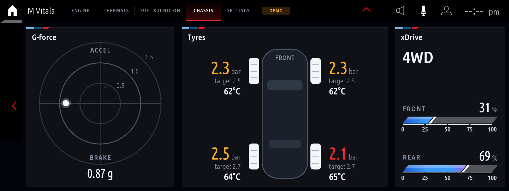</a>
<a href="docs/assets/apps/car_vitals/preview-03.png">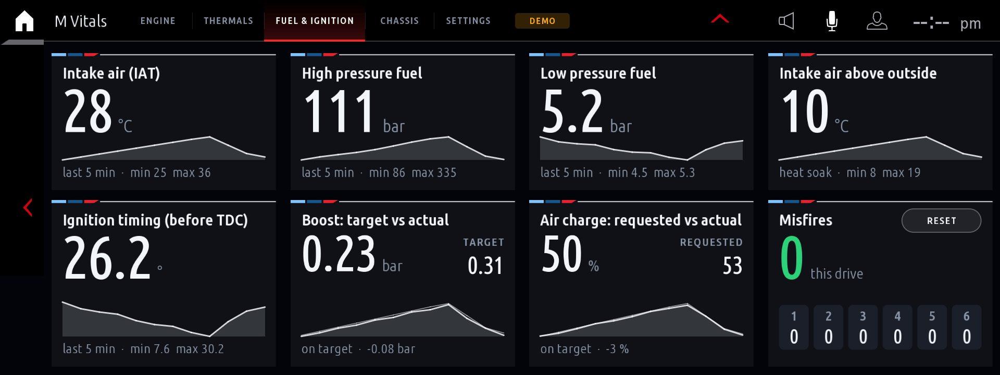</a>
<a href="docs/assets/apps/car_vitals/preview-04.gif">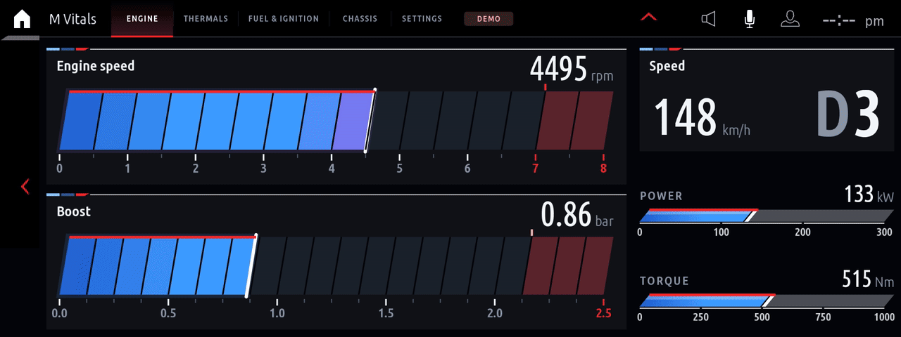</a>
<a href="docs/assets/apps/car_vitals/preview-05.gif"></a>
<a href="docs/assets/apps/car_vitals/preview-06.png">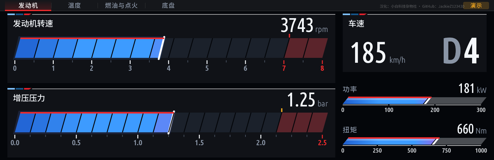</a>
</p>

<a id="component-64696d6f6e5f747261636b5f6d6f6465"></a>

### Track Mode

`dimon_track_mode@1.0.1` · **source** · app


Lap timer with sectors, best lap and live delta

Declared evidence HMI: ID7, ID8 · Review: `eligible_static`.

Runtime dependencies: [mgu-render &gt;=0.6.24 (selected 0.6.25; release)](#component-6d67752d72656e646572)
Build prerequisites: [mgu-deploy &gt;=0.3.2 (selected 0.8.27; release)](#component-6d67752d6465706c6f79); [mgu-python &gt;=1.0.2 (selected 1.0.3; release)](#component-6d67752d707974686f6e)

[Original README / installation](apps/_sources/dimonprograms-apps/apps/dimon_track_mode/README.md) · [Source directory](apps/_ports/dimonprograms-idrive8/apps/dimon_track_mode)

<a id="component-646f6f6d"></a>

### Doom

`doom@1.7.22` · **source** · app


Doom (Freedoom: Phase 1) on the iDrive. Main menu with all settings; the game drawn in full resolution across the whole screen, on the controller; BACK returns to the menu and saves

Declared evidence HMI: ID7, ID8 · Review: `eligible_static`.

Runtime dependencies: [idrive7-renderd &gt;=2.1.18 (selected 2.1.19; source)](#component-696472697665372d72656e64657264); [mgu-inputgate &gt;=1.1.0 (selected 1.2.2; source)](#component-6d67752d696e70757467617465)
Build prerequisites: [mgu-deploy &gt;=0.3.2 (selected 0.8.27; release)](#component-6d67752d6465706c6f79); [mgu-python &gt;=1.0.2 (selected 1.0.3; release)](#component-6d67752d707974686f6e)

[Original README / installation](apps/_sources/idrive7-apps/README.md) · [Source directory](apps/_sources/idrive7-apps/apps/doom)

#### Declared screenshots

<p>
<a href="docs/assets/apps/doom/preview-01.png">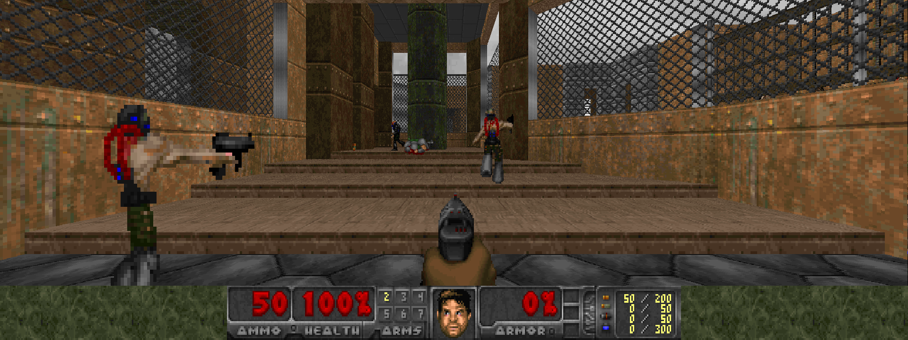</a>
<a href="docs/assets/apps/doom/screen_2.png"></a>
</p>

<a id="component-6470665f696438"></a>

### DPF Monitoring (iDrive 8, untested)

`dpf_id8@1.0.0` · **source** · app


NOT YET TESTED ON AN iDRIVE 8 CAR. Needs the MGU Store's Renderer (mgu-render): the Store installs it first if it is missing. The diesel particulate filter: soot and ash load, regenerations, differential pressure and exhaust temperatures from the diesel engine unit (DDE). Read-only.

Declared evidence HMI: ID8 · Review: `eligible_static`.

Runtime dependencies: [mgu-render &gt;=0.3.1 (selected 0.6.25; release)](#component-6d67752d72656e646572)
Build prerequisites: [mgu-deploy &gt;=0.3.2 (selected 0.8.27; release)](#component-6d67752d6465706c6f79); [mgu-python &gt;=1.0.2 (selected 1.0.3; release)](#component-6d67752d707974686f6e)

[Original README / installation](apps/_sources/giuseppe-mgu-apps-id8/README.md) · [Source directory](apps/_sources/giuseppe-mgu-apps-id8/dpf-monitoring/app)

<a id="component-647261676779"></a>

### Drag Timer

`draggy@2.6.0` · **source** · app


0-100, 100-200 and 1/4 mile timer with best times

Declared evidence HMI: ID7, ID8 · Review: `eligible_static`.

Runtime dependencies: [idrive7-renderd &gt;=2.1.18 (selected 2.1.19; source)](#component-696472697665372d72656e64657264); [mgu-inputgate &gt;=1.1.0 (selected 1.2.2; source)](#component-6d67752d696e70757467617465)
Build prerequisites: [mgu-deploy &gt;=0.3.2 (selected 0.8.27; release)](#component-6d67752d6465706c6f79); [mgu-python &gt;=1.0.2 (selected 1.0.3; release)](#component-6d67752d707974686f6e)

[Original README / installation](apps/_sources/idrive7-apps/README.md) · [Source directory](apps/_sources/idrive7-apps/apps/draggy)

#### Declared screenshots

<p>
<a href="docs/assets/apps/draggy/preview-01.png">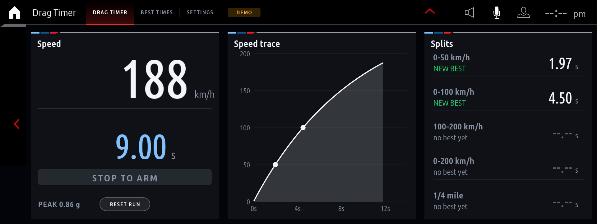</a>
<a href="docs/assets/apps/draggy/preview-02.gif"></a>
<a href="docs/assets/apps/draggy/screen_3.gif"></a>
</p>

<a id="component-6474635f7363616e6e6572"></a>

### Fault Scanner

`dtc_scanner@2.9.8` · **source** · app


Read and clear fault memory of every control unit, plus active Check Control messages

Declared evidence HMI: ID7, ID8 · Review: `eligible_static`.

Runtime dependencies: [idrive7-renderd &gt;=2.1.18 (selected 2.1.19; source)](#component-696472697665372d72656e64657264); [mgu-inputgate &gt;=1.1.0 (selected 1.2.2; source)](#component-6d67752d696e70757467617465)
Build prerequisites: [mgu-deploy &gt;=0.3.2 (selected 0.8.27; release)](#component-6d67752d6465706c6f79); [mgu-python &gt;=1.0.2 (selected 1.0.3; release)](#component-6d67752d707974686f6e)

[Original README / installation](apps/_sources/idrive7-apps/README.md) · [Source directory](apps/_sources/idrive7-apps/apps/dtc_scanner)

#### Declared screenshots

<p>
<a href="docs/assets/apps/dtc_scanner/preview-01.png"></a>
<a href="docs/assets/apps/dtc_scanner/preview-02.png"></a>
<a href="docs/assets/apps/dtc_scanner/screen_3.png"></a>
</p>

<a id="component-64796e6f"></a>

### Virtual Dyno

`dyno@1.6.3` · **source** · app


Power and torque curves from a full-throttle pull, saved and compared

Declared evidence HMI: ID7, ID8 · Review: `eligible_static`.

Runtime dependencies: [idrive7-renderd &gt;=2.1.15 (selected 2.1.19; source)](#component-696472697665372d72656e64657264)
Build prerequisites: [mgu-deploy &gt;=0.3.2 (selected 0.8.27; release)](#component-6d67752d6465706c6f79); [mgu-python &gt;=1.0.2 (selected 1.0.3; release)](#component-6d67752d707974686f6e)

[Original README / installation](apps/_sources/idrive7-apps/README.md) · [Source directory](apps/_sources/idrive7-apps/apps/dyno)

#### Declared screenshots

<p>
<a href="docs/assets/apps/dyno/preview-01.png"></a>
<a href="docs/assets/apps/dyno/screen_2.png"></a>
</p>

<a id="component-653835"></a>

### E85 Blend

`e85@1.2.2` · **source** · app


The ethanol content in your tank from the fills you book and the car's own tank level, and how many litres of E85 or 98 hit your target: a top-up or a full tank, step by step at the pump. Warns before your tune's safe limit, and tracks what fuel costs you

Declared evidence HMI: ID7, ID8 · Review: `eligible_static`.

Runtime dependencies: [mgu-render &gt;=0.6.24 (selected 0.6.25; release)](#component-6d67752d72656e646572)
Build prerequisites: [mgu-deploy &gt;=0.3.2 (selected 0.8.27; release)](#component-6d67752d6465706c6f79); [mgu-python &gt;=1.0.2 (selected 1.0.3; release)](#component-6d67752d707974686f6e)

[Original README / installation](apps/_sources/dante-idrive-apps/README.md) · [Source directory](apps/_ports/dante-idrive8/apps/e85)

#### Declared screenshots

<p>
<a href="docs/assets/apps/e85/screen_1.gif"></a>
<a href="docs/assets/apps/e85/screen_2.gif">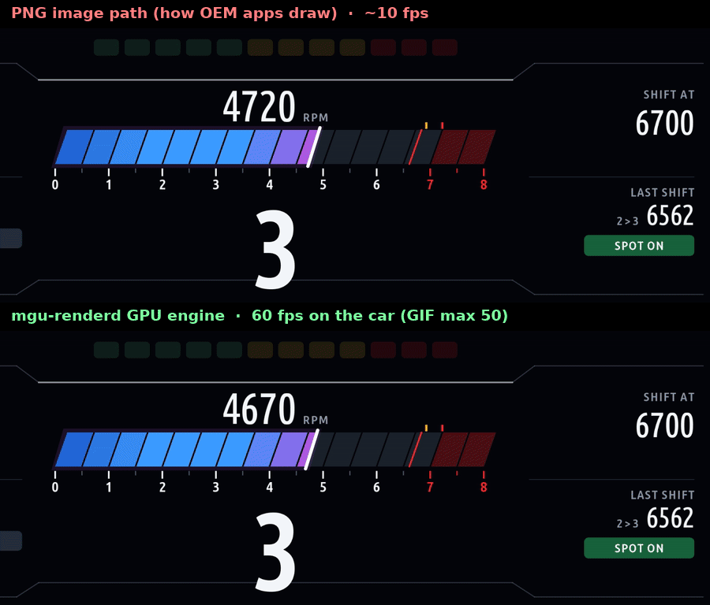</a>
<a href="docs/assets/apps/e85/screen_3.gif">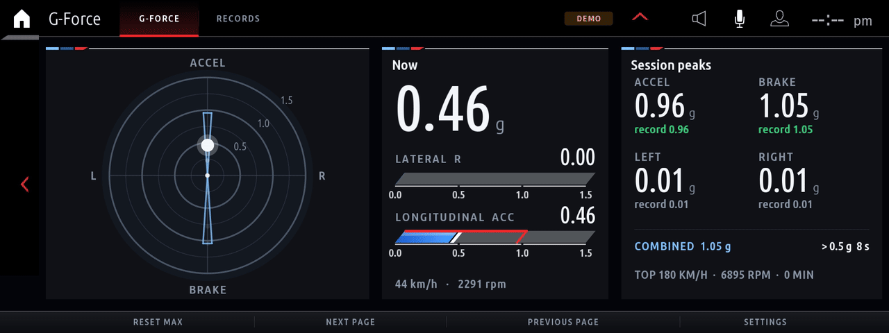</a>
</p>

<a id="component-656472697665"></a>

### eDrive

`edrive@2.11.0` · **source** · app


Real electric range (plug-in hybrids and fully electric cars such as the iX3), live battery power, cells and climate power, HV battery health (SOH) and energy, last charge, charge log, the 12 V battery (charge, voltage, what it does, regen, history) and a home-screen widget; on a 48 V mild hybrid its 48 V battery and DC/DC converter

Declared evidence HMI: ID7, ID8 · Review: `eligible_static`.

Runtime dependencies: [idrive7-renderd &gt;=2.1.15 (selected 2.1.19; source)](#component-696472697665372d72656e64657264)
Build prerequisites: [mgu-deploy &gt;=0.3.2 (selected 0.8.27; release)](#component-6d67752d6465706c6f79); [mgu-python &gt;=1.0.2 (selected 1.0.3; release)](#component-6d67752d707974686f6e)

[Original README / installation](apps/_sources/idrive7-apps/README.md) · [Source directory](apps/_sources/idrive7-apps/apps/edrive)

#### Declared screenshots

<p>
<a href="docs/assets/apps/edrive/preview-01.png"></a>
<a href="docs/assets/apps/edrive/preview-02.png"></a>
<a href="docs/assets/apps/edrive/preview-03.png"></a>
<a href="docs/assets/apps/edrive/preview-04.png"></a>
<a href="docs/assets/apps/edrive/preview-05.png"></a>
<a href="docs/assets/apps/edrive/preview-06.png">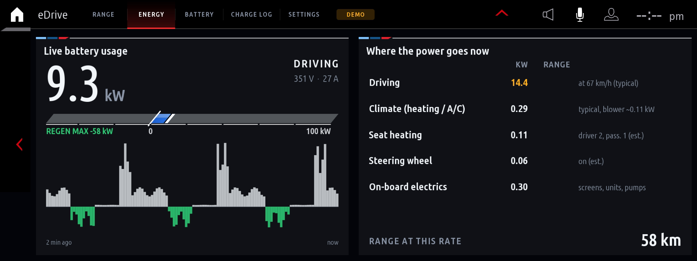</a>
<a href="docs/assets/apps/edrive/preview-07.png">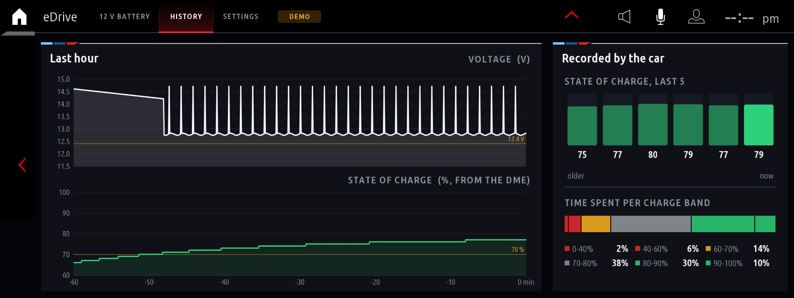</a>
</p>

<a id="component-657361676f6e6f5f73657474696e6773"></a>

### Esagono Settings

`esagono_settings@0.1.0` · **source** · app


Settings for the Esagono cluster widget: drive mode colours, redline, shift flash, scale, backdrop and demo.

Declared evidence HMI: ID8 · Review: `eligible_static`.

Runtime dependencies: [esagono-cluster &gt;=0.2.0 (selected 0.2.1; source)](#component-657361676f6e6f2d636c7573746572)

[Original README / installation](apps/_sources/grabandrey-esagono-cluster/README.md) · [Source directory](apps/_sources/grabandrey-esagono-cluster/apps/esagono_settings)

#### Declared screenshots

<p>
<a href="docs/assets/apps/esagono_settings/screen_1.png"></a>
</p>

<a id="component-67666f726365"></a>

### G-Force

`gforce@1.6.22` · **source** · app


Friction circle with grip envelope, peak g per direction and session records

Declared evidence HMI: ID7, ID8 · Review: `eligible_static`.

Runtime dependencies: [idrive7-renderd &gt;=2.1.15 (selected 2.1.19; source)](#component-696472697665372d72656e64657264)
Build prerequisites: [mgu-deploy &gt;=0.3.2 (selected 0.8.27; release)](#component-6d67752d6465706c6f79); [mgu-python &gt;=1.0.2 (selected 1.0.3; release)](#component-6d67752d707974686f6e)

[Original README / installation](apps/_sources/idrive7-apps/README.md) · [Source directory](apps/_sources/idrive7-apps/apps/gforce)

#### Declared screenshots

<p>
<a href="docs/assets/apps/gforce/preview-01.png"></a>
<a href="docs/assets/apps/gforce/preview-02.gif"></a>
<a href="docs/assets/apps/gforce/screen_3.gif"></a>
</p>

<a id="component-6964615f6c696768746c6f67"></a>

### Light Logger

`ida_lightlog@1.3.1` · **source** · app


Finds what switches the seat logos off: the RGB light modules, the body controller's lamp outputs, and a finder that compares everything the body controller and seat modules report with the logos on and off. Keep on (off until you switch it on) holds the logos' lamp output on while the car is on. EXPERIMENTAL, untested on a car.

Declared evidence HMI: ID8 · Review: `eligible_static`.

Runtime dependencies: None declared.

[Original README / installation](apps/_sources/grabandrey-idrive-apps/README.md) · [Source directory](apps/_sources/grabandrey-idrive-apps/packages/lightlog/app)

<a id="component-6964615f736561746c6967687473"></a>

### Seat Lights

`ida_seatlights@1.3.2` · **source** · app


One switch: keeps the seat (headrest) logos lit, no timer, until you switch it off; off while the car is locked with the engine off (G87 M2: the body controller's lamp output 45). The switch is kept across drives. EXPERIMENTAL.

Declared evidence HMI: ID8 · Review: `eligible_static`.

Runtime dependencies: [mgu-render &gt;=0.6.11 (selected 0.6.25; release)](#component-6d67752d72656e646572)

[Original README / installation](apps/_sources/grabandrey-idrive-apps/README.md) · [Source directory](apps/_sources/grabandrey-idrive-apps/packages/seatlights/app)

<a id="component-6964615f766974616c73"></a>

### Vitals

`ida_vitals@1.3.1` · **source** · app

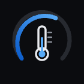

Water, engine oil, gearbox oil and tyre temperatures in the iDrive 8 cluster: reads the car's data for the Vitals widget and holds its settings.

Declared evidence HMI: ID8 · Review: `eligible_static`.

Runtime dependencies: [ida-vitals-cluster &gt;=1.3.0 (selected 1.3.3; source)](#component-6964612d766974616c732d636c7573746572); [mgu-render &gt;=0.6.11 (selected 0.6.25; release)](#component-6d67752d72656e646572)

[Original README / installation](apps/_sources/grabandrey-idrive-apps/README.md) · [Source directory](apps/_sources/grabandrey-idrive-apps/packages/vitals/app)

#### Declared screenshots

<p>
<a href="docs/assets/apps/ida_vitals/screen_1.png"></a>
</p>

<a id="component-69746572696f6465765f616d6269656e74"></a>

### Ambient Light

`iteriodev_ambient@1.4.3` · **release** · app

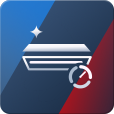

Any color on the interior ambient light. Your car's zones in a list (the ones your car has): give each the main color, its own or the car's, or pick All zones. Color bars for any shade, brightness (or follow the car's), the car's nine colors, and six presets that keep the whole look. Drive modes: a color for each drive mode (Sport, Comfort, Eco Pro, their Plus and Individual, Adaptive) that the light switches to with the mode, on or off. Works while the car's own ambient light is on. Needs the Comfort tool from the same source. Works with the touchscreen or the iDrive controller. iDrive 7 and

Declared evidence HMI: ID7, ID8 · Review: `eligible_static`.

Runtime dependencies: [iteriodev-comfort &gt;=0.6.3 (selected 0.6.3; external)](#component-69746572696f6465762d636f6d666f7274); [mgu-deploy &gt;=0.7.5 (selected 0.8.27; release)](#component-6d67752d6465706c6f79)

Publisher artifact: 744,650 bytes; SHA-256 `ba1f7a12d46cd611bd7c3d868fafe195bfdfca6d3a490fcc39c2a01a360c5519`.

[Original README / installation](https://raw.githubusercontent.com/IterioDev/car-apps/f9ca32bd3cebd163fa16fbe17cc3473623be2c81/README.md) · [Original publisher artifact](https://raw.githubusercontent.com/IterioDev/car-apps/f9ca32bd3cebd163fa16fbe17cc3473623be2c81/apps/iteriodev_ambient/iteriodev_ambient%401.4.3.tgz)

#### Declared screenshots

<p>
<a href="docs/assets/apps/iteriodev_ambient/screen_1.png">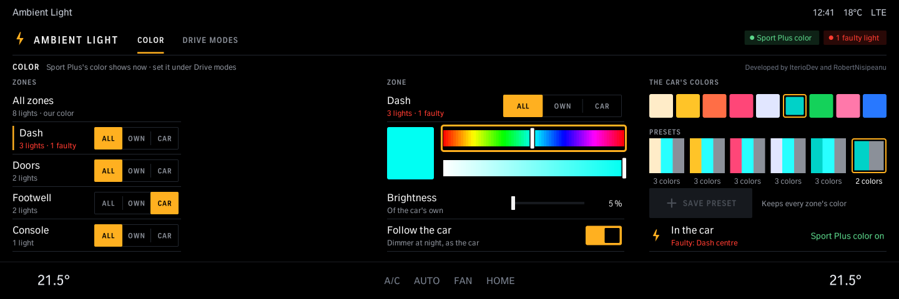</a>
<a href="docs/assets/apps/iteriodev_ambient/screen_2.png"></a>
<a href="docs/assets/apps/iteriodev_ambient/screen_3.png"></a>
</p>

<a id="component-69746572696f6465765f63617264617368"></a>

### Car Data

`iteriodev_cardash@1.4.1` · **release** · app

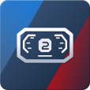

Declared evidence HMI: ID8 · Review: `eligible_static`.

Runtime dependencies: [mgu-deploy &gt;=0.7.5 (selected 0.8.27; release)](#component-6d67752d6465706c6f79)

Publisher artifact: 775,221 bytes; SHA-256 `95fe3980a5d9552bec03693233a23d928663f6a7655d02a16edb15519d631a4f`.

[Original README / installation](https://raw.githubusercontent.com/IterioDev/car-apps/22a141241d6d329ea671426749a8a029ac22258e/README.md) · [Original publisher artifact](https://raw.githubusercontent.com/IterioDev/car-apps/22a141241d6d329ea671426749a8a029ac22258e/apps/iteriodev_cardash/iteriodev_cardash%401.4.1.tgz)

#### Declared screenshots

<p>
<a href="docs/assets/apps/iteriodev_cardash/screen_1.png"></a>
<a href="docs/assets/apps/iteriodev_cardash/screen_2.png"></a>
<a href="docs/assets/apps/iteriodev_cardash/screen_3.png"></a>
</p>

<a id="component-69746572696f6465765f647261676779"></a>

### Drag Timer

`iteriodev_draggy@1.2.0` · **release** · app


Declared evidence HMI: ID8 · Review: `eligible_static`.

Runtime dependencies: [mgu-deploy &gt;=0.7.5 (selected 0.8.27; release)](#component-6d67752d6465706c6f79)

Publisher artifact: 738,700 bytes; SHA-256 `d2520d168bd9af27a2b50e7cf7535bcccf76d7d4910cb12d303445d84c518f80`.

[Original README / installation](https://raw.githubusercontent.com/IterioDev/car-apps/22a141241d6d329ea671426749a8a029ac22258e/README.md) · [Original publisher artifact](https://raw.githubusercontent.com/IterioDev/car-apps/22a141241d6d329ea671426749a8a029ac22258e/apps/iteriodev_draggy/iteriodev_draggy%401.2.0.tgz)

#### Declared screenshots

<p>
<a href="docs/assets/apps/iteriodev_draggy/screen_1.png">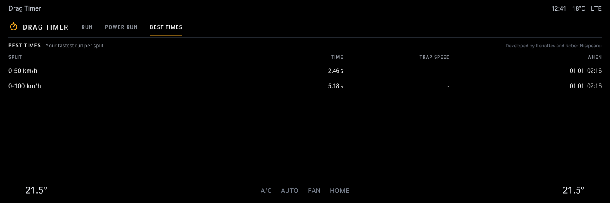</a>
<a href="docs/assets/apps/iteriodev_draggy/screen_2.png"></a>
<a href="docs/assets/apps/iteriodev_draggy/screen_3.png"></a>
</p>

<a id="component-69746572696f6465765f6474637363616e"></a>

### Fault Codes

`iteriodev_dtcscan@1.2.0` · **release** · app


Declared evidence HMI: ID8 · Review: `eligible_static`.

Runtime dependencies: [mgu-deploy &gt;=0.7.5 (selected 0.8.27; release)](#component-6d67752d6465706c6f79)

Publisher artifact: 2,762,057 bytes; SHA-256 `7c9e16ccd8b299ac5a8a733717e29136e0de15041d6a05b51267730c6b65a7b2`.

[Original README / installation](https://raw.githubusercontent.com/IterioDev/car-apps/22a141241d6d329ea671426749a8a029ac22258e/README.md) · [Original publisher artifact](https://raw.githubusercontent.com/IterioDev/car-apps/22a141241d6d329ea671426749a8a029ac22258e/apps/iteriodev_dtcscan/iteriodev_dtcscan%401.2.0.tgz)

#### Declared screenshots

<p>
<a href="docs/assets/apps/iteriodev_dtcscan/screen_1.png"></a>
<a href="docs/assets/apps/iteriodev_dtcscan/screen_2.png">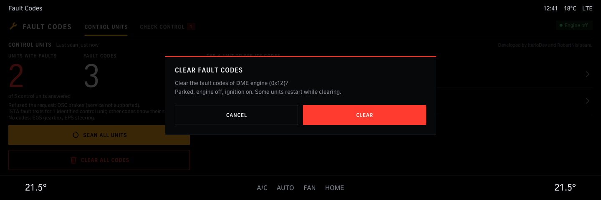</a>
<a href="docs/assets/apps/iteriodev_dtcscan/screen_3.png"></a>
</p>

<a id="component-69746572696f6465765f656472697665"></a>

### eDrive

`iteriodev_edrive@1.1.0` · **release** · app


Declared evidence HMI: ID8 · Review: `eligible_static`.

Runtime dependencies: [mgu-deploy &gt;=0.7.5 (selected 0.8.27; release)](#component-6d67752d6465706c6f79)

Publisher artifact: 750,535 bytes; SHA-256 `6537d98218b92756a851911ab275d8f93c06e40322742798cb3bebbfaf184b03`.

[Original README / installation](https://raw.githubusercontent.com/IterioDev/car-apps/22a141241d6d329ea671426749a8a029ac22258e/README.md) · [Original publisher artifact](https://raw.githubusercontent.com/IterioDev/car-apps/22a141241d6d329ea671426749a8a029ac22258e/apps/iteriodev_edrive/iteriodev_edrive%401.1.0.tgz)

#### Declared screenshots

<p>
<a href="docs/assets/apps/iteriodev_edrive/screen_1.png">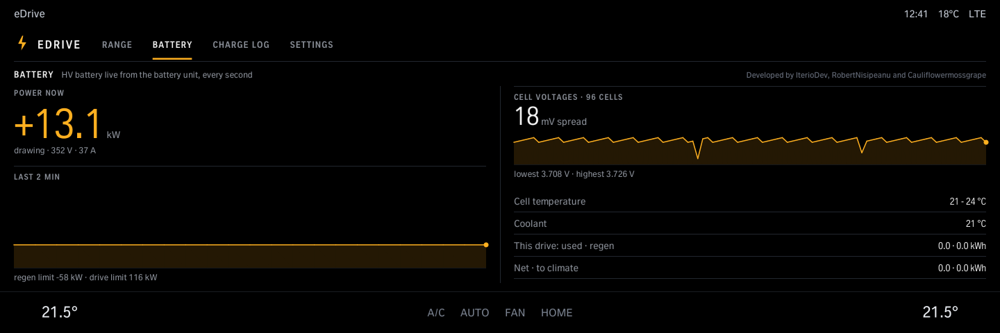</a>
<a href="docs/assets/apps/iteriodev_edrive/screen_2.png"></a>
<a href="docs/assets/apps/iteriodev_edrive/screen_3.png"></a>
</p>

<a id="component-69746572696f6465765f6c69766561646a757374"></a>

### Live Adjustments

`iteriodev_liveadjust@1.2.0` · **release** · app


Declared evidence HMI: ID8 · Review: `eligible_static`.

Runtime dependencies: [mgu-deploy &gt;=0.7.5 (selected 0.8.27; release)](#component-6d67752d6465706c6f79)

Publisher artifact: 741,641 bytes; SHA-256 `9c2d6f10a849102fa7dc1e0225804af9c549738d905185be6ea81fe8c71cc08e`.

[Original README / installation](https://raw.githubusercontent.com/IterioDev/car-apps/22a141241d6d329ea671426749a8a029ac22258e/README.md) · [Original publisher artifact](https://raw.githubusercontent.com/IterioDev/car-apps/22a141241d6d329ea671426749a8a029ac22258e/apps/iteriodev_liveadjust/iteriodev_liveadjust%401.2.0.tgz)

#### Declared screenshots

<p>
<a href="docs/assets/apps/iteriodev_liveadjust/screen_1.png">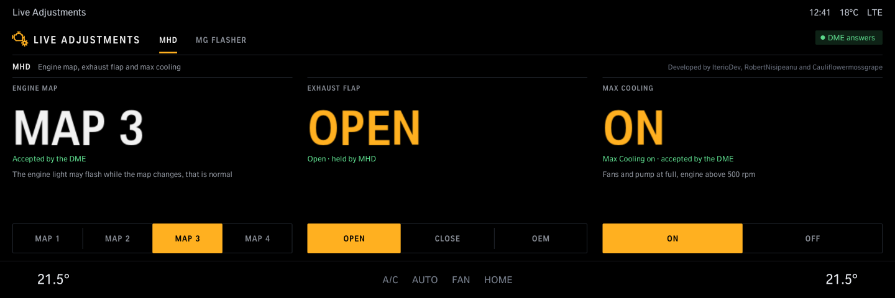</a>
<a href="docs/assets/apps/iteriodev_liveadjust/screen_2.png">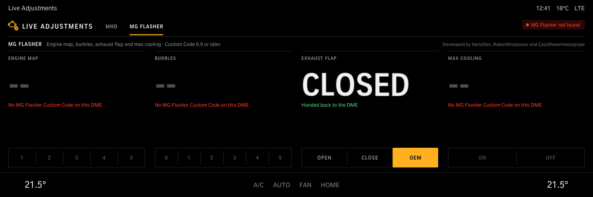</a>
<a href="docs/assets/apps/iteriodev_liveadjust/screen_3.png"></a>
</p>

<a id="component-69746572696f6465765f6f7665726c617973"></a>

### Overlays

`iteriodev_overlays@1.4.0` · **release** · app


Declared evidence HMI: ID8 · Review: `eligible_static`.

Runtime dependencies: [iteriodev-overlays &gt;=0.5.0 (selected 0.5.0; external)](#component-69746572696f6465762d6f7665726c617973); [mgu-deploy &gt;=0.7.5 (selected 0.8.27; release)](#component-6d67752d6465706c6f79)

Publisher artifact: 728,911 bytes; SHA-256 `300db4ea936fa70ad3aa3d39bf23ad4be5a2df112b715d8d3fc4300bd2ce020e`.

[Original README / installation](https://raw.githubusercontent.com/IterioDev/car-apps/22a141241d6d329ea671426749a8a029ac22258e/README.md) · [Original publisher artifact](https://raw.githubusercontent.com/IterioDev/car-apps/22a141241d6d329ea671426749a8a029ac22258e/apps/iteriodev_overlays/iteriodev_overlays%401.4.0.tgz)

#### Declared screenshots

<p>
<a href="docs/assets/apps/iteriodev_overlays/screen_1.png">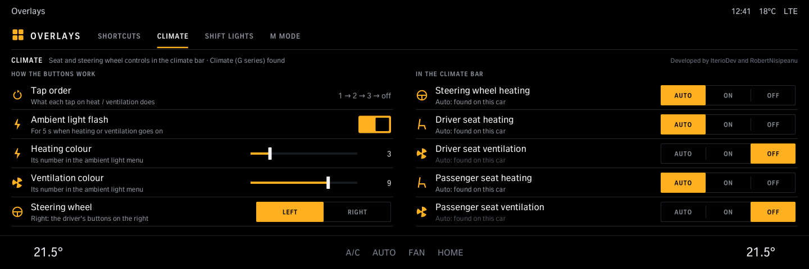</a>
<a href="docs/assets/apps/iteriodev_overlays/screen_2.png">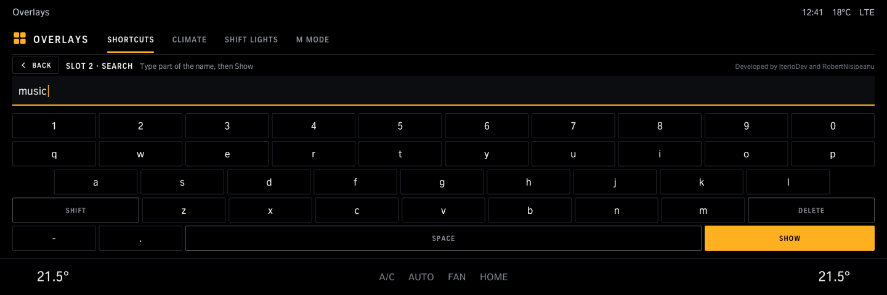</a>
<a href="docs/assets/apps/iteriodev_overlays/screen_3.png">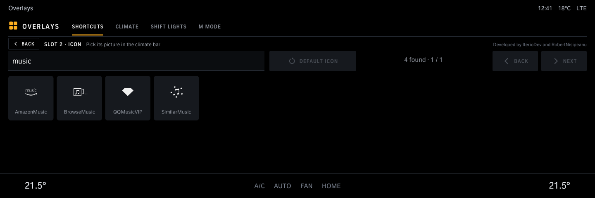</a>
</p>

<a id="component-69746572696f6465765f7365617473"></a>

### Seats

`iteriodev_seats@1.6.3` · **release** · app

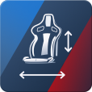

Declared evidence HMI: ID7, ID8 · Review: `eligible_static`.

Runtime dependencies: [iteriodev-comfort &gt;=0.6.1 (selected 0.6.3; external)](#component-69746572696f6465762d636f6d666f7274); [mgu-deploy &gt;=0.7.5 (selected 0.8.27; release)](#component-6d67752d6465706c6f79)

Publisher artifact: 1,156,820 bytes; SHA-256 `33e9dd466af2eb3fbef93fcb8bce0b4be4746df65ba020af8f051c844a66b535`.

[Original README / installation](https://raw.githubusercontent.com/IterioDev/car-apps/22a141241d6d329ea671426749a8a029ac22258e/README.md) · [Original publisher artifact](https://raw.githubusercontent.com/IterioDev/car-apps/22a141241d6d329ea671426749a8a029ac22258e/apps/iteriodev_seats/iteriodev_seats%401.6.3.tgz)

#### Declared screenshots

<p>
<a href="docs/assets/apps/iteriodev_seats/screen_1.png"></a>
<a href="docs/assets/apps/iteriodev_seats/screen_2.png"></a>
<a href="docs/assets/apps/iteriodev_seats/screen_3.png"></a>
</p>

<a id="component-69746572696f6465765f73657276696365"></a>

### Service

`iteriodev_service@1.0.0` · **release** · app

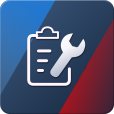

Declared evidence HMI: ID8 · Review: `eligible_static`.

Runtime dependencies: [mgu-deploy &gt;=0.7.5 (selected 0.8.27; release)](#component-6d67752d6465706c6f79)

Publisher artifact: 721,275 bytes; SHA-256 `7a2e25ed39e9cbab1dff0da433ad36ecb3edf03f72f364cc29f72e83fb09786d`.

[Original README / installation](https://raw.githubusercontent.com/IterioDev/car-apps/22a141241d6d329ea671426749a8a029ac22258e/README.md) · [Original publisher artifact](https://raw.githubusercontent.com/IterioDev/car-apps/22a141241d6d329ea671426749a8a029ac22258e/apps/iteriodev_service/iteriodev_service%401.0.0.tgz)

#### Declared screenshots

<p>
<a href="docs/assets/apps/iteriodev_service/screen_1.png"></a>
<a href="docs/assets/apps/iteriodev_service/screen_2.png">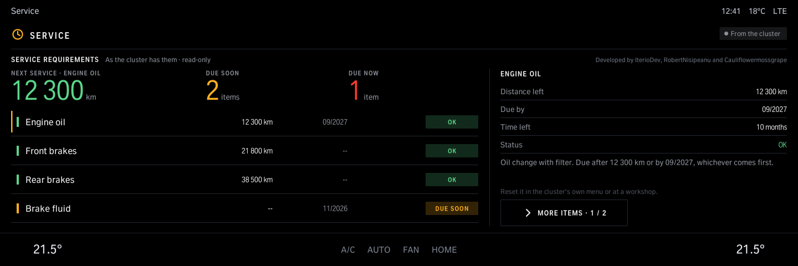</a>
<a href="docs/assets/apps/iteriodev_service/screen_3.png"></a>
</p>

<a id="component-69746572696f6465765f7461696c7363616c65"></a>

### Tailscale

`iteriodev_tailscale@1.2.0` · **release** · app


Log the head unit in to your tailnet without a computer: shows Tailscale's state, the login link as a QR code to scan with your phone, the head unit's tailnet name and address, Rename (default mgu), Disconnect / Connect (switched off, still logged in) and Log out. Works with the iDrive controller too. Needs the Tailscale tool from the same source.

Declared evidence HMI: ID7, ID8 · Review: `eligible_static`.

Runtime dependencies: [iteriodev-tailscale &gt;=1.104.4 (selected 1.104.6; external)](#component-69746572696f6465762d7461696c7363616c65); [mgu-deploy &gt;=0.7.5 (selected 0.8.27; release)](#component-6d67752d6465706c6f79)

Publisher artifact: 747,267 bytes; SHA-256 `0e4a0deef88e2254cff3d25fb0962c67d38fc86533c3e27df14c107fa5cca838`.

[Original README / installation](https://raw.githubusercontent.com/IterioDev/car-apps/f9ca32bd3cebd163fa16fbe17cc3473623be2c81/README.md) · [Original publisher artifact](https://raw.githubusercontent.com/IterioDev/car-apps/f9ca32bd3cebd163fa16fbe17cc3473623be2c81/apps/iteriodev_tailscale/iteriodev_tailscale%401.2.0.tgz)

#### Declared screenshots

<p>
<a href="docs/assets/apps/iteriodev_tailscale/screen_1.png">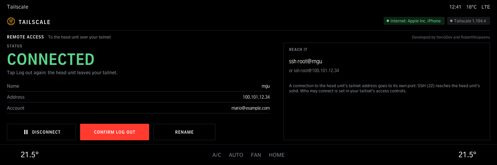</a>
<a href="docs/assets/apps/iteriodev_tailscale/screen_2.png"></a>
<a href="docs/assets/apps/iteriodev_tailscale/screen_3.png"></a>
</p>

<a id="component-69746572696f6465765f7475726e76696577"></a>

### Turn View

`iteriodev_turnview@1.6.0` · **release** · app

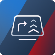

The front camera in the instrument cluster with a turn card and, near each turn, a blue turn sign (three chevrons pointing the way), from BMW Maps, Apple CarPlay or Android Auto; the camera shows with or without a route. Or on the head unit instead: the Camera button opens the camera's whole picture with the same card and sign, at any speed (Picture on: Head unit), for kerbs and tight gaps. iDrive 8: pick "Turn View AR" in the cluster's widget menu (from the car's next start after installing). iDrive 7: off at every start of the car; switch it on in this app and set Instrument cluster &gt; Centra

Declared evidence HMI: ID7, ID8 · Review: `eligible_static`.

Runtime dependencies: [iteriodev-turnview &gt;=0.9.0 (selected 0.9.1; external)](#component-69746572696f6465762d7475726e76696577); [mgu-deploy &gt;=0.7.5 (selected 0.8.27; release)](#component-6d67752d6465706c6f79)

Publisher artifact: 735,720 bytes; SHA-256 `ae2e8fbfdfd57878669cfaaf787f6af9908f05fbd67479b7399ff9498d079351`.

[Original README / installation](https://raw.githubusercontent.com/IterioDev/car-apps/f9ca32bd3cebd163fa16fbe17cc3473623be2c81/README.md) · [Original publisher artifact](https://raw.githubusercontent.com/IterioDev/car-apps/f9ca32bd3cebd163fa16fbe17cc3473623be2c81/apps/iteriodev_turnview/iteriodev_turnview%401.6.0.tgz)

#### Declared screenshots

<p>
<a href="docs/assets/apps/iteriodev_turnview/screen_1.png"></a>
<a href="docs/assets/apps/iteriodev_turnview/screen_2.png"></a>
<a href="docs/assets/apps/iteriodev_turnview/screen_3.png"></a>
</p>

<a id="component-6b6d5f6d6f746f72646174656e"></a>

### Motordaten

`km_motordaten@0.4.1` · **source** · app


Live-Motordaten der DME wie die M2-App: Temperaturen, Drücke, Drehzahl, Leistung, Klopfen; Maximalwerte, Logs, Fehlerspeicher lesen/löschen; MHD Max Cooling (wird automatisch erkannt).

Declared evidence HMI: ID7, ID8 · Review: `eligible_static`.

Runtime dependencies: [idrive7-renderd &gt;=2.1.18 (selected 2.1.19; source)](#component-696472697665372d72656e64657264)
Build prerequisites: [mgu-deploy &gt;=0.3.2 (selected 0.8.27; release)](#component-6d67752d6465706c6f79); [mgu-python &gt;=1.0.2 (selected 1.0.3; release)](#component-6d67752d707974686f6e)

[Original README / installation](apps/_sources/prototype019-idrive7-motordaten/README.md) · [Source directory](apps/_sources/prototype019-idrive7-motordaten/apps/km_motordaten)

<a id="component-6c6976655f61646a7573746d656e7473"></a>

### Engine Config

`live_adjustments@0.9.10` · **source** · app


Engine Config for BMW MGU ID7. Exhaust Flap: OEM, OPEN and CLOSE over the car's own diagnostic link, or following the driving mode (Sport open, Eco Pro closed); held against the DME's timeout, Close handed back above a set engine speed. With BM3 or MHD picked in Settings: engine map switching, burbles, ASD and Max Cooling. Experimental: xDrive off until the ignition cycle (DSC LMV&&#35;95;FUNKTION), behind its own setting

Declared evidence HMI: ID7, ID8 · Review: `eligible_static`.

Runtime dependencies: [idrive7-renderd &gt;=2.1.18 (selected 2.1.19; source)](#component-696472697665372d72656e64657264); [mgu-inputgate &gt;=1.1.0 (selected 1.2.2; source)](#component-6d67752d696e70757467617465)
Build prerequisites: [mgu-deploy &gt;=0.3.2 (selected 0.8.27; release)](#component-6d67752d6465706c6f79); [mgu-python &gt;=1.0.2 (selected 1.0.3; release)](#component-6d67752d707974686f6e)

[Original README / installation](apps/_sources/idrive7-apps/README.md) · [Source directory](apps/_sources/idrive7-apps/apps/live_adjustments)

#### Declared screenshots

<p>
<a href="docs/assets/apps/live_adjustments/preview-01.png"></a>
<a href="docs/assets/apps/live_adjustments/preview-02.png"></a>
<a href="docs/assets/apps/live_adjustments/preview-03.png"></a>
<a href="docs/assets/apps/live_adjustments/preview-04.png"></a>
<a href="docs/assets/apps/live_adjustments/preview-05.png"></a>
<a href="docs/assets/apps/live_adjustments/preview-06.png">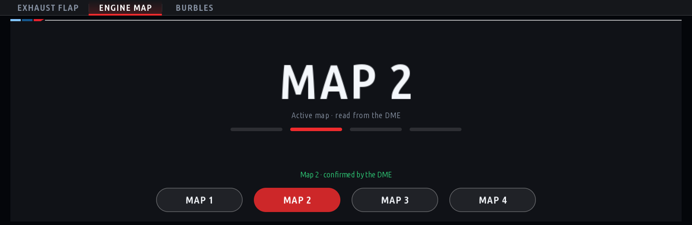</a>
<a href="docs/assets/apps/live_adjustments/preview-07.png"></a>
<a href="docs/assets/apps/live_adjustments/preview-08.png"></a>
<a href="docs/assets/apps/live_adjustments/preview-09.png"></a>
<a href="docs/assets/apps/live_adjustments/preview-10.png"></a>
<a href="docs/assets/apps/live_adjustments/preview-11.png"></a>
<a href="docs/assets/apps/live_adjustments/preview-12.png"></a>
<a href="docs/assets/apps/live_adjustments/preview-13.png">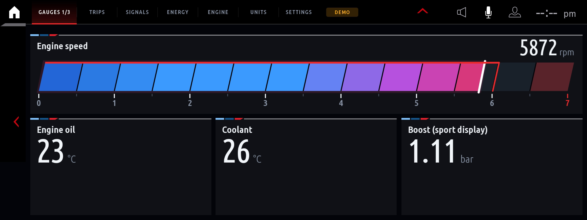</a>
<a href="docs/assets/apps/live_adjustments/preview-14.png"></a>
</p>

<a id="component-6c6976655f64617461"></a>

### Live Data

`live_data@1.0.18` · **source** · app


Read-only live values from the car and its control units, a trip computer with fuel cost, and gauge screens of your own, one of them as the home-screen widget

Declared evidence HMI: ID7, ID8 · Review: `eligible_static`.

Runtime dependencies: [idrive7-renderd &gt;=2.1.18 (selected 2.1.19; source)](#component-696472697665372d72656e64657264); [mgu-inputgate &gt;=1.1.0 (selected 1.2.2; source)](#component-6d67752d696e70757467617465)
Build prerequisites: [mgu-deploy &gt;=0.3.2 (selected 0.8.27; release)](#component-6d67752d6465706c6f79); [mgu-python &gt;=1.0.2 (selected 1.0.3; release)](#component-6d67752d707974686f6e)

[Original README / installation](apps/_sources/idrive7-apps/README.md) · [Source directory](apps/_sources/idrive7-apps/apps/live_data)

#### Declared screenshots

<p>
<a href="docs/assets/apps/live_data/preview-01.png"></a>
<a href="docs/assets/apps/live_data/preview-02.png"></a>
<a href="docs/assets/apps/live_data/preview-03.png">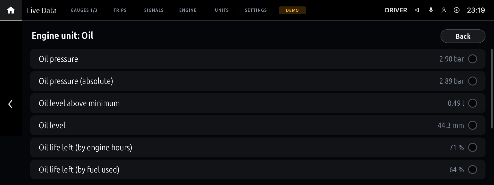</a>
<a href="docs/assets/apps/live_data/preview-04.png"></a>
<a href="docs/assets/apps/live_data/preview-05.png">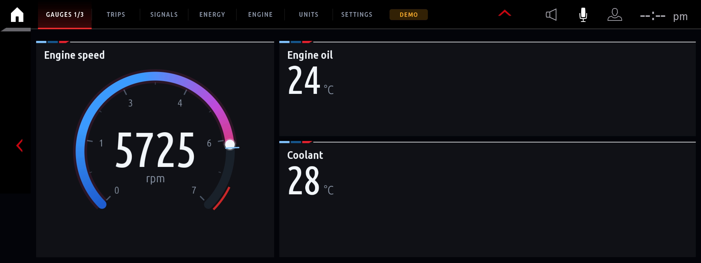</a>
<a href="docs/assets/apps/live_data/preview-06.png">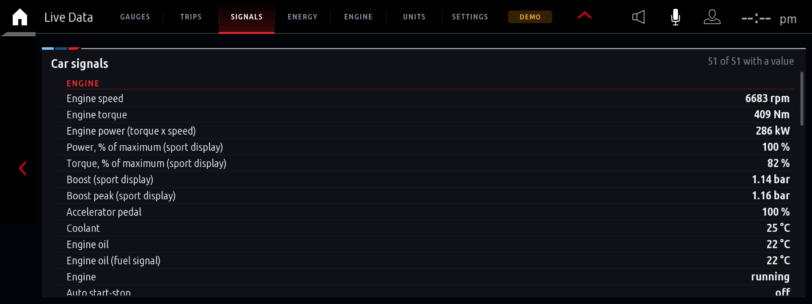</a>
<a href="docs/assets/apps/live_data/preview-07.png"></a>
<a href="docs/assets/apps/live_data/preview-08.png"></a>
<a href="docs/assets/apps/live_data/preview-09.png"></a>
<a href="docs/assets/apps/live_data/preview-10.png"></a>
<a href="docs/assets/apps/live_data/preview-11.png"></a>
<a href="docs/assets/apps/live_data/preview-12.png"></a>
</p>

<a id="component-6d5f636f70696c6f74"></a>

### M-Copilot

`m_copilot@1.0.31` · **source** · app


AI co-driver that answers with your car's own data: live readings, service list, fault memory, model and engine from the car, plus your tune and mods. Read-only.

Declared evidence HMI: ID7, ID8 · Review: `eligible_static`.

Runtime dependencies: [mgu-inputgate &gt;=1.0.0 (selected 1.2.2; source)](#component-6d67752d696e70757467617465); [mgu-render &gt;=0.6.24 (selected 0.6.25; release)](#component-6d67752d72656e646572)
Build prerequisites: [mgu-deploy &gt;=0.3.2 (selected 0.8.27; release)](#component-6d67752d6465706c6f79); [mgu-python &gt;=1.0.2 (selected 1.0.3; release)](#component-6d67752d707974686f6e)

[Original README / installation](apps/_ports/hexlay-idrive8/README.md) · [Source directory](apps/_ports/hexlay-idrive8/apps/m_copilot)

#### Declared screenshots

<p>
<a href="docs/assets/apps/m_copilot/preview-01.png">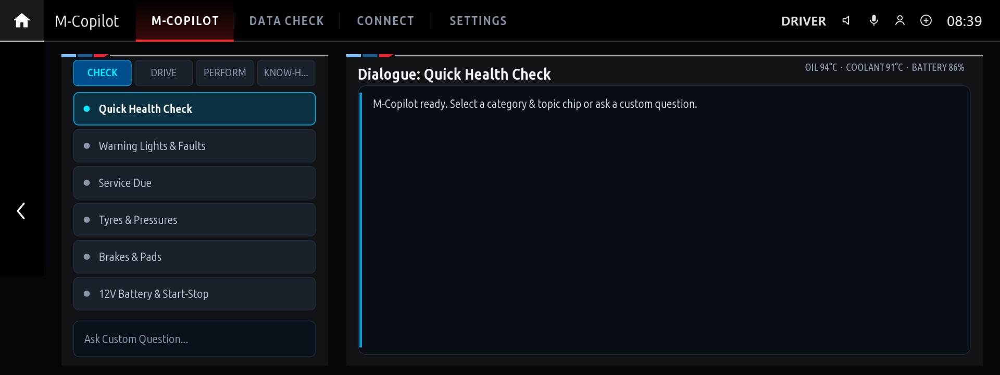</a>
<a href="docs/assets/apps/m_copilot/preview-02.png"></a>
<a href="docs/assets/apps/m_copilot/preview-03.png"></a>
<a href="docs/assets/apps/m_copilot/preview-04.png">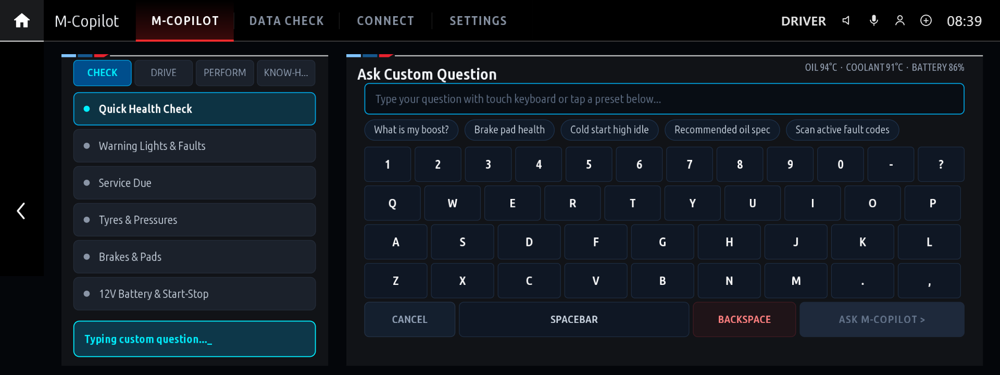</a>
<a href="docs/assets/apps/m_copilot/preview-05.png">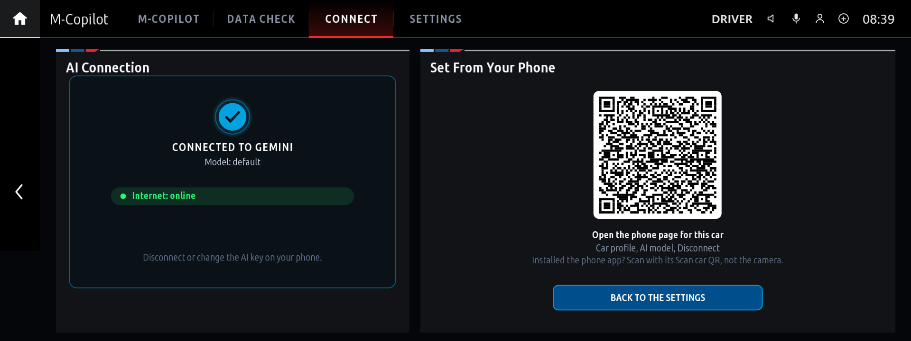</a>
</p>

<a id="component-6d617a7a6168616b65725f7864726976655f72656d6f766572"></a>

### mazzahaker&&#35;95;xdrive&&#35;95;remover

`mazzahaker_xdrive_remover@0.1.26` · **source** · app


Transfer case diagnostics for BMW iDrive 7 and 8, with an experimental front drive off command (until ignition cycle).

Declared evidence HMI: ID7, ID8 · Review: `eligible_static`.

Runtime dependencies: [mgu-render &gt;=0.6.11 (selected 0.6.25; release)](#component-6d67752d72656e646572)

[Original README / installation](apps/_sources/mazzahaker-idrive8-features/README.md) · [Source directory](apps/_sources/mazzahaker-idrive8-features/apps/mazzahaker_xdrive_remover)

<a id="component-6f61702d64726976657265636f726465722d6e657874"></a>

### Drive Recorder

`oap-driverecorder-next@2.5.1` · **release** · app


Declared evidence HMI: ID7, ID8 · Review: `eligible_static`.

Runtime dependencies: [iteriodev-drplay &gt;=1.2.0 (selected 1.2.6; external)](#component-69746572696f6465762d6472706c6179); [mgu-deploy &gt;=0.7.5 (selected 0.8.27; release)](#component-6d67752d6465706c6f79)

Publisher artifact: 767,988 bytes; SHA-256 `7707bd677bff3073ca6e71edcaf3ade94ac0f5be00476d75ec1f084331b754e0`.

[Original README / installation](https://raw.githubusercontent.com/IterioDev/car-apps/22a141241d6d329ea671426749a8a029ac22258e/README.md) · [Original publisher artifact](https://raw.githubusercontent.com/IterioDev/car-apps/22a141241d6d329ea671426749a8a029ac22258e/apps/oap-driverecorder-next/oap-driverecorder-next%402.5.1.tgz)

#### Declared screenshots

<p>
<a href="docs/assets/apps/oap-driverecorder-next/screen_1.png"></a>
<a href="docs/assets/apps/oap-driverecorder-next/screen_2.png">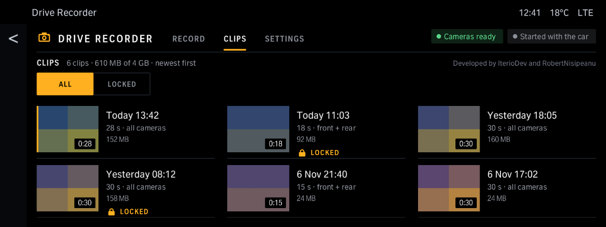</a>
<a href="docs/assets/apps/oap-driverecorder-next/screen_3.png"></a>
</p>

<a id="component-7061726b65645f67616d6573"></a>

### Parked Games

`parked_games@0.2.3` · **source** · app


Small games for when the car is parked, played with the iDrive knob (and the touchscreen)

Declared evidence HMI: ID7, ID8 · Review: `eligible_static`.

Runtime dependencies: [mgu-render &gt;=0.6.24 (selected 0.6.25; release)](#component-6d67752d72656e646572)
Build prerequisites: [mgu-deploy &gt;=0.3.2 (selected 0.8.27; release)](#component-6d67752d6465706c6f79); [mgu-python &gt;=1.0.2 (selected 1.0.3; release)](#component-6d67752d707974686f6e)

[Original README / installation](apps/_sources/maxxxfoka-idrive7games/README.md) · [Source directory](apps/_ports/maxxxfoka-idrive8/apps/parked_games)

#### Declared screenshots

<p>
<a href="docs/assets/apps/parked_games/screen_1.png"></a>
<a href="docs/assets/apps/parked_games/screen_2.png"></a>
</p>

<a id="component-7070735f676175676573"></a>

### Proven Gauges

`pps_gauges@1.0.3` · **source** · app


BETA, not yet tested on a car. Proven Performance Solutions gauge sets: Street, Track, Boost, Thermal and Tyres. A guide only: check against a gauge you trust

Declared evidence HMI: ID7, ID8 · Review: `eligible_static`.

Runtime dependencies: [idrive7-renderd &gt;=2.1.18 (selected 2.1.19; source)](#component-696472697665372d72656e64657264); [mgu-inputgate &gt;=1.1.0 (selected 1.2.2; source)](#component-6d67752d696e70757467617465)
Build prerequisites: [mgu-deploy &gt;=0.3.2 (selected 0.8.27; release)](#component-6d67752d6465706c6f79); [mgu-python &gt;=1.0.2 (selected 1.0.3; release)](#component-6d67752d707974686f6e)

[Original README / installation](apps/_sources/proven-apps/README.md) · [Source directory](apps/_sources/proven-apps/apps/pps_gauges)

<a id="component-7070735f7761726d7570"></a>

### Proven Warm-Up

`pps_warmup@1.2.1` · **source** · app


BETA, not yet tested on a car. Shows when engine oil, gearbox oil and coolant reach the warm-up temperatures set by Proven Performance Solutions. A guide only: it does not replace the car's own warnings

Declared evidence HMI: ID7, ID8 · Review: `eligible_static`.

Runtime dependencies: [idrive7-renderd &gt;=2.1.15 (selected 2.1.19; source)](#component-696472697665372d72656e64657264)
Build prerequisites: [mgu-deploy &gt;=0.3.2 (selected 0.8.27; release)](#component-6d67752d6465706c6f79); [mgu-python &gt;=1.0.2 (selected 1.0.3; release)](#component-6d67752d707974686f6e)

[Original README / installation](apps/_sources/proven-apps/README.md) · [Source directory](apps/_sources/proven-apps/apps/pps_warmup)

<a id="component-7265646c696e65"></a>

### Redline

`redline@2.0.45` · **source** · app


Full-screen rev tach with shift lights, gear, shift scoring and cold-engine rev guard; HUD by @biscotit

Declared evidence HMI: ID7, ID8 · Review: `eligible_static`.

Runtime dependencies: [idrive7-renderd &gt;=2.1.15 (selected 2.1.19; source)](#component-696472697665372d72656e64657264)
Build prerequisites: [mgu-deploy &gt;=0.3.2 (selected 0.8.27; release)](#component-6d67752d6465706c6f79); [mgu-python &gt;=1.0.2 (selected 1.0.3; release)](#component-6d67752d707974686f6e)

[Original README / installation](apps/_sources/idrive7-apps/README.md) · [Source directory](apps/_sources/idrive7-apps/apps/redline)

#### Declared screenshots

<p>
<a href="docs/assets/apps/redline/preview-01.png"></a>
<a href="docs/assets/apps/redline/preview-02.png"></a>
<a href="docs/assets/apps/redline/preview-03.gif"></a>
<a href="docs/assets/apps/redline/preview-04.gif">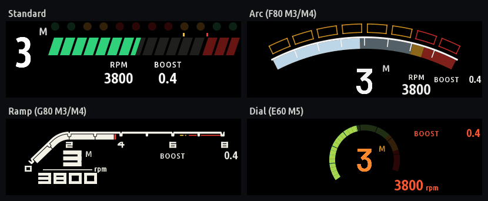</a>
<a href="docs/assets/apps/redline/preview-05.webp">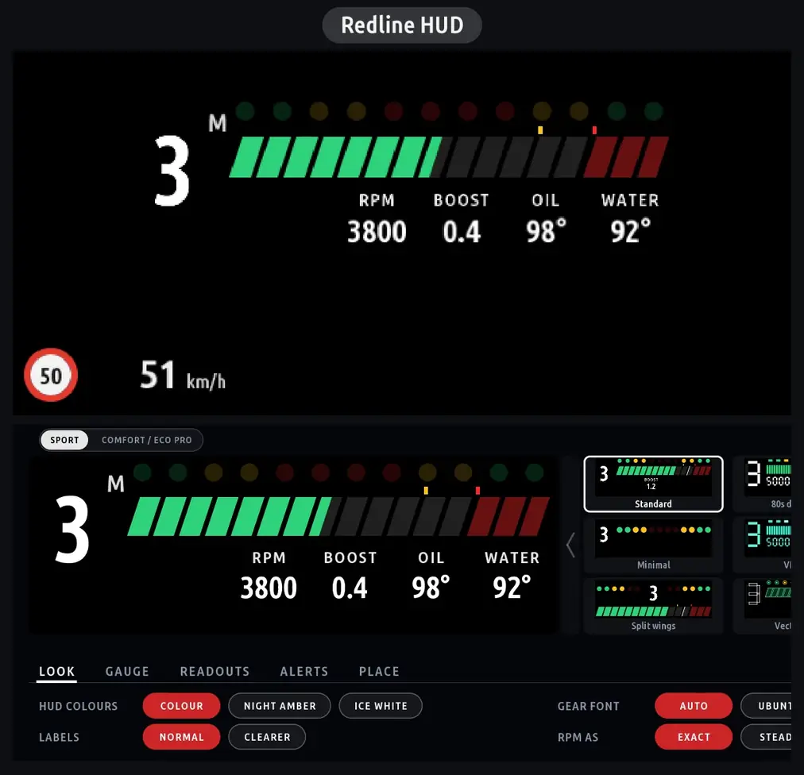</a>
<a href="docs/assets/apps/redline/preview-06.png"></a>
</p>

<a id="component-726f626572746e5f73746f7265"></a>

### Store

`robertn_store@0.9.41` · **source** · app


The apps and head-unit tools of every source with their state, and the sources; installs, updates and removes them through mgu-updater

Declared evidence HMI: ID7, ID8 · Review: `eligible_static`.

Runtime dependencies: [mgu-deploy &gt;=0.8.12 (selected 0.8.27; release)](#component-6d67752d6465706c6f79); [mgu-render &gt;=0.3.1 (selected 0.6.25; release)](#component-6d67752d72656e646572); [mgu-updater &gt;=0.8.28 (selected 0.8.51; release)](#component-6d67752d75706461746572)

[Original README / installation](https://github.com/robertnisipeanu/mgu-store/blob/b42fdba837210899005b52b84f6bd00cd4ac7f8f/README.md) · [Source directory](tools/_sources/collection-mgu-store-b42fdba/apps/robertn_store)

#### Declared screenshots

<p>
<a href="docs/assets/apps/robertn_store/preview-01.png"></a>
<a href="docs/assets/apps/robertn_store/screen_2.png"></a>
<a href="docs/assets/apps/robertn_store/screen_3.png">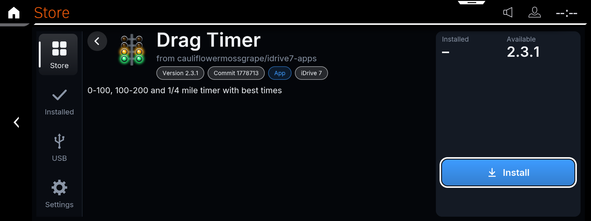</a>
</p>

<a id="component-73657276696365"></a>

### Service

`service@1.6.3` · **source** · app


Service requirements from the instrument cluster: oil, brakes, brake fluid, vehicle check, inspection - distance, date, details; brake fluid and vehicle check reset

Declared evidence HMI: ID7, ID8 · Review: `eligible_static`.

Runtime dependencies: [idrive7-renderd &gt;=2.1.15 (selected 2.1.19; source)](#component-696472697665372d72656e64657264)
Build prerequisites: [mgu-deploy &gt;=0.3.2 (selected 0.8.27; release)](#component-6d67752d6465706c6f79); [mgu-python &gt;=1.0.2 (selected 1.0.3; release)](#component-6d67752d707974686f6e)

[Original README / installation](apps/_sources/idrive7-apps/README.md) · [Source directory](apps/_sources/idrive7-apps/apps/service)

#### Declared screenshots

<p>
<a href="docs/assets/apps/service/preview-01.png"></a>
<a href="docs/assets/apps/service/screen_2.png"></a>
</p>

<a id="component-73706f74696679"></a>

### Spotify

`spotify@1.0.30` · **source** · app


Spotify Connect cockpit player and library browser for BMW iDrive 7

Declared evidence HMI: ID7, ID8 · Review: `eligible_static`.

Runtime dependencies: [mgu-inputgate &gt;=1.0.0 (selected 1.2.2; source)](#component-6d67752d696e70757467617465); [mgu-render &gt;=0.6.24 (selected 0.6.25; release)](#component-6d67752d72656e646572)
Build prerequisites: [mgu-deploy &gt;=0.3.2 (selected 0.8.27; release)](#component-6d67752d6465706c6f79); [mgu-python &gt;=1.0.2 (selected 1.0.3; release)](#component-6d67752d707974686f6e)

[Original README / installation](apps/_ports/hexlay-idrive8/README.md) · [Source directory](apps/_ports/hexlay-idrive8/apps/spotify)

#### Declared screenshots

<p>
<a href="docs/assets/apps/spotify/preview-01.png">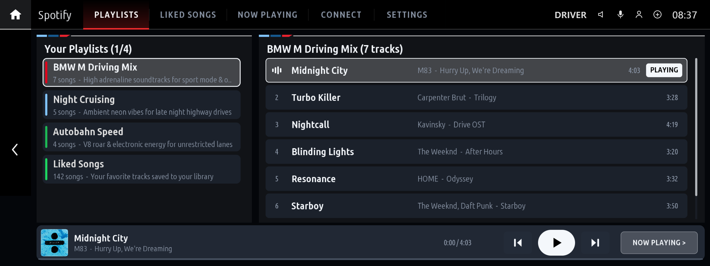</a>
<a href="docs/assets/apps/spotify/preview-02.png"></a>
<a href="docs/assets/apps/spotify/preview-03.png"></a>
<a href="docs/assets/apps/spotify/preview-04.png">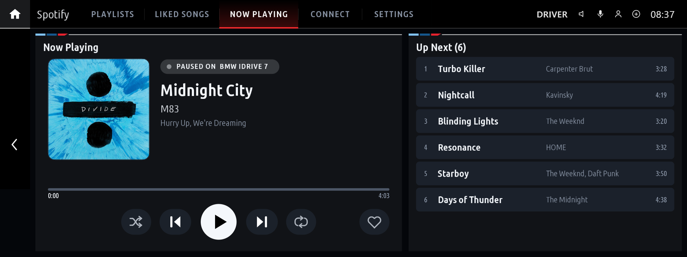</a>
<a href="docs/assets/apps/spotify/preview-05.png">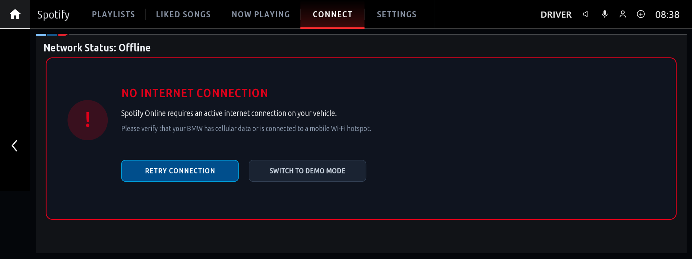</a>
<a href="docs/assets/apps/spotify/preview-06.png">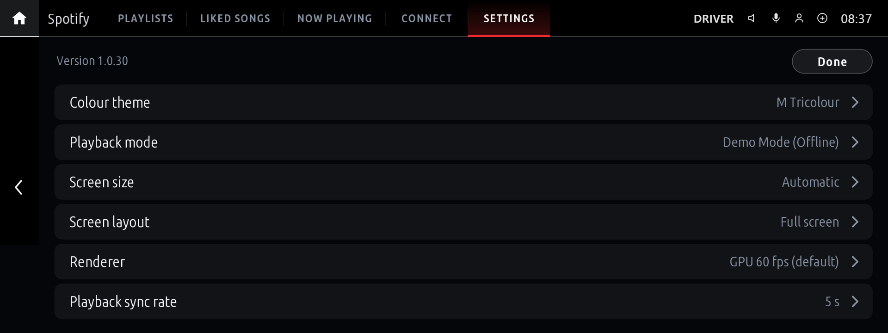</a>
</p>

<a id="component-7379735f6d6f6e69746f72"></a>

### System Monitor

`sys_monitor@1.0.4` · **source** · app


What uses the head unit's memory and processor: free RAM, a live history, and every app and program with the memory it takes. Read only.

Declared evidence HMI: ID7, ID8 · Review: `eligible_static`.

Runtime dependencies: [mgu-inputgate &gt;=1.0.0 (selected 1.2.2; source)](#component-6d67752d696e70757467617465); [mgu-render &gt;=0.6.24 (selected 0.6.25; release)](#component-6d67752d72656e646572)
Build prerequisites: [mgu-deploy &gt;=0.3.2 (selected 0.8.27; release)](#component-6d67752d6465706c6f79); [mgu-python &gt;=1.0.2 (selected 1.0.3; release)](#component-6d67752d707974686f6e)

[Original README / installation](apps/_ports/hexlay-idrive8/README.md) · [Source directory](apps/_ports/hexlay-idrive8/apps/sys_monitor)

#### Declared screenshots

<p>
<a href="docs/assets/apps/sys_monitor/preview-01.png"></a>
<a href="docs/assets/apps/sys_monitor/preview-02.png"></a>
<a href="docs/assets/apps/sys_monitor/preview-03.png"></a>
<a href="docs/assets/apps/sys_monitor/preview-04.png">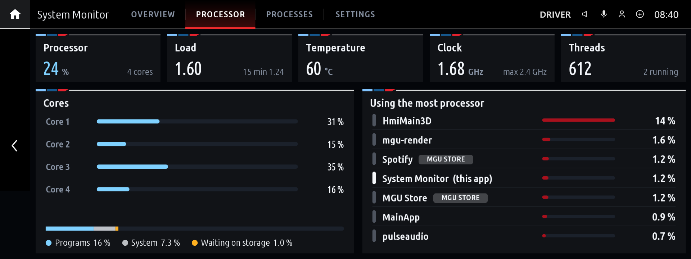</a>
</p>

<a id="component-747275655f74696d655f696438"></a>

### True Time (iDrive 8, untested)

`true_time_id8@1.0.0` · **source** · app


NOT YET TESTED ON AN iDRIVE 8 CAR. Needs the MGU Store's Renderer (mgu-render): the Store installs it first if it is missing. Acceleration and braking times, measured and corrected for the road's slope (the DSC's acceleration sensor). Read-only. Performance runs only on closed courses.

Declared evidence HMI: ID8 · Review: `eligible_static`.

Runtime dependencies: [mgu-render &gt;=0.3.1 (selected 0.6.25; release)](#component-6d67752d72656e646572)
Build prerequisites: [mgu-deploy &gt;=0.3.2 (selected 0.8.27; release)](#component-6d67752d6465706c6f79); [mgu-python &gt;=1.0.2 (selected 1.0.3; release)](#component-6d67752d707974686f6e)

[Original README / installation](apps/_sources/giuseppe-mgu-apps-id8/README.md) · [Source directory](apps/_sources/giuseppe-mgu-apps-id8/true-time/app)

<a id="component-7475726e6b65795f655f626c656e645f696438"></a>

### TurnKey E Blend

`turnkey_e_blend_id8@0.5.0` · **source** · app


Plan a petrol and E85 blend, read the remaining fuel from the car, or estimate tank ethanol.

Declared evidence HMI: ID8 · Review: `eligible_static`.

Runtime dependencies: [mgu-deploy &gt;=0.7.0 (selected 0.8.27; release)](#component-6d67752d6465706c6f79)

[Original README / installation](https://raw.githubusercontent.com/vecyoroleg-lgtm/turnkey-e-blend-id8/918b336fbad09b8b49c0dd2914523c0ef1633d8a/README.md) · [Source directory](apps/_prebuilt/turnkey_e_blend_id8)

<a id="component-76656869636c655f70617373"></a>

### Bimmer Pass

`vehicle_pass@1.1.1` · **source** · app


Personal maintenance log, tyre sizes and own target pressures, vehicle profile, modifications, engine oil and part numbers.

Declared evidence HMI: ID7, ID8 · Review: `eligible_static`.

Runtime dependencies: [mgu-render &gt;=0.6.24 (selected 0.6.25; release)](#component-6d67752d72656e646572)
Build prerequisites: [mgu-deploy &gt;=0.3.2 (selected 0.8.27; release)](#component-6d67752d6465706c6f79); [mgu-python &gt;=1.0.2 (selected 1.0.3; release)](#component-6d67752d707974686f6e)

[Original README / installation](apps/_sources/app-studio-custom/README-DE-EN.txt) · [Source directory](apps/_ports/appstudio-idrive8/apps/vehicle_pass)

<a id="component-7761726d7570"></a>

### Warm-Up

`warmup@1.9.0` · **source** · app


Oil and coolant warm-up calculator (time to ready), safe rev limit, turbo cool-down and a cold start counter

Declared evidence HMI: ID7, ID8 · Review: `eligible_static`.

Runtime dependencies: [idrive7-renderd &gt;=2.1.15 (selected 2.1.19; source)](#component-696472697665372d72656e64657264)
Build prerequisites: [mgu-deploy &gt;=0.3.2 (selected 0.8.27; release)](#component-6d67752d6465706c6f79); [mgu-python &gt;=1.0.2 (selected 1.0.3; release)](#component-6d67752d707974686f6e)

[Original README / installation](apps/_sources/idrive7-apps/README.md) · [Source directory](apps/_sources/idrive7-apps/apps/warmup)

#### Declared screenshots

<p>
<a href="docs/assets/apps/warmup/preview-01.png"></a>
<a href="docs/assets/apps/warmup/preview-02.gif"></a>
<a href="docs/assets/apps/warmup/preview-03.png"></a>
</p>

<a id="component-7a66386870"></a>

### Transmission Config

`zf8hp@1.5.8` · **source** · app


Transmission Config, experimental ZF 8HP monitor: live data, clutch fill adaptations, shift maps and temperature history

Declared evidence HMI: ID7, ID8 · Review: `eligible_static`.

Runtime dependencies: [idrive7-renderd &gt;=2.1.18 (selected 2.1.19; source)](#component-696472697665372d72656e64657264); [mgu-inputgate &gt;=1.1.0 (selected 1.2.2; source)](#component-6d67752d696e70757467617465)
Build prerequisites: [mgu-deploy &gt;=0.3.2 (selected 0.8.27; release)](#component-6d67752d6465706c6f79); [mgu-python &gt;=1.0.2 (selected 1.0.3; release)](#component-6d67752d707974686f6e)

[Original README / installation](apps/_sources/idrive7-apps/README.md) · [Source directory](apps/_sources/idrive7-apps/apps/zf8hp)

#### Declared screenshots

<p>
<a href="docs/assets/apps/zf8hp/preview-01.png"></a>
<a href="docs/assets/apps/zf8hp/preview-02.png"></a>
<a href="docs/assets/apps/zf8hp/preview-03.png">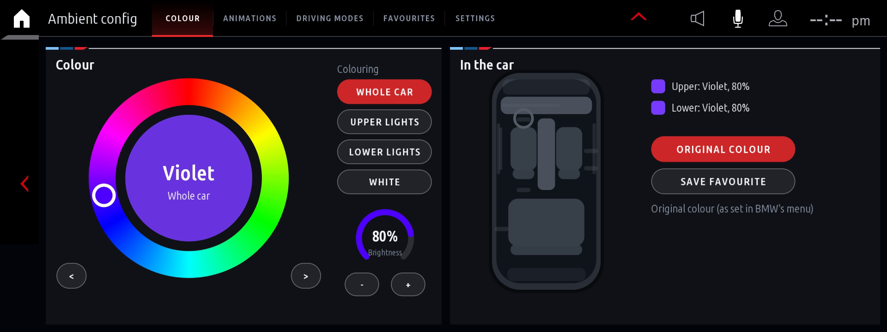</a>
</p>

## Helper tools

17 selected tool entries.

<a id="component-6170702d70726976616379"></a>

### App privacy

`app-privacy@1.7.2` · **release** · tool

Keeps our apps out of the head unit's backend app reporting and restarts them after a crash

Declared evidence HMI: ID7, ID8 · Review: `eligible_static`.

Runtime dependencies: [mgu-deploy &gt;=0.6.3 (selected 0.8.27; release)](#component-6d67752d6465706c6f79)
Retained as an explicitly selected helper.

Publisher artifact: 19,586 bytes; SHA-256 `eea01214be305cec03a9cb8abeefa2ab543693376ab16a8d9639eb55e5191c5b`.

[Original README / installation](https://github.com/robertnisipeanu/mgu-store/blob/3ecfafd4b6b2492c1776f53e3b74add5653c5c61/README.md) · [Original publisher artifact](https://github.com/robertnisipeanu/mgu-store/releases/download/app-privacy%401.7.2/app-privacy%401.7.2.tgz)

<a id="component-636c75737465722d72656e646572"></a>

### Cluster renderer

`cluster-render@0.6.9` · **source** · tool

Draws every app's layers on the instrument cluster and the HUD, sharing the display slots and one upload budget

Declared evidence HMI: ID7, ID8 · Review: `eligible_static`.

Runtime dependencies: [mgu-deploy &gt;=0.4.0 (selected 0.8.27; release)](#component-6d67752d6465706c6f79)
Required or retained by: [adam&&#35;95;shiftlights](#component-6164616d5f73686966746c6967687473); [esagono-cluster](#component-657361676f6e6f2d636c7573746572); [ida-vitals-cluster](#component-6964612d766974616c732d636c7573746572); [iteriodev-turnview](#component-69746572696f6465762d7475726e76696577)

[Original README / installation](https://github.com/robertnisipeanu/idrive-apps/blob/8de5d4999929be14732882afd81beb7382edb82f/README.md) · [Source directory](tools/_released/cluster-render)

<a id="component-657361676f6e6f2d636c7573746572"></a>

### Esagono Cluster

`esagono-cluster@0.2.1` · **source** · tool

Supercar-style hexagon rev ring for the middle of the iDrive 8 cluster: 72-segment rev ring, redline and shift flash, big digital rpm readout, Comfort / Sport / Track colours. Pick 'Esagono' in the cluster's widget menu; change its settings in the Esagono Settings app. Live rpm needs an hmictl helper (IterioDev Overlays); EXPERIMENTAL, untested on a car.

Declared evidence HMI: ID8 · Review: `eligible_static`.

Runtime dependencies: [cluster-render &gt;=0.6.9 (selected 0.6.9; source)](#component-636c75737465722d72656e646572); [iteriodev-overlays &gt;=0.5.0 (selected 0.5.0; external)](#component-69746572696f6465762d6f7665726c617973); [mgu-deploy &gt;=0.7.0 (selected 0.8.27; release)](#component-6d67752d6465706c6f79)
Required or retained by: [esagono&&#35;95;settings](#component-657361676f6e6f5f73657474696e6773)

[Original README / installation](apps/_sources/grabandrey-esagono-cluster/README.md) · [Source directory](tools/_packages/esagono-cluster)

<a id="component-6964612d766974616c732d636c7573746572"></a>

### Vitals Cluster

`ida-vitals-cluster@1.3.3` · **source** · tool

iDrive 8-style widget for the middle of the cluster: water, engine oil and gearbox oil temperature bars, and each tyre's temperature and pressure. Pick 'Vitals' in the cluster's widget menu; the Vitals app feeds it the car's data and holds its settings. EXPERIMENTAL, untested on a car.

Declared evidence HMI: ID8 · Review: `eligible_static`.

Runtime dependencies: [cluster-render &gt;=0.6.9 (selected 0.6.9; source)](#component-636c75737465722d72656e646572); [mgu-deploy &gt;=0.7.0 (selected 0.8.27; release)](#component-6d67752d6465706c6f79)
Required or retained by: [ida&&#35;95;vitals](#component-6964615f766974616c73)

[Original README / installation](apps/_sources/grabandrey-idrive-apps/README.md) · [Source directory](tools/_packages/ida-vitals-cluster)

<a id="component-696472697665372d72656e64657264"></a>

### GPU renderer

`idrive7-renderd@2.1.19` · **source** · tool

The apps' own GPU renderer (mgu-render): draws them at 60 fps, beside the MGU Store's Renderer; installed with the apps (iDrive 7 and iDrive 8)

Declared evidence HMI: ID7, ID8 · Review: `eligible_static`.

Runtime dependencies: [mgu-deploy &gt;=0.6.1 (selected 0.8.27; release)](#component-6d67752d6465706c6f79)
Build prerequisites: [mgu-deploy &gt;=0.4.0 (selected 0.8.27; release)](#component-6d67752d6465706c6f79)
Required or retained by: [ambient&&#35;95;config](#component-616d6269656e745f636f6e666967); [andrei&&#35;95;mdrive](#component-616e647265695f6d6472697665); [brake&&#35;95;test](#component-6272616b655f74657374); [car&&#35;95;vitals](#component-6361725f766974616c73); [doom](#component-646f6f6d); [draggy](#component-647261676779); [dtc&&#35;95;scanner](#component-6474635f7363616e6e6572); [dyno](#component-64796e6f); [edrive](#component-656472697665); [gforce](#component-67666f726365); [km&&#35;95;motordaten](#component-6b6d5f6d6f746f72646174656e); [live&&#35;95;adjustments](#component-6c6976655f61646a7573746d656e7473); [live&&#35;95;data](#component-6c6976655f64617461); [pps&&#35;95;gauges](#component-7070735f676175676573); [pps&&#35;95;warmup](#component-7070735f7761726d7570); [redline](#component-7265646c696e65); [service](#component-73657276696365); [warmup](#component-7761726d7570); [zf8hp](#component-7a66386870)

[Original README / installation](apps/_sources/idrive7-apps/kit/renderd/README.md) · [Source directory](apps/_sources/idrive7-apps/kit/renderd/prebuilt)

<a id="component-69746572696f6465762d636f6d666f7274"></a>

### iteriodev-comfort

`iteriodev-comfort@0.6.3` · **external** · tool

Unchanged original companion tool, fetched by the configured IterioDev Store source.

Declared evidence HMI: ID7, ID8 · Review: `eligible_static`.

Runtime dependencies: [mgu-deploy &gt;=0.7.11 (selected 0.8.27; release)](#component-6d67752d6465706c6f79)
Required or retained by: [iteriodev&&#35;95;ambient](#component-69746572696f6465765f616d6269656e74); [iteriodev&&#35;95;seats](#component-69746572696f6465765f7365617473)

Original source: IterioDev/car-apps · branch:main · `f9ca32bd3cebd163fa16fbe17cc3473623be2c81`.

[Original README / installation](https://raw.githubusercontent.com/IterioDev/car-apps/f9ca32bd3cebd163fa16fbe17cc3473623be2c81/README.md) · [Original repository](https://github.com/IterioDev/car-apps/tree/f9ca32bd3cebd163fa16fbe17cc3473623be2c81)

<a id="component-69746572696f6465762d6472706c6179"></a>

### iteriodev-drplay

`iteriodev-drplay@1.2.6` · **external** · tool

Unchanged original companion tool, fetched by the configured IterioDev Store source.

Declared evidence HMI: ID7, ID8 · Review: `eligible_static`.

Runtime dependencies: None declared.
Required or retained by: [oap-driverecorder-next](#component-6f61702d64726976657265636f726465722d6e657874)

Original source: IterioDev/car-apps · branch:main · `f9ca32bd3cebd163fa16fbe17cc3473623be2c81`.

[Original README / installation](https://raw.githubusercontent.com/IterioDev/car-apps/f9ca32bd3cebd163fa16fbe17cc3473623be2c81/README.md) · [Original repository](https://github.com/IterioDev/car-apps/tree/f9ca32bd3cebd163fa16fbe17cc3473623be2c81)

<a id="component-69746572696f6465762d6f7665726c617973"></a>

### iteriodev-overlays

`iteriodev-overlays@0.5.0` · **external** · tool

Unchanged original companion tool, fetched by the configured IterioDev Store source.

Declared evidence HMI: ID8 · Review: `eligible_static`.

Runtime dependencies: [mgu-deploy &gt;=0.7.11 (selected 0.8.27; release)](#component-6d67752d6465706c6f79); [mgu-render &gt;=0.6.10 (selected 0.6.25; release)](#component-6d67752d72656e646572)
Required or retained by: [esagono-cluster](#component-657361676f6e6f2d636c7573746572); [iteriodev&&#35;95;overlays](#component-69746572696f6465765f6f7665726c617973)

Original source: IterioDev/car-apps · branch:main · `f9ca32bd3cebd163fa16fbe17cc3473623be2c81`.

[Original README / installation](https://raw.githubusercontent.com/IterioDev/car-apps/f9ca32bd3cebd163fa16fbe17cc3473623be2c81/README.md) · [Original repository](https://github.com/IterioDev/car-apps/tree/f9ca32bd3cebd163fa16fbe17cc3473623be2c81)

<a id="component-69746572696f6465762d73637265656e63617374"></a>

### iteriodev-screencast

`iteriodev-screencast@1.0.9` · **external** · tool

Unchanged original companion tool, fetched by the configured IterioDev Store source.

Declared evidence HMI: ID7, ID8 · Review: `eligible_static`.

Runtime dependencies: [iteriodev-tailscale &gt;=1.104.4 (selected 1.104.6; external)](#component-69746572696f6465762d7461696c7363616c65)
Retained as an explicitly selected helper.

Original source: IterioDev/car-apps · branch:main · `f9ca32bd3cebd163fa16fbe17cc3473623be2c81`.

[Original README / installation](https://raw.githubusercontent.com/IterioDev/car-apps/f9ca32bd3cebd163fa16fbe17cc3473623be2c81/README.md) · [Original repository](https://github.com/IterioDev/car-apps/tree/f9ca32bd3cebd163fa16fbe17cc3473623be2c81)

<a id="component-69746572696f6465762d7461696c7363616c65"></a>

### iteriodev-tailscale

`iteriodev-tailscale@1.104.6` · **external** · tool

Unchanged original companion tool, fetched by the configured IterioDev Store source.

Declared evidence HMI: ID7, ID8 · Review: `eligible_static`.

Runtime dependencies: [mgu-uplink &gt;=0.4.0 (selected 0.7.13; release)](#component-6d67752d75706c696e6b)
Required or retained by: [iteriodev-screencast](#component-69746572696f6465762d73637265656e63617374); [iteriodev&&#35;95;tailscale](#component-69746572696f6465765f7461696c7363616c65)

Original source: IterioDev/car-apps · branch:main · `f9ca32bd3cebd163fa16fbe17cc3473623be2c81`.

[Original README / installation](https://raw.githubusercontent.com/IterioDev/car-apps/f9ca32bd3cebd163fa16fbe17cc3473623be2c81/README.md) · [Original repository](https://github.com/IterioDev/car-apps/tree/f9ca32bd3cebd163fa16fbe17cc3473623be2c81)

<a id="component-69746572696f6465762d7475726e76696577"></a>

### iteriodev-turnview

`iteriodev-turnview@0.9.1` · **external** · tool

Unchanged original companion tool, fetched by the configured IterioDev Store source.

Declared evidence HMI: ID7, ID8 · Review: `eligible_static`.

Runtime dependencies: [cluster-render &gt;=0.5.10 (selected 0.6.9; source)](#component-636c75737465722d72656e646572); [mgu-deploy &gt;=0.7.11 (selected 0.8.27; release)](#component-6d67752d6465706c6f79)
Required or retained by: [iteriodev&&#35;95;turnview](#component-69746572696f6465765f7475726e76696577)

Original source: IterioDev/car-apps · branch:main · `f9ca32bd3cebd163fa16fbe17cc3473623be2c81`.

[Original README / installation](https://raw.githubusercontent.com/IterioDev/car-apps/f9ca32bd3cebd163fa16fbe17cc3473623be2c81/README.md) · [Original repository](https://github.com/IterioDev/car-apps/tree/f9ca32bd3cebd163fa16fbe17cc3473623be2c81)

<a id="component-6d67752d6465706c6f79"></a>

### Deploy tool

`mgu-deploy@0.8.27` · **release** · tool

Installs, updates, rolls back and removes our tools and apps on the head unit, with a snapshot before every change

Declared evidence HMI: ID7, ID8 · Review: `eligible_static`.

Runtime dependencies: None declared.
Required or retained by: [ab&&#35;95;storage](#component-61625f73746f72616765); [adam&&#35;95;shiftlights](#component-6164616d5f73686966746c6967687473); [adam&&#35;95;vitals](#component-6164616d5f766974616c73); [ambient&&#35;95;config](#component-616d6269656e745f636f6e666967); [andrei&&#35;95;mdrive](#component-616e647265695f6d6472697665); [app-privacy](#component-6170702d70726976616379); [aref&&#35;95;carcare](#component-617265665f63617263617265); [aref&&#35;95;carlyrics](#component-617265665f6361726c7972696373); [aref&&#35;95;explorer](#component-617265665f6578706c6f726572); [bcs&&#35;95;store](#component-6263735f73746f7265); [bimmer&&#35;95;blocks](#component-62696d6d65725f626c6f636b73); [bm3&&#35;95;live&&#35;95;id8](#component-626d335f6c6976655f696438); [boostline&&#35;95;id8](#component-626f6f73746c696e655f696438); [brake&&#35;95;test](#component-6272616b655f74657374); [c365&&#35;95;drive](#component-633336355f6472697665); [car&&#35;95;vitals](#component-6361725f766974616c73); [cluster-render](#component-636c75737465722d72656e646572); [dimon&&#35;95;track&&#35;95;mode](#component-64696d6f6e5f747261636b5f6d6f6465); [doom](#component-646f6f6d); [dpf&&#35;95;id8](#component-6470665f696438); [draggy](#component-647261676779); [dtc&&#35;95;scanner](#component-6474635f7363616e6e6572); [dyno](#component-64796e6f); [e85](#component-653835); [edrive](#component-656472697665); [esagono-cluster](#component-657361676f6e6f2d636c7573746572); [gforce](#component-67666f726365); [ida-vitals-cluster](#component-6964612d766974616c732d636c7573746572); [idrive7-renderd](#component-696472697665372d72656e64657264); [iteriodev-comfort](#component-69746572696f6465762d636f6d666f7274); [iteriodev-overlays](#component-69746572696f6465762d6f7665726c617973); [iteriodev-turnview](#component-69746572696f6465762d7475726e76696577); [iteriodev&&#35;95;ambient](#component-69746572696f6465765f616d6269656e74); [iteriodev&&#35;95;cardash](#component-69746572696f6465765f63617264617368); [iteriodev&&#35;95;draggy](#component-69746572696f6465765f647261676779); [iteriodev&&#35;95;dtcscan](#component-69746572696f6465765f6474637363616e); [iteriodev&&#35;95;edrive](#component-69746572696f6465765f656472697665); [iteriodev&&#35;95;liveadjust](#component-69746572696f6465765f6c69766561646a757374); [iteriodev&&#35;95;overlays](#component-69746572696f6465765f6f7665726c617973); [iteriodev&&#35;95;seats](#component-69746572696f6465765f7365617473); [iteriodev&&#35;95;service](#component-69746572696f6465765f73657276696365); [iteriodev&&#35;95;tailscale](#component-69746572696f6465765f7461696c7363616c65); [iteriodev&&#35;95;turnview](#component-69746572696f6465765f7475726e76696577); [km&&#35;95;motordaten](#component-6b6d5f6d6f746f72646174656e); [live&&#35;95;adjustments](#component-6c6976655f61646a7573746d656e7473); [live&&#35;95;data](#component-6c6976655f64617461); [m&&#35;95;copilot](#component-6d5f636f70696c6f74); [mgu-inputgate](#component-6d67752d696e70757467617465); [mgu-render](#component-6d67752d72656e646572); [mgu-updater](#component-6d67752d75706461746572); [oap-driverecorder-next](#component-6f61702d64726976657265636f726465722d6e657874); [parked&&#35;95;games](#component-7061726b65645f67616d6573); [pps&&#35;95;gauges](#component-7070735f676175676573); [pps&&#35;95;warmup](#component-7070735f7761726d7570); [redline](#component-7265646c696e65); [robertn&&#35;95;store](#component-726f626572746e5f73746f7265); [service](#component-73657276696365); [spotify](#component-73706f74696679); [sys&&#35;95;monitor](#component-7379735f6d6f6e69746f72); [true&&#35;95;time&&#35;95;id8](#component-747275655f74696d655f696438); [turnkey&&#35;95;e&&#35;95;blend&&#35;95;id8](#component-7475726e6b65795f655f626c656e645f696438); [vehicle&&#35;95;pass](#component-76656869636c655f70617373); [warmup](#component-7761726d7570); [zf8hp](#component-7a66386870)

Publisher artifact: 168,362 bytes; SHA-256 `57797407580d4f0c4be234e226d4f51972002adeb1ad718e3cf2ffcd00ea36b6`.

[Original README / installation](https://github.com/robertnisipeanu/mgu-store/blob/ef2b8a0463ed1e0c3b97c0461dbf033cf45a8412/README.md) · [Original publisher artifact](https://github.com/robertnisipeanu/mgu-store/releases/download/mgu-deploy%400.8.27/mgu-deploy%400.8.27.tgz)

<a id="component-6d67752d696e70757467617465"></a>

### Controller gate

`mgu-inputgate@1.2.2` · **source** · tool

Lets the apps have the iDrive controller (tabs, page buttons, settings, Doom); loads into the HMI at the next start (iDrive 7 and iDrive 8)

Declared evidence HMI: ID7, ID8 · Review: `eligible_static`.

Runtime dependencies: [mgu-deploy &gt;=0.3.2 (selected 0.8.27; release)](#component-6d67752d6465706c6f79)
Build prerequisites: [mgu-deploy &gt;=0.3.2 (selected 0.8.27; release)](#component-6d67752d6465706c6f79)
Required or retained by: [adam&&#35;95;shiftlights](#component-6164616d5f73686966746c6967687473); [ambient&&#35;95;config](#component-616d6269656e745f636f6e666967); [andrei&&#35;95;mdrive](#component-616e647265695f6d6472697665); [brake&&#35;95;test](#component-6272616b655f74657374); [car&&#35;95;vitals](#component-6361725f766974616c73); [doom](#component-646f6f6d); [draggy](#component-647261676779); [dtc&&#35;95;scanner](#component-6474635f7363616e6e6572); [live&&#35;95;adjustments](#component-6c6976655f61646a7573746d656e7473); [live&&#35;95;data](#component-6c6976655f64617461); [m&&#35;95;copilot](#component-6d5f636f70696c6f74); [pps&&#35;95;gauges](#component-7070735f676175676573); [spotify](#component-73706f74696679); [sys&&#35;95;monitor](#component-7379735f6d6f6e69746f72); [zf8hp](#component-7a66386870)

[Original README / installation](tools/_sources/cauli-inputgate-1.2.1/kit/renderd/inputgate/tool/README.md) · [Source directory](tools/_packages/mgu-inputgate)

<a id="component-6d67752d707974686f6e"></a>

### Python

`mgu-python@1.0.3` · **release** · tool

Python 3.12 for apps that build on the head unit with Python

Declared evidence HMI: ID7, ID8 · Review: `eligible_static`.

Runtime dependencies: None declared.
Required or retained by: [ab&&#35;95;storage](#component-61625f73746f72616765); [adam&&#35;95;shiftlights](#component-6164616d5f73686966746c6967687473); [adam&&#35;95;vitals](#component-6164616d5f766974616c73); [ambient&&#35;95;config](#component-616d6269656e745f636f6e666967); [andrei&&#35;95;mdrive](#component-616e647265695f6d6472697665); [aref&&#35;95;carcare](#component-617265665f63617263617265); [aref&&#35;95;carlyrics](#component-617265665f6361726c7972696373); [aref&&#35;95;explorer](#component-617265665f6578706c6f726572); [bimmer&&#35;95;blocks](#component-62696d6d65725f626c6f636b73); [boostline&&#35;95;id8](#component-626f6f73746c696e655f696438); [brake&&#35;95;test](#component-6272616b655f74657374); [c365&&#35;95;drive](#component-633336355f6472697665); [car&&#35;95;vitals](#component-6361725f766974616c73); [dimon&&#35;95;track&&#35;95;mode](#component-64696d6f6e5f747261636b5f6d6f6465); [doom](#component-646f6f6d); [dpf&&#35;95;id8](#component-6470665f696438); [draggy](#component-647261676779); [dtc&&#35;95;scanner](#component-6474635f7363616e6e6572); [dyno](#component-64796e6f); [e85](#component-653835); [edrive](#component-656472697665); [gforce](#component-67666f726365); [km&&#35;95;motordaten](#component-6b6d5f6d6f746f72646174656e); [live&&#35;95;adjustments](#component-6c6976655f61646a7573746d656e7473); [live&&#35;95;data](#component-6c6976655f64617461); [m&&#35;95;copilot](#component-6d5f636f70696c6f74); [mgu-updater](#component-6d67752d75706461746572); [parked&&#35;95;games](#component-7061726b65645f67616d6573); [pps&&#35;95;gauges](#component-7070735f676175676573); [pps&&#35;95;warmup](#component-7070735f7761726d7570); [redline](#component-7265646c696e65); [service](#component-73657276696365); [spotify](#component-73706f74696679); [sys&&#35;95;monitor](#component-7379735f6d6f6e69746f72); [true&&#35;95;time&&#35;95;id8](#component-747275655f74696d655f696438); [vehicle&&#35;95;pass](#component-76656869636c655f70617373); [warmup](#component-7761726d7570); [zf8hp](#component-7a66386870)

Publisher artifact: 14,441,404 bytes; SHA-256 `98ce27bcee265ba6846446ad7867193fbdc9e0447195dbf22bcfaabf7e2f2533`.

[Original README / installation](https://github.com/robertnisipeanu/mgu-store/blob/3ecfafd4b6b2492c1776f53e3b74add5653c5c61/README.md) · [Original publisher artifact](https://github.com/robertnisipeanu/mgu-store/releases/download/mgu-python%401.0.3/mgu-python%401.0.3.tgz)

<a id="component-6d67752d72656e646572"></a>

### Renderer

`mgu-render@0.6.25` · **release** · tool

Draws apps' screens on the GPU, over the HMI or inside the app's page

Declared evidence HMI: ID7, ID8 · Review: `eligible_static`.

Runtime dependencies: [mgu-deploy &gt;=0.6.9 (selected 0.8.27; release)](#component-6d67752d6465706c6f79)
Required or retained by: [ab&&#35;95;storage](#component-61625f73746f72616765); [adam&&#35;95;shiftlights](#component-6164616d5f73686966746c6967687473); [adam&&#35;95;vitals](#component-6164616d5f766974616c73); [aref&&#35;95;carcare](#component-617265665f63617263617265); [aref&&#35;95;carlyrics](#component-617265665f6361726c7972696373); [aref&&#35;95;explorer](#component-617265665f6578706c6f726572); [bcs&&#35;95;store](#component-6263735f73746f7265); [bimmer&&#35;95;blocks](#component-62696d6d65725f626c6f636b73); [bm3&&#35;95;live&&#35;95;id8](#component-626d335f6c6976655f696438); [boostline&&#35;95;id8](#component-626f6f73746c696e655f696438); [c365&&#35;95;drive](#component-633336355f6472697665); [dimon&&#35;95;track&&#35;95;mode](#component-64696d6f6e5f747261636b5f6d6f6465); [dpf&&#35;95;id8](#component-6470665f696438); [e85](#component-653835); [ida&&#35;95;seatlights](#component-6964615f736561746c6967687473); [ida&&#35;95;vitals](#component-6964615f766974616c73); [iteriodev-overlays](#component-69746572696f6465762d6f7665726c617973); [m&&#35;95;copilot](#component-6d5f636f70696c6f74); [mazzahaker&&#35;95;xdrive&&#35;95;remover](#component-6d617a7a6168616b65725f7864726976655f72656d6f766572); [parked&&#35;95;games](#component-7061726b65645f67616d6573); [robertn&&#35;95;store](#component-726f626572746e5f73746f7265); [spotify](#component-73706f74696679); [sys&&#35;95;monitor](#component-7379735f6d6f6e69746f72); [true&&#35;95;time&&#35;95;id8](#component-747275655f74696d655f696438); [vehicle&&#35;95;pass](#component-76656869636c655f70617373)

Publisher artifact: 103,355 bytes; SHA-256 `73b5444307aaf7a3a1b519cb14032869f18930749284aef557a2e0bd58d3fd61`.

[Original README / installation](https://raw.githubusercontent.com/robertnisipeanu/mgu-store/3ecfafd4b6b2492c1776f53e3b74add5653c5c61/README.md) · [Original publisher artifact](https://github.com/robertnisipeanu/mgu-store/releases/download/mgu-render%400.6.25/mgu-render%400.6.25.tgz)

<a id="component-6d67752d75706461746572"></a>

### Updater

`mgu-updater@0.8.51` · **release** · tool

Installs, updates and removes apps and head-unit tools from its sources

Declared evidence HMI: ID7, ID8 · Review: `eligible_static`.

Runtime dependencies: [mgu-deploy &gt;=0.8.4 (selected 0.8.27; release)](#component-6d67752d6465706c6f79); [mgu-python &gt;=1.0.2 (selected 1.0.3; release)](#component-6d67752d707974686f6e)
Required or retained by: [bcs&&#35;95;store](#component-6263735f73746f7265); [mgu-uplink](#component-6d67752d75706c696e6b); [robertn&&#35;95;store](#component-726f626572746e5f73746f7265)

Publisher artifact: 143,205 bytes; SHA-256 `e38745a14fad5d34648c101e0d7eadd9a60d53fa1f4cda38462e3f77e08eeb95`.

[Original README / installation](https://github.com/robertnisipeanu/mgu-store/blob/ef2b8a0463ed1e0c3b97c0461dbf033cf45a8412/README.md) · [Original publisher artifact](https://github.com/robertnisipeanu/mgu-store/releases/download/mgu-updater%400.8.51/mgu-updater%400.8.51.tgz)

<a id="component-6d67752d75706c696e6b"></a>

### Internet uplink

`mgu-uplink@0.7.13` · **release** · tool

Internet for selected apps through a USB network adapter, an LTE stick, a USB-tethered phone or Wi-Fi

Declared evidence HMI: ID7, ID8 · Review: `eligible_static`.

Runtime dependencies: [mgu-updater &gt;=0.7.2 (selected 0.8.51; release)](#component-6d67752d75706461746572)
Required or retained by: [iteriodev-tailscale](#component-69746572696f6465762d7461696c7363616c65)

Publisher artifact: 3,605,106 bytes; SHA-256 `077e3200356df726a1e653fd67db9f9a1237e22b548f946b726c6eadd0f48d28`.

[Original README / installation](https://github.com/robertnisipeanu/mgu-store/blob/ef2b8a0463ed1e0c3b97c0461dbf033cf45a8412/README.md) · [Original publisher artifact](https://github.com/robertnisipeanu/mgu-store/releases/download/mgu-uplink%400.7.13/mgu-uplink%400.7.13.tgz)
