# games distribution

Canonical source commit: `714b2edb37f1bac811444ead348509b2b2836745`
Target HMI: mixed / preservation; see each record
Eligibility policy: preservation

The file export copies selected committed files and validates their static
identities, dependencies, and file checksums. It does not build packages,
execute target code, download artifacts, or install software.

Runtime / physical installation: **NOT OBSERVED**. HMI labels and screenshots
describe the reviewed source metadata; they are not proof of an installed result.

[Applications](#applications) · [Helper tools](#helper-tools) · [Sources and installation](#sources-and-installation)

## Sources and installation

| Channel | Applications | Helper tools | Delivery |
|---|---:|---:|---|
| source | 9 | 6 | [Source recipes](mgu-repo.json); selected source files are included. |
| release | 14 | 11 | [Publisher artifact references](release/catalog.json); artifact payloads are not downloaded by this export. |
| external | 0 | 0 | [Pinned original sources](.distribution/external-dependencies.json); retain their configured origin and channel. |

### Add this distribution to MGU Store

Configure **both AQ entries** below: the GitHub branch supplies source recipes,
and the HTTPS catalog supplies the selected released apps and helpers.
Keep the companion-source entries so their original external tools remain available.

[Exact Store source configuration](data/store-sources.json)

```json
{
  "schema": 1,
  "sources": [
    {
      "channel": "branch:games",
      "id": "aq-mgu-apps",
      "repo": "tiraUnderCode23/AQ_MGU",
      "type": "github"
    },
    {
      "id": "aq-mgu-catalog",
      "type": "https",
      "url": "https://raw.githubusercontent.com/tiraUnderCode23/AQ_MGU/games/release/catalog.json"
    },
    {
      "channel": "branch:main",
      "id": "aq-mgu-iteriodev",
      "repo": "IterioDev/car-apps",
      "type": "github"
    }
  ]
}
```

Use each entry's original README for its installation procedure and prerequisites.
[Preserved original repository README](.distribution/original/README.md)

Target-derived SDK inputs remain external build requirements;
they were not read, extracted, or included here.

## Applications

23 selected app entries.

<a id="component-617572656c6d5f617065785f6368617365"></a>

### Apex Chase

`aurelm_apex_chase@1.0.0` · **release** · app


A maze chase in a city at night, drawn by the GPU renderer at 60 fps: the M car collects the fuel drops while four electric cars hunt it; a NITRO can drains their batteries. iDrive controller or swipes. Parked only.

Declared evidence HMI: ID7 · Review: `incompatible`.

Runtime dependencies: None declared.

Publisher artifact: 570,128 bytes; SHA-256 `21c78f14db74f9e08210862fa16d100e9af010244933c769bb9083764267c02b`.

[Original README / installation](https://raw.githubusercontent.com/aurelmarius/bmw-games/9c7125cc83ad65dca839a5f9f01c56247679da8d/README.md) · [Original publisher artifact](https://raw.githubusercontent.com/aurelmarius/bmw-games/9c7125cc83ad65dca839a5f9f01c56247679da8d/packages/aurelm_apex_chase%401.0.0.tgz)

#### Declared screenshots

<p>
<a href="docs/assets/apps/aurelm_apex_chase/screen_1.png"></a>
<a href="docs/assets/apps/aurelm_apex_chase/screen_2.png"></a>
</p>

<a id="component-617572656c6d5f626c61636b6a61636b"></a>

### Blackjack

`aurelm_blackjack@1.0.1` · **release** · app


Casino blackjack for play credits, drawn by the GPU renderer at 60 fps: a felt table with a leather rail, cards dealt from the shoe, chips, six decks, 3 to 2, double, split, insurance, a strategy hint, statistics. iDrive controller or touch. Parked only.

Declared evidence HMI: ID7 · Review: `incompatible`.

Runtime dependencies: None declared.

Publisher artifact: 573,880 bytes; SHA-256 `128e7261e22a43d3d441c998a694a3891cc171cec16d20aa1740bcfd5b6c6fd5`.

[Original README / installation](https://raw.githubusercontent.com/aurelmarius/bmw-games/9c7125cc83ad65dca839a5f9f01c56247679da8d/README.md) · [Original publisher artifact](https://raw.githubusercontent.com/aurelmarius/bmw-games/9c7125cc83ad65dca839a5f9f01c56247679da8d/packages/aurelm_blackjack%401.0.1.tgz)

#### Declared screenshots

<p>
<a href="docs/assets/apps/aurelm_blackjack/screen_1.png"></a>
<a href="docs/assets/apps/aurelm_blackjack/screen_2.png"></a>
</p>

<a id="component-617572656c6d5f6c61705f7265636f7264"></a>

### Lap Record

`aurelm_lap_record@1.0.0` · **release** · app


Time trial on a circuit seen from above, the camera on the car: the knob is the steering wheel, lap after lap against your best and its ghost, the gap live, sectors in purple, green and yellow. Two circuits, kerbs, gravel, tyre walls, grandstands, tyre smoke and marks. GPU renderer. Parked only.

Declared evidence HMI: ID7 · Review: `incompatible`.

Runtime dependencies: None declared.

Publisher artifact: 574,607 bytes; SHA-256 `f3923efc0a55b9b08a1feb34ff8583de2a320d64a6472e26ce6e37539bef0b31`.

[Original README / installation](https://raw.githubusercontent.com/aurelmarius/bmw-games/9c7125cc83ad65dca839a5f9f01c56247679da8d/README.md) · [Original publisher artifact](https://raw.githubusercontent.com/aurelmarius/bmw-games/9c7125cc83ad65dca839a5f9f01c56247679da8d/packages/aurelm_lap_record%401.0.0.tgz)

#### Declared screenshots

<p>
<a href="docs/assets/apps/aurelm_lap_record/screen_1.png"></a>
<a href="docs/assets/apps/aurelm_lap_record/screen_2.png"></a>
</p>

<a id="component-617572656c6d5f6c75636b795f736576656e73"></a>

### Lucky Sevens

`aurelm_lucky_sevens@1.1.0` · **release** · app


A five reel slot machine for play credits, drawn by the GPU renderer at 60 fps: glossy symbols, reels that bounce to a stop, ten paylines, WILD, free spins, a progressive jackpot, statistics. iDrive controller or touch. Parked only.

Declared evidence HMI: ID7 · Review: `incompatible`.

Runtime dependencies: None declared.

Publisher artifact: 573,862 bytes; SHA-256 `e5ab4ccce1f2f9159eaba91c251caa3c2485b4daf08ee812517000303557708a`.

[Original README / installation](https://raw.githubusercontent.com/aurelmarius/bmw-games/9c7125cc83ad65dca839a5f9f01c56247679da8d/README.md) · [Original publisher artifact](https://raw.githubusercontent.com/aurelmarius/bmw-games/9c7125cc83ad65dca839a5f9f01c56247679da8d/packages/aurelm_lucky_sevens%401.1.0.tgz)

#### Declared screenshots

<p>
<a href="docs/assets/apps/aurelm_lucky_sevens/screen_1.png">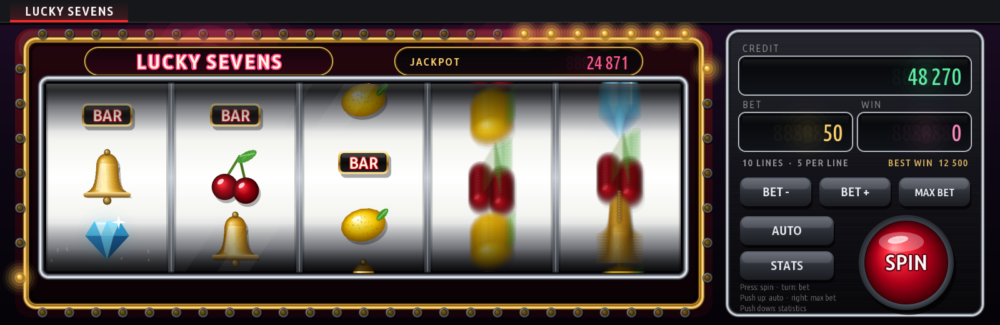</a>
<a href="docs/assets/apps/aurelm_lucky_sevens/screen_2.png">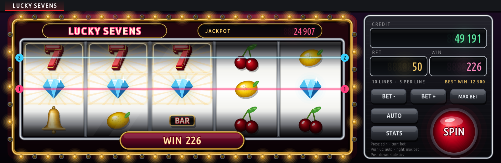</a>
<a href="docs/assets/apps/aurelm_lucky_sevens/screen_3.png"></a>
</p>

<a id="component-617572656c6d5f70696e62616c6c"></a>

### M Pinball

`aurelm_pinball@1.0.1` · **release** · app


A pinball table on the circuit: wheels for bumpers, the CHICANE ramp, the PIT LANE, the M-POWER targets and SAFETY CAR MULTIBALL, seen in perspective with real ball physics; drawn by the GPU renderer at 60 fps. Flippers on the controller or a finger on each half of the table. Parked only.

Declared evidence HMI: ID7 · Review: `incompatible`.

Runtime dependencies: None declared.

Publisher artifact: 577,802 bytes; SHA-256 `3be0eccdcb00e908dc45d4c9597a56a3cd2e3be1a5d35218c2782aba8e50a374`.

[Original README / installation](https://raw.githubusercontent.com/aurelmarius/bmw-games/9c7125cc83ad65dca839a5f9f01c56247679da8d/README.md) · [Original publisher artifact](https://raw.githubusercontent.com/aurelmarius/bmw-games/9c7125cc83ad65dca839a5f9f01c56247679da8d/packages/aurelm_pinball%401.0.1.tgz)

#### Declared screenshots

<p>
<a href="docs/assets/apps/aurelm_pinball/screen_1.png"></a>
<a href="docs/assets/apps/aurelm_pinball/screen_2.png"></a>
</p>

<a id="component-617572656c6d5f7069745f77616c6c"></a>

### Pit Wall

`aurelm_pit_wall@1.0.0` · **release** · app


Break the advertising panels off the pit wall: a night race scene drawn by the GPU renderer at 60 fps, the ball on an M front wing, start lights, combos and power-ups. iDrive controller or touch. Parked only.

Declared evidence HMI: ID7 · Review: `incompatible`.

Runtime dependencies: None declared.

Publisher artifact: 565,262 bytes; SHA-256 `63053576847bc45d1a76a43d77cc11cf33a7d1d4f64307eb8a48de6bc952de31`.

[Original README / installation](https://raw.githubusercontent.com/aurelmarius/bmw-games/9c7125cc83ad65dca839a5f9f01c56247679da8d/README.md) · [Original publisher artifact](https://raw.githubusercontent.com/aurelmarius/bmw-games/9c7125cc83ad65dca839a5f9f01c56247679da8d/packages/aurelm_pit_wall%401.0.0.tgz)

#### Declared screenshots

<p>
<a href="docs/assets/apps/aurelm_pit_wall/screen_1.png">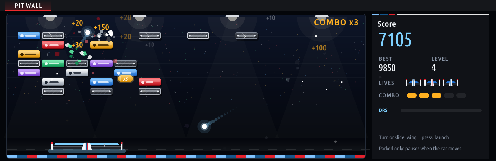</a>
</p>

<a id="component-617572656c6d5f72696467655f6475656c"></a>

### Ridge Duel

`aurelm_ridge_duel@1.0.1` · **release** · app


Two armed cars on hills at dusk, a turn each: aim with the knob, hold for power, fire. Ground that shells bite into, wind, four kinds of shell, a rival aimed by the game. Your car: a sport sedan (agile) or a performance SUV (armoured), in your colour. GPU renderer. Parked only.

Declared evidence HMI: ID7 · Review: `incompatible`.

Runtime dependencies: None declared.

Publisher artifact: 577,789 bytes; SHA-256 `2c6d8790aa914dd935f0d96035a2616b0317473d87f4797e591d1004a548bcc9`.

[Original README / installation](https://raw.githubusercontent.com/aurelmarius/bmw-games/9c7125cc83ad65dca839a5f9f01c56247679da8d/README.md) · [Original publisher artifact](https://raw.githubusercontent.com/aurelmarius/bmw-games/9c7125cc83ad65dca839a5f9f01c56247679da8d/packages/aurelm_ridge_duel%401.0.1.tgz)

#### Declared screenshots

<p>
<a href="docs/assets/apps/aurelm_ridge_duel/screen_1.png"></a>
<a href="docs/assets/apps/aurelm_ridge_duel/screen_2.png"></a>
<a href="docs/assets/apps/aurelm_ridge_duel/screen_3.png"></a>
</p>

<a id="component-617572656c6d5f736e616b65"></a>

### Snake

`aurelm_snake@1.0.0` · **release** · app


Snake on the central display, drawn by the GPU renderer at 60 fps: steer with the iDrive controller (push or turn) or swipe on the screen. Parked only.

Declared evidence HMI: ID7 · Review: `incompatible`.

Runtime dependencies: None declared.

Publisher artifact: 557,582 bytes; SHA-256 `bc2e4a76023e0b2a778e722d69aed4ad90a9b7eb21324d624f13fd54ef61c014`.

[Original README / installation](https://raw.githubusercontent.com/aurelmarius/bmw-games/9c7125cc83ad65dca839a5f9f01c56247679da8d/README.md) · [Original publisher artifact](https://raw.githubusercontent.com/aurelmarius/bmw-games/9c7125cc83ad65dca839a5f9f01c56247679da8d/packages/aurelm_snake%401.0.0.tgz)

#### Declared screenshots

<p>
<a href="docs/assets/apps/aurelm_snake/screen_1.png">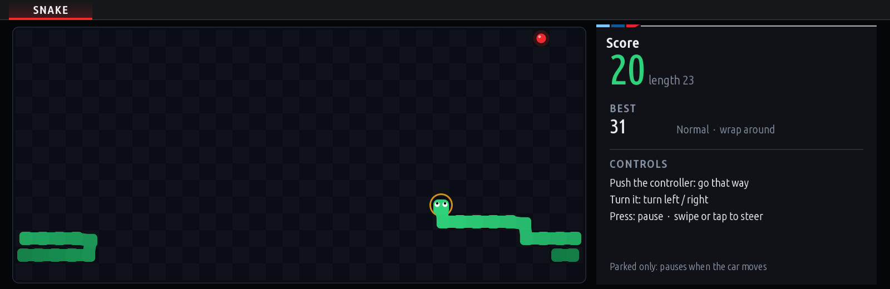</a>
</p>

<a id="component-617572656c6d5f736f6c697461697265"></a>

### Solitaire

`aurelm_solitaire@1.0.0` · **release** · app


Klondike solitaire drawn by the GPU renderer at 60 fps: a felt card table, cards that fly, flip and bounce home. Tap or press for the best move, drag cards, draw one or three, undo, hint, auto finish, statistics. Parked only.

Declared evidence HMI: ID7 · Review: `incompatible`.

Runtime dependencies: None declared.

Publisher artifact: 570,552 bytes; SHA-256 `742ed7f80b4169341a68675aa226b445398f24898f39906f53e6358aae980c3e`.

[Original README / installation](https://raw.githubusercontent.com/aurelmarius/bmw-games/9c7125cc83ad65dca839a5f9f01c56247679da8d/README.md) · [Original publisher artifact](https://raw.githubusercontent.com/aurelmarius/bmw-games/9c7125cc83ad65dca839a5f9f01c56247679da8d/packages/aurelm_solitaire%401.0.0.tgz)

#### Declared screenshots

<p>
<a href="docs/assets/apps/aurelm_solitaire/screen_1.png"></a>
<a href="docs/assets/apps/aurelm_solitaire/screen_2.png"></a>
</p>

<a id="component-617572656c6d5f7374726565745f7369656765"></a>

### Street Siege

`aurelm_street_siege@1.1.0` · **release** · app


Defend the M garage: cars storm the town by night and the M car stops them with its roof cannon. Five districts in turn (the yard, the docks, the warehouses, the parking, the scrapyard) laid out as mazes with wide streets: tyres, containers, warehouses, fences, pallets, wrecks, water, oil; power-ups; drawn by the GPU renderer at 60 fps. Parked only.

Declared evidence HMI: ID7 · Review: `incompatible`.

Runtime dependencies: None declared.

Publisher artifact: 576,692 bytes; SHA-256 `2963f545b959e9d009a68bb19edcf0ae0fce5b53cff3768f1341f4911d6fc49e`.

[Original README / installation](https://raw.githubusercontent.com/aurelmarius/bmw-games/9c7125cc83ad65dca839a5f9f01c56247679da8d/README.md) · [Original publisher artifact](https://raw.githubusercontent.com/aurelmarius/bmw-games/9c7125cc83ad65dca839a5f9f01c56247679da8d/packages/aurelm_street_siege%401.1.0.tgz)

#### Declared screenshots

<p>
<a href="docs/assets/apps/aurelm_street_siege/screen_1.png"></a>
<a href="docs/assets/apps/aurelm_street_siege/screen_2.png"></a>
</p>

<a id="component-617572656c6d5f747261636b5f646566656e646572"></a>

### Track Defender

`aurelm_track_defender@1.0.0` · **release** · app


Arcade shooter on the central display, drawn by the GPU renderer at 60 fps: drones attack the track in waves, the M car shoots them down. iDrive controller or touch. Parked only.

Declared evidence HMI: ID7 · Review: `incompatible`.

Runtime dependencies: None declared.

Publisher artifact: 564,807 bytes; SHA-256 `14f972b3cd7e41e0addff451164226b90cf25ff69f27a71d63b2449018dec378`.

[Original README / installation](https://raw.githubusercontent.com/aurelmarius/bmw-games/9c7125cc83ad65dca839a5f9f01c56247679da8d/README.md) · [Original publisher artifact](https://raw.githubusercontent.com/aurelmarius/bmw-games/9c7125cc83ad65dca839a5f9f01c56247679da8d/packages/aurelm_track_defender%401.0.0.tgz)

#### Declared screenshots

<p>
<a href="docs/assets/apps/aurelm_track_defender/screen_1.png">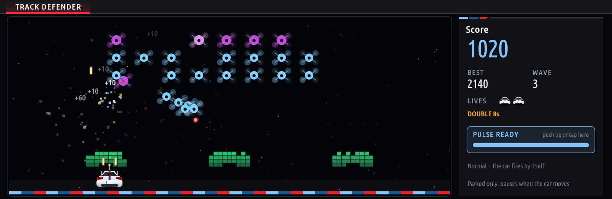</a>
</p>

<a id="component-62696d6d65725f626c6f636b73"></a>

### Bimmer Blocks

`bimmer_blocks@1.1.1` · **source** · app

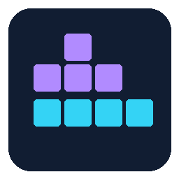

Falling-block puzzle. Play only while stationary. Manual pause, next piece, ghost and local high score.

Declared evidence HMI: ID7, ID8 · Review: `eligible_static`.

Runtime dependencies: [mgu-render &gt;=0.6.24 (selected 0.6.25; release)](#component-6d67752d72656e646572)
Build prerequisites: [mgu-deploy &gt;=0.3.2 (selected 0.8.27; release)](#component-6d67752d6465706c6f79); [mgu-python &gt;=1.0.2 (selected 1.0.3; release)](#component-6d67752d707974686f6e)

[Original README / installation](apps/_sources/app-studio-custom/README-DE-EN.txt) · [Source directory](apps/_ports/appstudio-idrive8/apps/bimmer_blocks)

<a id="component-646b5f6261636b67616d6d6f6e"></a>

### Нарды

`dk_backgammon@0.1.1` · **source** · app


Короткие и длинные нарды: вдвоём или с компьютером.

Declared evidence HMI: ID7 · Review: `incompatible`.

Runtime dependencies: None declared.

[Original README / installation](apps/_sources/mistergahan-mgu-backgammon/README.md) · [Source directory](apps/_sources/mistergahan-mgu-backgammon/apps/dk_backgammon)

<a id="component-646b5f746574726973"></a>

### Тетрис

`dk_tetris@0.1.1` · **source** · app


Тетрис для iDrive 7: семь фигур, уровни, рекорд и сохранение.

Declared evidence HMI: ID7 · Review: `incompatible`.

Runtime dependencies: None declared.

[Original README / installation](apps/_sources/mistergahan-mgu-backgammon/README.md) · [Source directory](apps/_sources/mistergahan-mgu-backgammon/apps/dk_tetris)

<a id="component-646f6f6d"></a>

### Doom

`doom@1.7.22` · **source** · app


Doom (Freedoom: Phase 1) on the iDrive. Main menu with all settings; the game drawn in full resolution across the whole screen, on the controller; BACK returns to the menu and saves

Declared evidence HMI: ID7, ID8 · Review: `eligible_static`.

Runtime dependencies: [idrive7-renderd &gt;=2.1.18 (selected 2.1.19; source)](#component-696472697665372d72656e64657264); [mgu-inputgate &gt;=1.1.0 (selected 1.2.2; source)](#component-6d67752d696e70757467617465)
Build prerequisites: [mgu-deploy &gt;=0.3.2 (selected 0.8.27; release)](#component-6d67752d6465706c6f79); [mgu-python &gt;=1.0.2 (selected 1.0.3; release)](#component-6d67752d707974686f6e)

[Original README / installation](apps/_sources/idrive7-apps/README.md) · [Source directory](apps/_sources/idrive7-apps/apps/doom)

#### Declared screenshots

<p>
<a href="docs/assets/apps/doom/preview-01.png"></a>
<a href="docs/assets/apps/doom/screen_2.png"></a>
</p>

<a id="component-696162616469615f6d5f617263616465"></a>

### M Arcade

`iabadia_m_arcade@0.1.3` · **source** · app


Six games in one controller-first arcade, with shared menus, progress and named records

Declared evidence HMI: ID7 · Review: `incompatible`.

Runtime dependencies: [mgu-render &gt;=0.6.9 (selected 0.6.25; release)](#component-6d67752d72656e646572)

[Original README / installation](apps/_sources/iabadia-idrive-games/apps/iabadia_m_arcade/README.md) · [Source directory](apps/_sources/iabadia-idrive-games/apps/iabadia_m_arcade)

#### Declared screenshots

<p>
<a href="docs/assets/apps/iabadia_m_arcade/screen_1.gif"></a>
<a href="docs/assets/apps/iabadia_m_arcade/screen_2.png">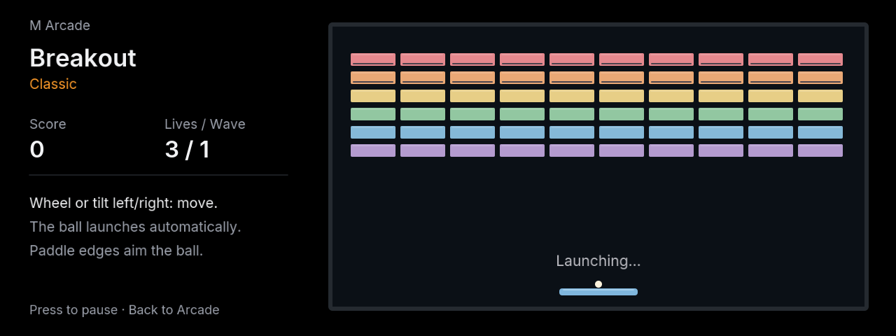</a>
<a href="docs/assets/apps/iabadia_m_arcade/screen_3.png"></a>
</p>

<a id="component-6a61705f6d6f6f6e72696465"></a>

### Moonride

`jap_moonride@0.3.4` · **release** · app


Moonlight game streaming from your PC (Sunshine / Apollo / Vibepollo) on the iDrive 7 screen, parked only by default. Needs a USB gamepad (XInput) or the touchscreen.

Declared evidence HMI: ID7 · Review: `incompatible`.

Runtime dependencies: [jap-moonride &gt;=0.3.4 (selected 0.3.4; release)](#component-6a61702d6d6f6f6e72696465); [mgu-render &gt;=0.6.8 (selected 0.6.25; release)](#component-6d67752d72656e646572)

Publisher artifact: 1,223,456 bytes; SHA-256 `530bb9b0cb00c3f40726307d50305401fdc2ffc7a97ba1a296276d0e2f2d05a5`.

[Original README / installation](https://raw.githubusercontent.com/JustAnotherPU/moonride/1a8e89f99ca17a95ff428b8959dcf379077143db/README.md) · [Original publisher artifact](https://github.com/JustAnotherPU/moonride/releases/download/catalog/jap_moonride%400.3.4.tgz)

#### Declared screenshots

<p>
<a href="docs/assets/apps/jap_moonride/screen_1.png"></a>
<a href="docs/assets/apps/jap_moonride/screen_2.png">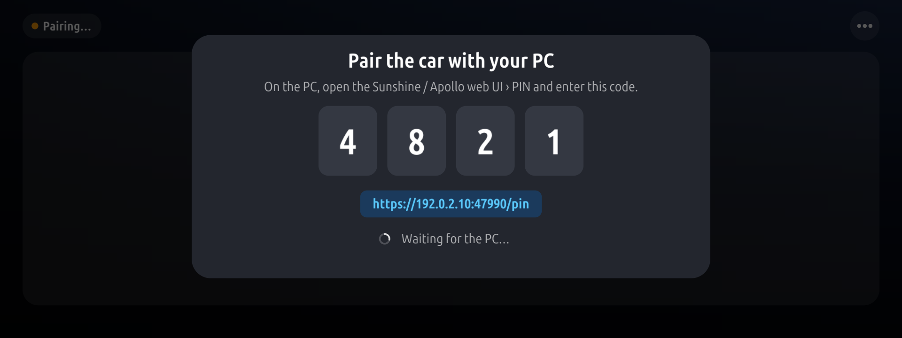</a>
<a href="docs/assets/apps/jap_moonride/screen_3.png">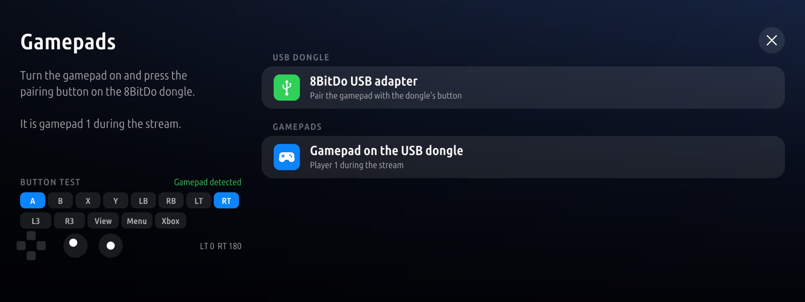</a>
</p>

<a id="component-6b787278685f646f6f646c655f6a756d70"></a>

### Doodle Jump

`kxrxh_doodle_jump@0.9.0` · **release** · app

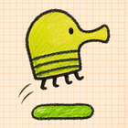

Doodle Jump for MGU7

Declared evidence HMI: ID7 · Review: `incompatible`.

Runtime dependencies: [doodle-gpu &gt;=1.0.0 (selected 1.0.0; release)](#component-646f6f646c652d677075); [mgu-python &gt;=1.0.3 (selected 1.0.3; release)](#component-6d67752d707974686f6e); [mgu-render &gt;=0.6.23 (selected 0.6.25; release)](#component-6d67752d72656e646572)

Publisher artifact: 24,956,148 bytes; SHA-256 `c672603efd96172b5d6cc26d95de674c6fc0b5c74fa156145904dc0ee9294334`.

[Original README / installation](https://raw.githubusercontent.com/kxrxh/doodle-jump-mgu/b3335710a22df83d415d0511cd6a5ac7e3be83ea/README.md) · [Original publisher artifact](https://github.com/kxrxh/doodle-jump-mgu/releases/download/v0.9.0/kxrxh_doodle_jump%400.9.0.tgz)

<a id="component-6d67755f67616d6573746174696f6e"></a>

### MGU GameStation

`mgu_gamestation@0.3.0` · **source** · app


Offline retro games with iDrive or phone controllers, two players and in-game saves. Parked only.

Declared evidence HMI: ID7 · Review: `incompatible`.

Runtime dependencies: [idrive7-renderd &gt;=2.1.6 (selected 2.1.19; source)](#component-696472697665372d72656e64657264); [mgu-game-net &gt;=0.1.0 (selected 0.1.0; source)](#component-6d67752d67616d652d6e6574); [mgu-inputgate &gt;=1.0.0 (selected 1.2.2; source)](#component-6d67752d696e70757467617465)
Build prerequisites: [mgu-deploy &gt;=0.3.2 (selected 0.8.27; release)](#component-6d67752d6465706c6f79); [mgu-python &gt;=1.0.2 (selected 1.0.3; release)](#component-6d67752d707974686f6e)

[Original README / installation](apps/_sources/namels-mgu-apps-full/README.md) · [Source directory](apps/_sources/namels-mgu-apps-full/apps/mgu_gamestation)

<a id="component-6d785f726f61645f686f70706572"></a>

### Road Hopper

`mx_road_hopper@0.1.1` · **source** · app


Hop across the road and the river to fill five homes, played with the iDrive controller. Parked only by default

Declared evidence HMI: ID7 · Review: `incompatible`.

Runtime dependencies: [cluster-render &gt;=0.4.0 (selected 0.6.9; source)](#component-636c75737465722d72656e646572)
Build prerequisites: [mgu-deploy &gt;=0.3.2 (selected 0.8.27; release)](#component-6d67752d6465706c6f79); [mgu-python &gt;=1.0.2 (selected 1.0.3; release)](#component-6d67752d707974686f6e)

[Original README / installation](apps/_sources/cruzen991-cluster/README.md) · [Source directory](apps/_sources/cruzen991-cluster/apps/mx_road_hopper)

#### Declared screenshots

<p>
<a href="docs/assets/apps/mx_road_hopper/screen_1.png"></a>
</p>

<a id="component-7061726b65645f67616d6573"></a>

### Parked Games

`parked_games@0.2.3` · **source** · app


Small games for when the car is parked, played with the iDrive knob (and the touchscreen)

Declared evidence HMI: ID7, ID8 · Review: `eligible_static`.

Runtime dependencies: [mgu-render &gt;=0.6.24 (selected 0.6.25; release)](#component-6d67752d72656e646572)
Build prerequisites: [mgu-deploy &gt;=0.3.2 (selected 0.8.27; release)](#component-6d67752d6465706c6f79); [mgu-python &gt;=1.0.2 (selected 1.0.3; release)](#component-6d67752d707974686f6e)

[Original README / installation](apps/_sources/maxxxfoka-idrive7games/README.md) · [Source directory](apps/_ports/maxxxfoka-idrive8/apps/parked_games)

#### Declared screenshots

<p>
<a href="docs/assets/apps/parked_games/screen_1.png"></a>
<a href="docs/assets/apps/parked_games/screen_2.png"></a>
</p>

<a id="component-76697a75616c7973655f6d6f6f6e6c69676874"></a>

### Moonlight

`vizualyse_moonlight@0.3.1` · **source** · app


Moonlight: shows the phone link and QR code for the Moonlight game streaming service, its status, and stops, quits or resumes the game streamed from a PC running Sunshine

Declared evidence HMI: ID7 · Review: `incompatible`.

Runtime dependencies: [vizualyse-moonlight &gt;=0.3.0 (selected 0.3.1; source)](#component-76697a75616c7973652d6d6f6f6e6c69676874)

[Original README / installation](apps/README.md) · [Source directory](apps/_published/vizualyse_moonlight)

<a id="component-76697a75616c7973655f737465616d"></a>

### Steam

`vizualyse_steam@0.2.1` · **release** · app


Steam: plays Windows games from your Steam library on the car (the vizualyse-steam tool), shows the phone link and QR code for signing in and installing, and shows or hides the game on the central screen

Declared evidence HMI: ID7 · Review: `incompatible`.

Runtime dependencies: [vizualyse-steam &gt;=0.3.0 (selected 0.4.0; release)](#component-76697a75616c7973652d737465616d)

Publisher artifact: 42,638 bytes; SHA-256 `18b00da11c10fa19b548e871ef542b9786eee22ccd6bddd3b9f61339d77d801a`.

[Original README / installation](https://github.com/Vizualyse/idrive-apps/blob/9766d42b9c1250c7e78461ea070194fcd2ec6461/apps/vizualyse_steam/README.md) · [Original publisher artifact](https://github.com/Vizualyse/idrive-apps/releases/download/vizualyse_steam%400.2.1/vizualyse_steam%400.2.1.tgz)

## Helper tools

17 selected tool entries.

<a id="component-6170702d70726976616379"></a>

### App privacy

`app-privacy@1.7.2` · **release** · tool

Keeps our apps out of the head unit's backend app reporting and restarts them after a crash

Declared evidence HMI: ID7, ID8 · Review: `eligible_static`.

Runtime dependencies: [mgu-deploy &gt;=0.6.3 (selected 0.8.27; release)](#component-6d67752d6465706c6f79)
Retained as an explicitly selected helper.

Publisher artifact: 19,586 bytes; SHA-256 `eea01214be305cec03a9cb8abeefa2ab543693376ab16a8d9639eb55e5191c5b`.

[Original README / installation](https://github.com/robertnisipeanu/mgu-store/blob/3ecfafd4b6b2492c1776f53e3b74add5653c5c61/README.md) · [Original publisher artifact](https://github.com/robertnisipeanu/mgu-store/releases/download/app-privacy%401.7.2/app-privacy%401.7.2.tgz)

<a id="component-636c75737465722d72656e646572"></a>

### Cluster renderer

`cluster-render@0.6.9` · **source** · tool

Draws every app's layers on the instrument cluster and the HUD, sharing the display slots and one upload budget

Declared evidence HMI: ID7, ID8 · Review: `eligible_static`.

Runtime dependencies: [mgu-deploy &gt;=0.4.0 (selected 0.8.27; release)](#component-6d67752d6465706c6f79)
Required or retained by: [mx&&#35;95;road&&#35;95;hopper](#component-6d785f726f61645f686f70706572); [vizualyse-moonlight](#component-76697a75616c7973652d6d6f6f6e6c69676874)

[Original README / installation](https://github.com/robertnisipeanu/idrive-apps/blob/8de5d4999929be14732882afd81beb7382edb82f/README.md) · [Source directory](tools/_released/cluster-render)

<a id="component-646f6f646c652d677075"></a>

### Doodle Jump GPU support

`doodle-gpu@1.0.0` · **release** · tool

Adds textured game scenes to the Store renderer

Declared evidence HMI: ID7 · Review: `incompatible`.

Runtime dependencies: [mgu-render &gt;=0.6.23 (selected 0.6.25; release)](#component-6d67752d72656e646572)
Required or retained by: [kxrxh&&#35;95;doodle&&#35;95;jump](#component-6b787278685f646f6f646c655f6a756d70)

Publisher artifact: 87,513 bytes; SHA-256 `877fa863a352a59d29853423273b4291d80f36f8385801d98a10c7f5cc7e4a52`.

[Original README / installation](https://raw.githubusercontent.com/kxrxh/doodle-jump-mgu/b3335710a22df83d415d0511cd6a5ac7e3be83ea/README.md) · [Original publisher artifact](https://github.com/kxrxh/doodle-jump-mgu/releases/download/v0.9.0/doodle-gpu%401.0.0.tgz)

<a id="component-696472697665372d72656e64657264"></a>

### GPU renderer

`idrive7-renderd@2.1.19` · **source** · tool

The apps' own GPU renderer (mgu-render): draws them at 60 fps, beside the MGU Store's Renderer; installed with the apps (iDrive 7 and iDrive 8)

Declared evidence HMI: ID7, ID8 · Review: `eligible_static`.

Runtime dependencies: [mgu-deploy &gt;=0.6.1 (selected 0.8.27; release)](#component-6d67752d6465706c6f79)
Build prerequisites: [mgu-deploy &gt;=0.4.0 (selected 0.8.27; release)](#component-6d67752d6465706c6f79)
Required or retained by: [doom](#component-646f6f6d); [mgu&&#35;95;gamestation](#component-6d67755f67616d6573746174696f6e)

[Original README / installation](apps/_sources/idrive7-apps/kit/renderd/README.md) · [Source directory](apps/_sources/idrive7-apps/kit/renderd/prebuilt)

<a id="component-6a61702d6d6f6f6e72696465"></a>

### Moonride streaming service

`jap-moonride@0.3.4` · **release** · tool

Moonride's background service: pairing, launch, the H.264/HEVC decoder (Intel MSDK) into mgu-render, the car's speakers, USB pads

Declared evidence HMI: ID7 · Review: `incompatible`.

Runtime dependencies: [jap-node22 &gt;=22.23.4 (selected 22.23.4; release)](#component-6a61702d6e6f64653232); [mgu-deploy &gt;=0.7.0 (selected 0.8.27; release)](#component-6d67752d6465706c6f79)
Required or retained by: [jap&&#35;95;moonride](#component-6a61705f6d6f6f6e72696465)

Publisher artifact: 588,700 bytes; SHA-256 `ef426b9b367c170becf76899306d584d899e34be4ef879aee71de04898dd24fb`.

[Original README / installation](https://raw.githubusercontent.com/JustAnotherPU/moonride/1a8e89f99ca17a95ff428b8959dcf379077143db/README.md) · [Original publisher artifact](https://github.com/JustAnotherPU/moonride/releases/download/catalog/jap-moonride%400.3.4.tgz)

<a id="component-6a61702d6e6f64653232"></a>

### Node.js 22

`jap-node22@22.23.4` · **release** · tool

Node.js 22 LTS for the background services of Moonride and RideTube (BMW's apps keep the system Node 8)

Declared evidence HMI: ID7 · Review: `incompatible`.

Runtime dependencies: [mgu-deploy &gt;=0.7.0 (selected 0.8.27; release)](#component-6d67752d6465706c6f79)
Required or retained by: [jap-moonride](#component-6a61702d6d6f6f6e72696465)

Publisher artifact: 49,203,293 bytes; SHA-256 `c62a8e2a3803b858b4d1020cb19746c8bd9ae8b753145f80c5adf7d781692743`.

[Original README / installation](https://raw.githubusercontent.com/JustAnotherPU/mgu-apps/42cd2242d9e75c48aace6ee40274451a88c920a7/README.md) · [Original publisher artifact](https://github.com/JustAnotherPU/mgu-apps/releases/download/catalog/jap-node22%4022.23.4.tgz)

<a id="component-6d67752d6465706c6f79"></a>

### Deploy tool

`mgu-deploy@0.8.27` · **release** · tool

Installs, updates, rolls back and removes our tools and apps on the head unit, with a snapshot before every change

Declared evidence HMI: ID7, ID8 · Review: `eligible_static`.

Runtime dependencies: None declared.
Required or retained by: [app-privacy](#component-6170702d70726976616379); [bimmer&&#35;95;blocks](#component-62696d6d65725f626c6f636b73); [cluster-render](#component-636c75737465722d72656e646572); [doom](#component-646f6f6d); [idrive7-renderd](#component-696472697665372d72656e64657264); [jap-moonride](#component-6a61702d6d6f6f6e72696465); [jap-node22](#component-6a61702d6e6f64653232); [mgu-inputgate](#component-6d67752d696e70757467617465); [mgu-render](#component-6d67752d72656e646572); [mgu-render-id7-touch](#component-6d67752d72656e6465722d6964372d746f756368); [mgu-updater](#component-6d67752d75706461746572); [mgu&&#35;95;gamestation](#component-6d67755f67616d6573746174696f6e); [mx&&#35;95;road&&#35;95;hopper](#component-6d785f726f61645f686f70706572); [parked&&#35;95;games](#component-7061726b65645f67616d6573); [vizualyse-bus](#component-76697a75616c7973652d627573); [vizualyse-moonlight](#component-76697a75616c7973652d6d6f6f6e6c69676874); [vizualyse-steam](#component-76697a75616c7973652d737465616d)

Publisher artifact: 168,362 bytes; SHA-256 `57797407580d4f0c4be234e226d4f51972002adeb1ad718e3cf2ffcd00ea36b6`.

[Original README / installation](https://github.com/robertnisipeanu/mgu-store/blob/ef2b8a0463ed1e0c3b97c0461dbf033cf45a8412/README.md) · [Original publisher artifact](https://github.com/robertnisipeanu/mgu-store/releases/download/mgu-deploy%400.8.27/mgu-deploy%400.8.27.tgz)

<a id="component-6d67752d67616d652d6e6574"></a>

### GameStation Phone Port

`mgu-game-net@0.1.0` · **source** · tool

Opens TCP 18878 on wlan&&#35;95;bridge for the GameStation phone controllers, only while GameStation listens

Declared evidence HMI: ID7 · Review: `incompatible`.

Runtime dependencies: None declared.
Required or retained by: [mgu&&#35;95;gamestation](#component-6d67755f67616d6573746174696f6e)

[Original README / installation](apps/_sources/namels-mgu-apps-full/README.md) · [Source directory](apps/_sources/namels-mgu-apps-full/native/game-net)

<a id="component-6d67752d696e70757467617465"></a>

### Controller gate

`mgu-inputgate@1.2.2` · **source** · tool

Lets the apps have the iDrive controller (tabs, page buttons, settings, Doom); loads into the HMI at the next start (iDrive 7 and iDrive 8)

Declared evidence HMI: ID7, ID8 · Review: `eligible_static`.

Runtime dependencies: [mgu-deploy &gt;=0.3.2 (selected 0.8.27; release)](#component-6d67752d6465706c6f79)
Build prerequisites: [mgu-deploy &gt;=0.3.2 (selected 0.8.27; release)](#component-6d67752d6465706c6f79)
Required or retained by: [doom](#component-646f6f6d); [mgu&&#35;95;gamestation](#component-6d67755f67616d6573746174696f6e)

[Original README / installation](tools/_sources/cauli-inputgate-1.2.1/kit/renderd/inputgate/tool/README.md) · [Source directory](tools/_packages/mgu-inputgate)

<a id="component-6d67752d707974686f6e"></a>

### Python

`mgu-python@1.0.3` · **release** · tool

Python 3.12 for apps that build on the head unit with Python

Declared evidence HMI: ID7, ID8 · Review: `eligible_static`.

Runtime dependencies: None declared.
Required or retained by: [bimmer&&#35;95;blocks](#component-62696d6d65725f626c6f636b73); [doom](#component-646f6f6d); [kxrxh&&#35;95;doodle&&#35;95;jump](#component-6b787278685f646f6f646c655f6a756d70); [mgu-updater](#component-6d67752d75706461746572); [mgu&&#35;95;gamestation](#component-6d67755f67616d6573746174696f6e); [mx&&#35;95;road&&#35;95;hopper](#component-6d785f726f61645f686f70706572); [parked&&#35;95;games](#component-7061726b65645f67616d6573); [vizualyse-moonlight](#component-76697a75616c7973652d6d6f6f6e6c69676874); [vizualyse-steam](#component-76697a75616c7973652d737465616d)

Publisher artifact: 14,441,404 bytes; SHA-256 `98ce27bcee265ba6846446ad7867193fbdc9e0447195dbf22bcfaabf7e2f2533`.

[Original README / installation](https://github.com/robertnisipeanu/mgu-store/blob/3ecfafd4b6b2492c1776f53e3b74add5653c5c61/README.md) · [Original publisher artifact](https://github.com/robertnisipeanu/mgu-store/releases/download/mgu-python%401.0.3/mgu-python%401.0.3.tgz)

<a id="component-6d67752d72656e646572"></a>

### Renderer

`mgu-render@0.6.25` · **release** · tool

Draws apps' screens on the GPU, over the HMI or inside the app's page

Declared evidence HMI: ID7, ID8 · Review: `eligible_static`.

Runtime dependencies: [mgu-deploy &gt;=0.6.9 (selected 0.8.27; release)](#component-6d67752d6465706c6f79)
Required or retained by: [bimmer&&#35;95;blocks](#component-62696d6d65725f626c6f636b73); [doodle-gpu](#component-646f6f646c652d677075); [iabadia&&#35;95;m&&#35;95;arcade](#component-696162616469615f6d5f617263616465); [jap&&#35;95;moonride](#component-6a61705f6d6f6f6e72696465); [kxrxh&&#35;95;doodle&&#35;95;jump](#component-6b787278685f646f6f646c655f6a756d70); [parked&&#35;95;games](#component-7061726b65645f67616d6573); [vizualyse-moonlight](#component-76697a75616c7973652d6d6f6f6e6c69676874); [vizualyse-steam](#component-76697a75616c7973652d737465616d)

Publisher artifact: 103,355 bytes; SHA-256 `73b5444307aaf7a3a1b519cb14032869f18930749284aef557a2e0bd58d3fd61`.

[Original README / installation](https://raw.githubusercontent.com/robertnisipeanu/mgu-store/3ecfafd4b6b2492c1776f53e3b74add5653c5c61/README.md) · [Original publisher artifact](https://github.com/robertnisipeanu/mgu-store/releases/download/mgu-render%400.6.25/mgu-render%400.6.25.tgz)

<a id="component-6d67752d72656e6465722d6964372d746f756368"></a>

### Full-width touch

`mgu-render-id7-touch@1.4.0` · **release** · tool

Lets full-screen apps (RideTube, Moonride) use the screen's left edge: both renderers get the whole screen as their touch area, so a tap on the strip where the back arrow usually is reaches the app instead of closing it. Leave such an app with the BACK or MENU button. Other apps keep the back arrow. Removing it takes effect at the next start of the head unit.

Declared evidence HMI: ID7 · Review: `incompatible`.

Runtime dependencies: [mgu-deploy &gt;=0.7.0 (selected 0.8.27; release)](#component-6d67752d6465706c6f79)
Retained as an explicitly selected helper.

Publisher artifact: 3,499 bytes; SHA-256 `74606000de4c70b4e81c72f39bfc7ff5d96b89cc22706e02d8fcb2bcd612df84`.

[Original README / installation](https://github.com/JustAnotherPU/ridetube/blob/959819b9fe14dac40a46ea83a40ebc70fe7eec5e/README.md) · [Original publisher artifact](https://github.com/JustAnotherPU/ridetube/releases/download/catalog/mgu-render-id7-touch%401.4.0.tgz)

<a id="component-6d67752d75706461746572"></a>

### Updater

`mgu-updater@0.8.51` · **release** · tool

Installs, updates and removes apps and head-unit tools from its sources

Declared evidence HMI: ID7, ID8 · Review: `eligible_static`.

Runtime dependencies: [mgu-deploy &gt;=0.8.4 (selected 0.8.27; release)](#component-6d67752d6465706c6f79); [mgu-python &gt;=1.0.2 (selected 1.0.3; release)](#component-6d67752d707974686f6e)
Required or retained by: [mgu-uplink](#component-6d67752d75706c696e6b)

Publisher artifact: 143,205 bytes; SHA-256 `e38745a14fad5d34648c101e0d7eadd9a60d53fa1f4cda38462e3f77e08eeb95`.

[Original README / installation](https://github.com/robertnisipeanu/mgu-store/blob/ef2b8a0463ed1e0c3b97c0461dbf033cf45a8412/README.md) · [Original publisher artifact](https://github.com/robertnisipeanu/mgu-store/releases/download/mgu-updater%400.8.51/mgu-updater%400.8.51.tgz)

<a id="component-6d67752d75706c696e6b"></a>

### Internet uplink

`mgu-uplink@0.7.13` · **release** · tool

Internet for selected apps through a USB network adapter, an LTE stick, a USB-tethered phone or Wi-Fi

Declared evidence HMI: ID7, ID8 · Review: `eligible_static`.

Runtime dependencies: [mgu-updater &gt;=0.7.2 (selected 0.8.51; release)](#component-6d67752d75706461746572)
Retained as an explicitly selected helper.

Publisher artifact: 3,605,106 bytes; SHA-256 `077e3200356df726a1e653fd67db9f9a1237e22b548f946b726c6eadd0f48d28`.

[Original README / installation](https://github.com/robertnisipeanu/mgu-store/blob/ef2b8a0463ed1e0c3b97c0461dbf033cf45a8412/README.md) · [Original publisher artifact](https://github.com/robertnisipeanu/mgu-store/releases/download/mgu-uplink%400.7.13/mgu-uplink%400.7.13.tgz)

<a id="component-76697a75616c7973652d627573"></a>

### Vizualyse bus

`vizualyse-bus@0.1.0` · **source** · tool

EXPERIMENTAL. The shared bus the Vizualyse tools use to ask each other to switch things off while they need the car's resources (Steam pauses Cast's cluster and HUD video while a game runs). Mosquitto 2.0.21 (MQTT) on a Unix socket only root's tools can reach; no network listener. Installed with the tools that use it; about 0.2 MB.

Declared evidence HMI: ID7 · Review: `incompatible`.

Runtime dependencies: [mgu-deploy &gt;=0.7.0 (selected 0.8.27; release)](#component-6d67752d6465706c6f79)
Required or retained by: [vizualyse-steam](#component-76697a75616c7973652d737465616d)

[Original README / installation](https://github.com/Vizualyse/idrive-apps/blob/9766d42b9c1250c7e78461ea070194fcd2ec6461/README.md) · [Source directory](tools/_released/vizualyse-bus)

<a id="component-76697a75616c7973652d6d6f6f6e6c69676874"></a>

### Moonlight

`vizualyse-moonlight@0.3.1` · **source** · tool

EXPERIMENTAL. Streams games from a PC running Sunshine (GameStream) to the central screen (or the cluster or the HUD) while parked, decoded on the car's GPU, with the sound through the speakers and game controllers (a wired Xbox 360-style USB pad, or the phone as a pad; no Bluetooth pads). Pair the PC and pick a game on the phone page: scan the QR code on the iDrive Moonlight page.

Declared evidence HMI: ID7 · Review: `incompatible`.

Runtime dependencies: [cluster-render &gt;=0.4.2 (selected 0.6.9; source)](#component-636c75737465722d72656e646572); [mgu-deploy &gt;=0.7.0 (selected 0.8.27; release)](#component-6d67752d6465706c6f79); [mgu-python &gt;=1.0.0 (selected 1.0.3; release)](#component-6d67752d707974686f6e); [mgu-render &gt;=0.6.11 (selected 0.6.25; release)](#component-6d67752d72656e646572)
Required or retained by: [vizualyse&&#35;95;moonlight](#component-76697a75616c7973655f6d6f6f6e6c69676874)

[Original README / installation](https://github.com/Vizualyse/idrive-apps/blob/9766d42b9c1250c7e78461ea070194fcd2ec6461/README.md) · [Source directory](tools/_released/vizualyse-moonlight)

<a id="component-76697a75616c7973652d737465616d"></a>

### Steam

`vizualyse-steam@0.4.0` · **release** · tool

Declared evidence HMI: ID7 · Review: `incompatible`.

Runtime dependencies: [mgu-deploy &gt;=0.7.0 (selected 0.8.27; release)](#component-6d67752d6465706c6f79); [mgu-python &gt;=1.0.0 (selected 1.0.3; release)](#component-6d67752d707974686f6e); [mgu-render &gt;=0.6.11 (selected 0.6.25; release)](#component-6d67752d72656e646572); [vizualyse-bus &gt;=0.1.0 (selected 0.1.0; source)](#component-76697a75616c7973652d627573)
Required or retained by: [vizualyse&&#35;95;steam](#component-76697a75616c7973655f737465616d)

Publisher artifact: 531,211,774 bytes; SHA-256 `3719af147d3d2209f9e5fa93de0993a3c95f8df9ccc2f5f7e990c6d227f5eeb6`.

[Original README / installation](https://github.com/Vizualyse/idrive-apps/blob/5c0629b3c6d2778c5524c609d294ba1a98a47191/README.md) · [Original publisher artifact](https://github.com/Vizualyse/idrive-apps/releases/download/vizualyse-steam%400.4.0/vizualyse-steam%400.4.0.tgz)
