# BMW MGU Apps Catalog

A curated directory of community-built apps for BMW MGU head units. Browse each app by name, read the short description, and view the icons and product images published with its source.

This is an independent community project and is not affiliated with or supported by BMW. Apps are provided by their respective authors; compatibility, testing and support vary by app.

- **[Complete app list](#applications)**
- [Pinned source revisions](data/sources.json)
- [Image files and attribution](data/app-images.json)
- [External sources not redistributed here](data/external-sources.json)
- [MGU Store source index](mgu-repo.json)

## Applications

| Icon | Application | Details | Screenshots and images |
|---|---|---|---|
|  | **[Ambient config](https://github.com/cauliflowermossgrape/idrive7-apps/tree/422957a85461826c1e8654d37c8ec66a94849f9c/apps/ambient_config)** `ambient_config` · v2.6.2 ID7 | Set ambient-light colours and animations, with a separate look for each driving mode. |  [All images (2)](docs/assets/apps/ambient_config/) |
|  | **[Brake Test](https://github.com/cauliflowermossgrape/idrive7-apps/tree/422957a85461826c1e8654d37c8ec66a94849f9c/apps/brake_test)** `brake_test` · v1.5.21 ID7 | Record 100–0 and 200–0 braking distances, peak deceleration and brake-fade trends. |   [All images (3)](docs/assets/apps/brake_test/) |
|  | **[M Vitals](https://github.com/cauliflowermossgrape/idrive7-apps/tree/422957a85461826c1e8654d37c8ec66a94849f9c/apps/car_vitals)** `car_vitals` · v2.27.6 ID7 | View live engine, temperature, intake, fuel, ignition, tyre and chassis readings. |   [All images (6)](docs/assets/apps/car_vitals/) |
|  | **[Doom](https://github.com/cauliflowermossgrape/idrive7-apps/tree/422957a85461826c1e8654d37c8ec66a94849f9c/apps/doom)** `doom` · v1.7.22 ID7 | Play Doom (Freedoom: Phase 1) on the head unit. Use only while parked. |  [All images (2)](docs/assets/apps/doom/) |
|  | **[Drag Timer](https://github.com/cauliflowermossgrape/idrive7-apps/tree/422957a85461826c1e8654d37c8ec66a94849f9c/apps/draggy)** `draggy` · v2.6.0 ID7 | Measure 0–100, 100–200 and quarter-mile runs, and keep best times. |   [All images (3)](docs/assets/apps/draggy/) |
|  | **[Fault Scanner](https://github.com/cauliflowermossgrape/idrive7-apps/tree/422957a85461826c1e8654d37c8ec66a94849f9c/apps/dtc_scanner)** `dtc_scanner` · v2.9.8 ID7 | Read and clear fault memory across control units, and review active Check Control messages. |  [All images (2)](docs/assets/apps/dtc_scanner/) |
|  | **[Virtual Dyno](https://github.com/cauliflowermossgrape/idrive7-apps/tree/422957a85461826c1e8654d37c8ec66a94849f9c/apps/dyno)** `dyno` · v1.6.3 ID7 | Plot and compare power and torque curves from full-throttle runs. |  [All images (2)](docs/assets/apps/dyno/) |
|  | **[eDrive](https://github.com/cauliflowermossgrape/idrive7-apps/tree/422957a85461826c1e8654d37c8ec66a94849f9c/apps/edrive)** `edrive` · v2.10.1 ID7 | View range, battery power and health, charging history, 12 V and (where supported) 48 V battery data. |  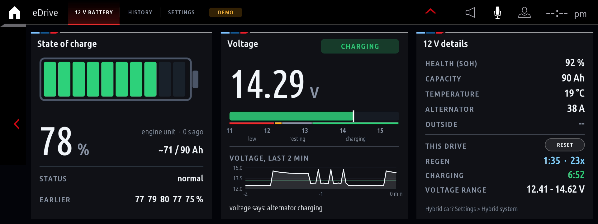 [All images (8)](docs/assets/apps/edrive/) |
|  | **[G-Force](https://github.com/cauliflowermossgrape/idrive7-apps/tree/422957a85461826c1e8654d37c8ec66a94849f9c/apps/gforce)** `gforce` · v1.6.22 ID7 | Review a friction-circle display, peak g-forces and session records. |   [All images (3)](docs/assets/apps/gforce/) |
|  | **[Engine Config](https://github.com/cauliflowermossgrape/idrive7-apps/tree/422957a85461826c1e8654d37c8ec66a94849f9c/apps/live_adjustments)** `live_adjustments` · v0.9.8 ID7 | Access supported engine and vehicle settings. Some controls can change vehicle behaviour; read the app guidance first. |   [All images (7)](docs/assets/apps/live_adjustments/) |
|  | **[Live Data](https://github.com/cauliflowermossgrape/idrive7-apps/tree/422957a85461826c1e8654d37c8ec66a94849f9c/apps/live_data)** `live_data` · v1.0.16 ID7 | Read live vehicle data, review trips and build custom gauges. The source describes the app as read-only. |  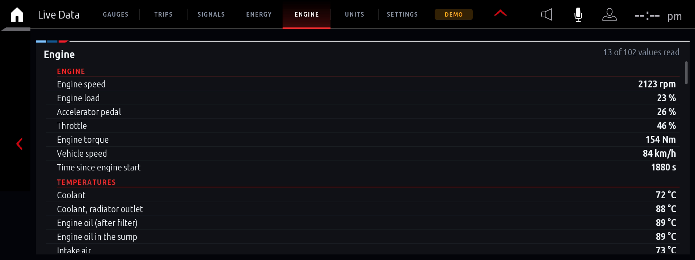 [All images (7)](docs/assets/apps/live_data/) |
|  | **[Redline](https://github.com/cauliflowermossgrape/idrive7-apps/tree/422957a85461826c1e8654d37c8ec66a94849f9c/apps/redline)** `redline` · v2.0.44 ID7 | A full-screen rev and shift display with shift lights, vehicle readings and shift scoring. |   [All images (6)](docs/assets/apps/redline/) |
|  | **[Service](https://github.com/cauliflowermossgrape/idrive7-apps/tree/422957a85461826c1e8654d37c8ec66a94849f9c/apps/service)** `service` · v1.6.2 ID7 | Review service intervals and maintenance details; selected service reminders can be reset. | 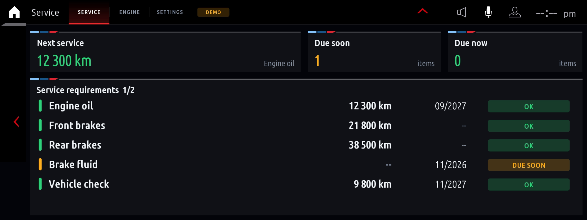 [All images (2)](docs/assets/apps/service/) |
| 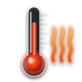 | **[Warm-Up](https://github.com/cauliflowermossgrape/idrive7-apps/tree/422957a85461826c1e8654d37c8ec66a94849f9c/apps/warmup)** `warmup` · v1.9.0 ID7 | Estimate oil and coolant warm-up time, with rev guidance and turbo cool-down information. |   [All images (3)](docs/assets/apps/warmup/) |
|  | **[Transmission Config](https://github.com/cauliflowermossgrape/idrive7-apps/tree/422957a85461826c1e8654d37c8ec66a94849f9c/apps/zf8hp)** `zf8hp` · v1.5.7 ID7 | Experimental transmission controls for the specifically verified controller and firmware only. |   [All images (3)](docs/assets/apps/zf8hp/) |
|  | **[Cluster Themes](https://github.com/bimmer-lab/apps/tree/ab81cee4d77859b531b21a118772c6b031455b78/apps/cluster_themes)** `cluster_themes` · v0.19.0 ID7 | Choose custom instrument-cluster themes, with layouts and colour options. |   [All images (19)](docs/assets/apps/cluster_themes/) |
|  | **[HUD Widgets](https://github.com/bimmer-lab/apps/tree/ab81cee4d77859b531b21a118772c6b031455b78/apps/idrive_hud_widgets)** `idrive_hud_widgets` · v0.15.0 ID7 | Choose head-up-display layouts for gear, shift, temperature and other vehicle readings. |   [All images (18)](docs/assets/apps/idrive_hud_widgets/) |
| 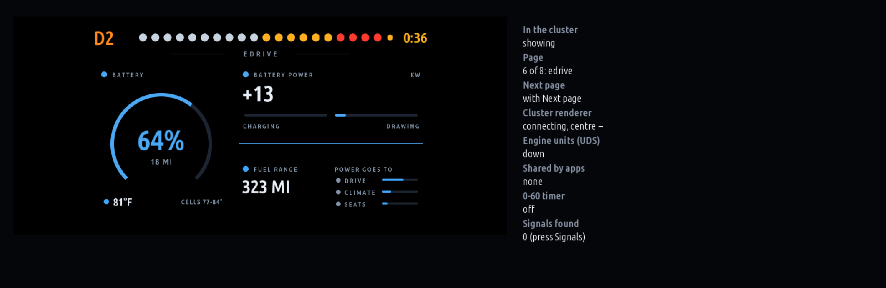 | **[Cluster Centre](https://github.com/tiraUnderCode23/idrive7-cluster-info/tree/10cefda018e59a4b21b4aa8026fc9116f0f4bd9e/apps/cluster_centre)** `cluster_centre` · v0.9.0 ID7 | Show selected vehicle readings in the instrument cluster’s central display area. |  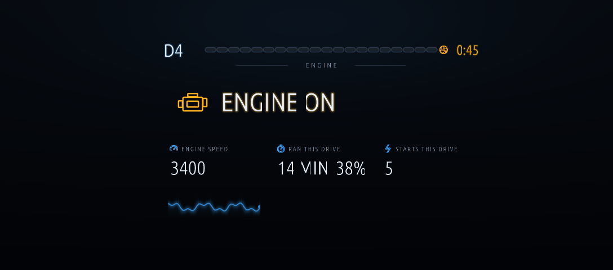 [All images (12)](docs/assets/apps/cluster_centre/) |
|  | **[Cluster Info](https://github.com/tiraUnderCode23/idrive7-cluster-info/tree/10cefda018e59a4b21b4aa8026fc9116f0f4bd9e/apps/cluster_info)** `cluster_info` · v1.6.8 ID7 | Display selected live readings over the Waze cluster map or in the head-up display. |  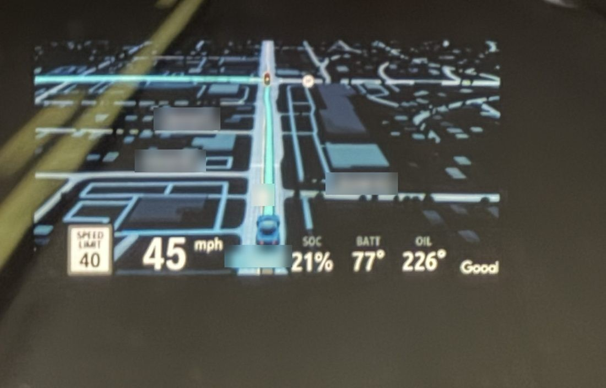 [All images (2)](docs/assets/apps/cluster_info/) |
| 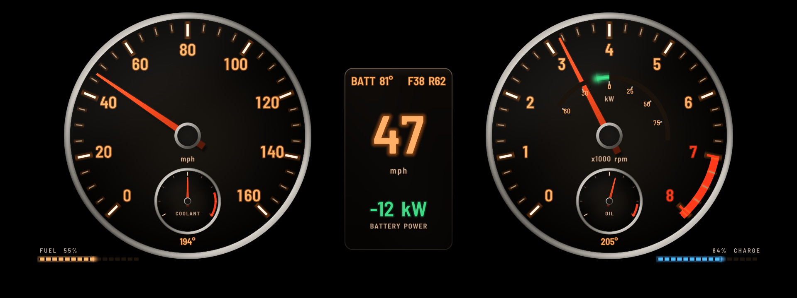 | **[Cluster Layouts](https://github.com/tiraUnderCode23/idrive7-cluster-info/tree/10cefda018e59a4b21b4aa8026fc9116f0f4bd9e/apps/cluster_layouts)** `cluster_layouts` · v0.28.1 ID7 | Choose custom instrument-cluster layouts rendered by the cluster itself. |  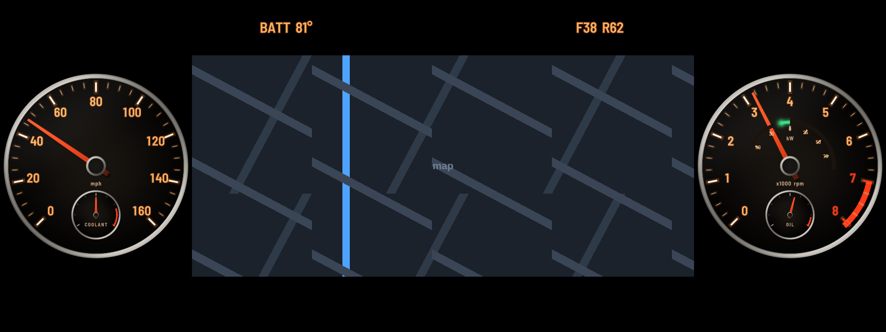 [All images (32)](docs/assets/apps/cluster_layouts/) |
| 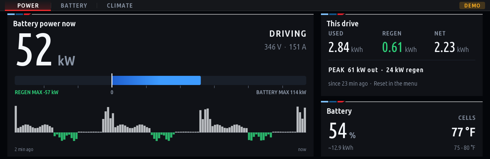 | **[eDrive Live](https://github.com/eroobeeroo/idrive7-apps/tree/c719804e28df27c25283afad6b1cfa8a49fe2c7d/apps/edrive2)** `edrive2` · v1.10.1 ID7 | Display live high-voltage battery power, cell temperatures, power limits and HVAC use. The source targets the BMW X5 xDrive45e (G05). |  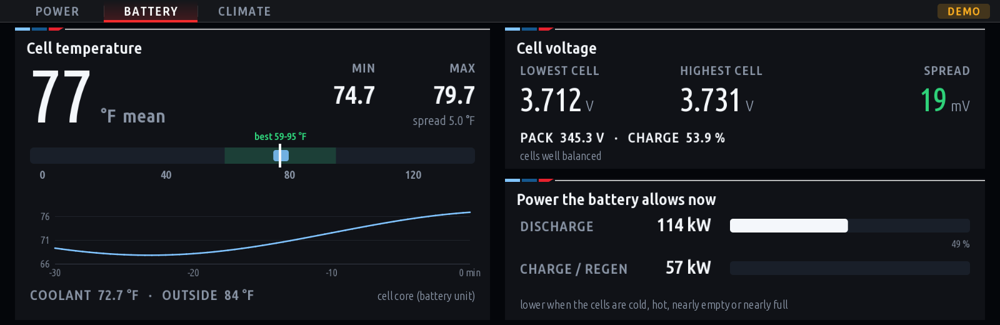 [All images (2)](docs/assets/apps/edrive2/) |
| <em>No standalone icon</em> | **[Light Show](https://github.com/eroobeeroo/idrive7-apps/tree/c719804e28df27c25283afad6b1cfa8a49fe2c7d/apps/light_show)** `light_show` · v0.5.2 ID7 | Run supported exterior-lamp test patterns using the vehicle’s built-in test functions. Review all warnings and use only while stationary in a safe, lawful setting. | No app image published upstream. No official image available |
|  | **[FSC Patch](https://github.com/Noahbg/mgu-apps/tree/3853c99c99c1e610ae0dee3547a1429b0c097300/apps/noahg_fscpatcher)** `noahg_fscpatcher` · v1.0.0 ID7 | Inspect, patch or restore the FSC verifier on the specifically supported MGU software build. System-level changes are involved. | No screenshot published. [All images (1)](docs/assets/apps/noahg_fscpatcher/) |
|  | **[OBD Bridge](https://github.com/Noahbg/mgu-apps/tree/3853c99c99c1e610ae0dee3547a1429b0c097300/apps/noahg_obdbridge)** `noahg_obdbridge` · v1.0.0 ID7 | Bridge the supported BM3 diagnostic protocol through the vehicle’s Wi-Fi hotspot; other protocols are not confirmed. | No screenshot published. [All images (1)](docs/assets/apps/noahg_obdbridge/) |
|  | **[idv7lol](https://github.com/ALMSTRA/idv7lol/tree/ff54c2cabd465eea1521770573701f26c36f880b/apps/idv7lol)** `idv7lol` · v0.2.14 ID7 | Run custom instrument-cluster themes created with idv7lol Studio. Vehicle testing is limited to the cases stated by the developer. |  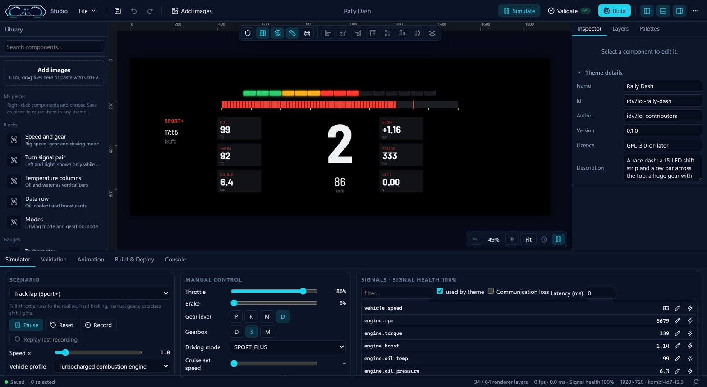 [All images (12)](docs/assets/apps/idv7lol/) |
|  | **[TurnKey E Blend](https://github.com/HasMan/turnkey-ethanol-blend/tree/a378719e9c858ef4693949c3a7bca68bd5f9cafb/apps/ethanol_mix)** `ethanol_mix` · v0.1.5 ID7 | Calculate ethanol/fuel blends with live readings and a manual fallback. Compatibility is limited to the developer’s stated test setup. | 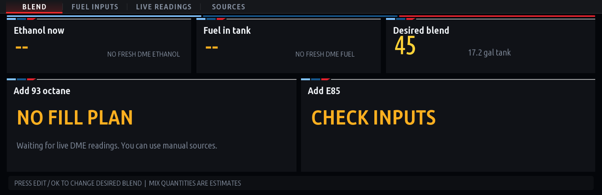 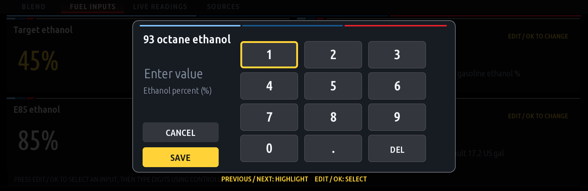 [All images (4)](docs/assets/apps/ethanol_mix/) |
|  | **[CarPlay Map Mirror](https://github.com/Impossible43/vlad-mgu-apps/tree/c3e18eb45969122a377ec93e728d6a1d11eeaa7b/apps/vlad_carplay_mirror)** `vlad_carplay_mirror` · v0.1.3 ID7 | Mirror a CarPlay navigation map to the instrument cluster; the source describes the app as experimental. | No screenshot published. [All images (1)](docs/assets/apps/vlad_carplay_mirror/) |
|  | **[Waze on cluster](https://github.com/robertnisipeanu/idrive-apps/tree/beffe76911bcf83df00a4b29332dc313bd574a65/apps/robertn_waze_cluster)** `robertn_waze_cluster` · v0.6.12 ID7 | Show phone navigation maps on the instrument cluster, with experimental head-up-display support. |   [All images (5)](docs/assets/apps/robertn_waze_cluster/) |

## Using this repository with MGU Store

The root [`mgu-repo.json`](mgu-repo.json) follows the MGU Store repository-tree format. Add this GitHub repository as a source from the Store’s source settings, then review each app’s requirements and compatibility notes before installing. Keep the source on the `main` branch to receive updates published to this repository.

Upstream changes are not imported automatically. Source snapshots are pinned at the commits listed in [`data/sources.json`](data/sources.json); updates are reviewed and published here separately.

## Compatibility and safety

These apps are unofficial. Some read vehicle data; others can change settings or interact with vehicle systems. A listing here does not mean an app has been tested on your vehicle. Read the app’s own documentation, firmware requirements, limitations and recovery instructions before use. Do not configure or operate an app while driving. Use any vehicle-control, diagnostics, coding, display or performance feature only when parked and in a safe, lawful setting.

In particular, the transmission configuration, engine-adjustment, FSC patch, OBD bridge, service reset, light-test and fuel-blend apps have specific compatibility limits or can change vehicle behaviour. Follow the author’s exact guidance and do not assume support for other software, controllers or models.

## Images and source attribution

The files linked in the catalog are app icons and screenshots copied from the pinned upstream snapshots. Original image pixels are unchanged. Each copy is indexed with its upstream path in [`data/app-images.json`](data/app-images.json). Some apps have no standalone icon or screenshot published; those gaps are identified rather than filled with unrelated artwork.

Application code and product localization files remain as published by their authors. Each project’s own licence, notices and third-party attributions remain in its source folder. Review them before redistribution. Projects whose terms do not clearly permit bundling are linked, not copied, in [`data/external-sources.json`](data/external-sources.json).

## Build status

The catalog and image index have been checked for valid paths and unique app IDs. This repository has not been validated as a complete build of every app, and no app has been installed or tested on a vehicle as part of this catalog update. Some apps require companion components, local SDK files or particular Store versions. Use the upstream build and compatibility notes as the authority for each app.
