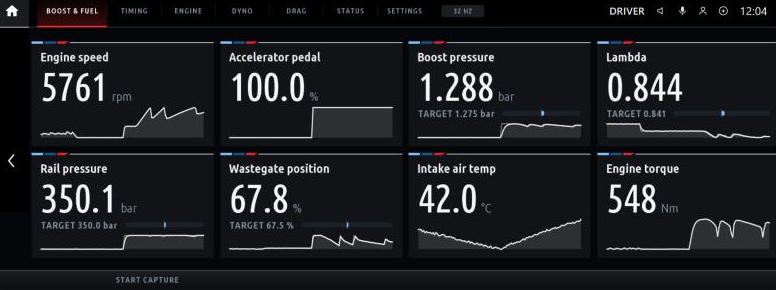
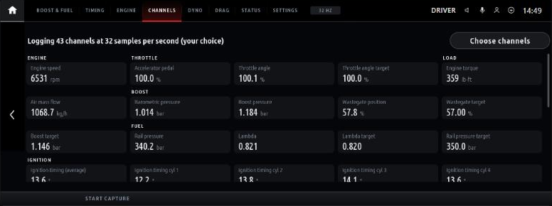
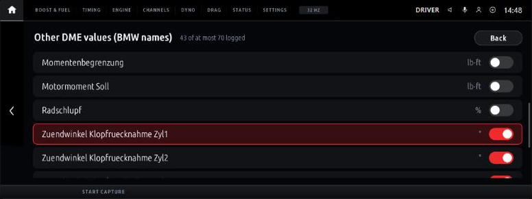
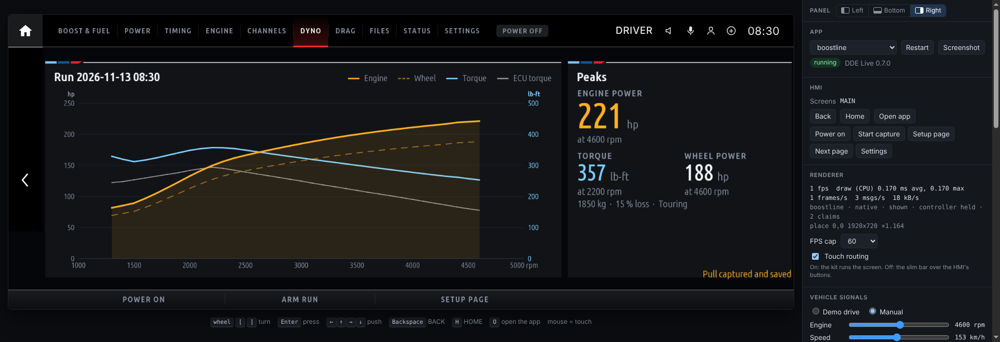
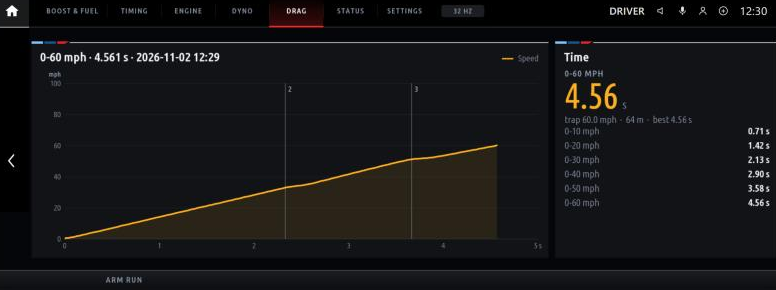
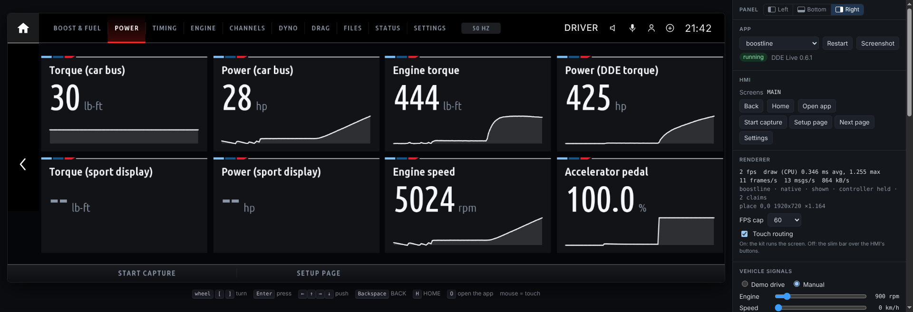
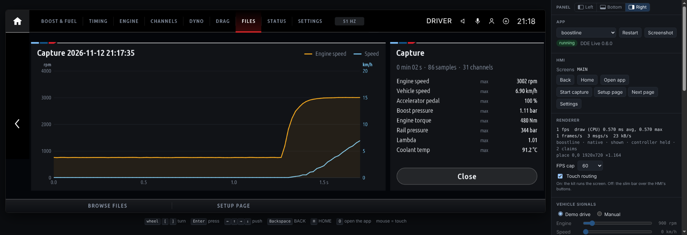

# ECU Live Data for iDrive 7

**Live engine data, CSV logs, a road dyno and a drag timer on the BMW iDrive 7 (MGU) head unit itself, for diesel (DDE) and petrol (DME) engines.** No laptop, phone, ENET cable or WiFi adapter: the head unit reads the engine computer over its own diagnostic link and shows live values, power curves and times on the centre display.

ECU Live Data is a fork of [boostline-idrive](https://github.com/clucraft/boostline-idrive) (MIT), adapted and optimised for BMW diesels (DDE) by [giuseppesalatino-boop](https://github.com/giuseppesalatino-boop). It is not affiliated with Boostline, its authors, or BMW.

It is built on [boostline-idrive](https://github.com/clucraft/boostline-idrive), which runs [Boostline](https://github.com/clucraft/Boostline)'s ECU logger on the head unit. It adds the diesel DDE (pages for turbo, DPF, EGR and injection, the DDE's own values as *Advanced PIDs*), torque and power from the car's own bus, a road dyno worked out as Virtual Dyno does, Power on / off, a Files page, and the app staying quiet while the car is switched off.

> **Status (1.0.0):** run on a car: a G31 520d (B47, DDE 8.32 `d83bx7c0`), iDrive 7. The petrol (DME) side is Boostline's and hasn't been tried on a car with this app. Values, dyno and drag figures are estimates from the car's data: check them against a proper tool before trusting them.

> **BMW's data isn't included.** The full channel set needs the BMW DME data you import yourself in Boostline's desktop app (see [On a car](#on-a-car)); without it the app reads the standard OBD-II channels. The car package contains BMW's SDK from your own head unit: build it yourself and never publish it.

> **Your iDrive 7 head unit must be rooted to use this.** BMW's head unit only runs apps BMW installs, so Boostline can only be installed on a unit you have root (SSH) access to. Rooting is done with the community tool [idrive7-8-ssh-root](https://github.com/cauliflowermossgrape/idrive7-8-ssh-root). It can wipe the head unit's coding, delete BMW Digital Key pairings and, at worst, brick the unit. Read [Rooting your head unit](#rooting-your-head-unit) before you start. The emulator on a PC needs no root.



Boostline is an independent community project. It is not affiliated with or endorsed by BMW. All trademarks belong to their owners.

---

## What it does

### Live data

- **Live tiles** on three pages (*Boost & fuel*, *Timing*, *Engine*); on a diesel (DDE) the *Timing* page gives way to *Turbo* and *DPF* (see [Diesel engines](#diesel-engines-dde)):
  - Each tile shows the current value and a 12-second trace.
  - Actual/target pairs share a tile with a deviation bar: boost, lambda, rail pressure, wastegate, throttle and VANOS.
  - Values are shown in the units you pick (see [Units](#units)).
  - **Setup page** (the button in the bar) chooses a page's tiles from everything your car offers: up to 8, in the order you tick them. A target goes into its actual's tile by itself. *Defaults* puts the page's own tiles back. Each page keeps its choice between drives, and the tiles' channels are logged whatever else you chose.
- **Channels page:** every channel being logged, with its live value. **Choose channels** picks what is logged, from everything your car offers (see [Choosing what to log](#choosing-what-to-log)).
- **Start capture** writes a Boostline CSV log of every logged channel to the app's data folder. The desktop app's log viewer, dyno and drag tools open it. Optionally, every full-throttle pull is captured automatically.
- **Status page:** VIN, DME software, diagnostic index, which BMW DME data is in use, sample rate, the diagnostic link's request counts, and Boostline's log.

### Units

Speed, power and torque default to **mph, hp and lb-ft**, and the default drag run is 0–60 mph. You can change each of them in the app's **Settings** (the Settings tab, or the Settings button):

| Setting | Choices (default first) |
|---|---|
| Speed unit | mph, km/h |
| Power unit | hp, PS, kW |
| Torque unit | lb-ft, Nm |
| Pressure unit | bar, psi, kPa |
| Temperature unit | Celsius, Fahrenheit |
| Mixture as | lambda, AFR (petrol) |
| Drag: run | 0–100 km/h, 0–200 km/h, 0–200 m, 0–400 m, the roll-ons 40–100 / 70–120 / 80–120 / 60–160 km/h, 100–200 / 200–300 km/h, 0–60 mph, 60–130 mph, 1/8 mile, 1/4 mile (Setup page on the Drag page picks it too) |
| Sport display: 100% torque / power | 300-760 Nm / 100-300 kW (what 100 % on the sport displays is) |
| Dyno: pull from | 1250, 1500, 1750, 2000 rpm |
| Dyno: pull to | 4000, 4250, 4500, 4750, 5000, 5250, 5500 rpm |

A change applies at once: the live tiles, the dyno curves and peaks, and the drag times and trace are redrawn in the new unit. Saved runs and logs aren't changed; they keep Boostline's native units, as on the desktop. The dyno's weight setting is in kg.

### Choosing what to log



Boostline reads the same set of channels for the tiles, the Channels page and a capture. By default that is what the three tile pages show plus the barometric pressure and outside temperature the dyno needs (31 channels in the emulator). To change it:

1. Open the **Channels** page and press **Choose channels**.
2. Pick a group, then tick or untick its channels. The touchscreen and the iDrive controller both work.
3. Press **Done**. Boostline switches to the new set at once (during a capture, when the capture stops, so a CSV never changes columns).



- **The limit is 70 channels,** Boostline's own maximum. The more you log, the fewer samples per second each one gets. The Channels page and the Status page show the current rate.
- **Always logged:** engine speed, vehicle speed, accelerator pedal and gear. The dyno and the drag timer need them.
- **Defaults** at the top of the picker goes back to the pages' set.
- **The tiles follow the choice:** untick a channel and its tile goes too.
- **Your choice is kept** between drives, in `boostline-app.json` in the app's data folder.
- **The picker needs the default display settings,** *Screen layout: Full screen* and *Renderer: GPU*, because the kit draws it over the page.

### Parameters you can log

Which ones your car offers depends on two things:

- **BMW DME data** (the file you copy from Boostline's desktop app, see [On a car](#on-a-car)): Boostline maps the values tuners log most onto the channels below, from the measurements your DME's data describes. Which ones exist depends on the DME family (MG1, MEVD17, MSD80 and so on). Every other numeric value in that data is offered too, in the picker's *Other DME values* group (cut into alphabetical parts when there are many), named from BMW's German descriptions translated into English (`vendor/boostline/src/core/bmwdata/translate.ts`: a dictionary of the data's words, German compounds split into their parts; a word it doesn't know stays German).
- **Standard OBD-II:** every DME answers some of these. They are offered with or without the DME data. Without it, they are all there is.

**Default:** *always* = always logged; *yes* = logged unless you untick it; *fallback* = logged by default only when the DME data lacks the better value next to it. **CSV id** is the channel's id in a capture's `# ids=` line. Units are the CSV's (native) units; the screen shows the ones you pick in Settings.

**Engine and throttle**

| Parameter | CSV id | Unit | Default | BMW DME data | OBD-II |
|---|---|---|---|---|---|
| Engine speed | `engine.rpm` | rpm | always | ✓ | PID 0C |
| Oil pressure | `engine.oil_pressure` | bar | | ✓ | |
| Run time since start | `obd.runtime` | s | | | PID 1F |
| Accelerator pedal | `throttle.pedal` | % | always | ✓ | PID 49 |
| Throttle angle | `throttle.position` | % | yes | ✓ | PID 11 |
| Throttle angle target | `throttle.target` | % | yes | ✓ | PID 4C |
| Throttle angle (relative) | `obd.throttle_relative` | % | | | PID 45 |

**Load and torque**

| Parameter | CSV id | Unit | Default | BMW DME data | OBD-II |
|---|---|---|---|---|---|
| Engine torque | `load.torque.actual` | Nm | yes | ✓ | PIDs 62 × 63 |
| Driver torque request | `load.torque.driver` | Nm | | ✓ | |
| Torque reserve target | `load.torque.reserve` | Nm | | ✓ | |
| Engine torque, % of reference | `obd.torque_actual_pct` | % | | | PID 62 |
| Driver torque request, % of reference | `obd.torque_demand_pct` | % | | | PID 61 |
| Reference torque | `obd.torque_reference` | Nm | | | PID 63 |
| Air mass flow | `load.maf` | kg/h | yes | ✓ | |
| Air mass flow (OBD-II) | `obd.maf` | g/s | fallback | | PID 10 |
| Air mass through the throttle | `load.maf_throttle` | kg/h | | ✓ | |
| Engine load | `load.engine` | % | | ✓ | |
| Engine load target | `load.engine_target` | % | | ✓ | |
| Calculated load | `load.calc` | % | | | PID 04 |
| Absolute load | `obd.load_absolute` | % | | | PID 43 |

**Boost**

| Parameter | CSV id | Unit | Default | BMW DME data | OBD-II |
|---|---|---|---|---|---|
| Boost pressure (above the air pressure) | `boost.actual` | bar | yes | ✓ | PIDs 0B − 33 |
| Boost target | `boost.target` | bar | yes | ✓ | |
| Boost pressure (absolute) | `boost.charge_abs` | bar | | ✓ | |
| Boost target (absolute) | `boost.target_abs` | bar | | ✓ | |
| Manifold pressure (absolute) | `boost.map` | bar | | ✓ | PID 0B (stops at 2.55 bar) |
| Barometric pressure | `boost.ambient` | bar | yes | ✓ | PID 33 |
| Wastegate position | `boost.wg_actual` | % | yes | ✓ | |
| Wastegate target | `boost.wg_target` | % | yes | ✓ | |

**Fuel**

| Parameter | CSV id | Unit | Default | BMW DME data | OBD-II |
|---|---|---|---|---|---|
| Rail pressure | `fuel.rail.actual` | bar | yes | ✓ | PID 23 |
| Rail pressure target | `fuel.rail.target` | bar | yes | ✓ | |
| Low-side fuel pressure | `fuel.lpfp` | bar | | ✓ | |
| Lambda | `fuel.lambda.actual` | λ | yes | ✓ | PID 34 (or 24) |
| Lambda target | `fuel.lambda.target` | λ | yes | ✓ | PID 44 |
| Short-term fuel trim | `fuel.stft` | % | | | PID 06 |
| Long-term fuel trim | `fuel.ltft` | % | | ✓ | PID 07 |
| Injection time | `fuel.inj_time` | ms | | ✓ | |
| Fuel rate | `obd.fuel_rate` | L/h | | | PID 5E |

**Ignition and knock**

| Parameter | CSV id | Unit | Default | BMW DME data | OBD-II |
|---|---|---|---|---|---|
| Ignition timing (average) | `ign.avg` | ° crank | yes | ✓ | |
| Ignition timing, per cylinder | `ign.cyl1` … `ign.cyl8` | ° crank | cyl 1–6 | ✓ | |
| Timing advance (cylinder 1) | `obd.timing_advance` | ° | fallback | | PID 0E |
| Knock signal, per cylinder | `knock.signal.cyl1` … `knock.signal.cyl8` | as the DME gives it | | ✓ | |

Timing pulled by knock control has no standard name across DMEs. When your DME's data has it, it is in *Other DME values* under its translated name (in the emulator: *Ignition angle reduction knock control cylinder 1* to *6*).

**Temperatures**

| Parameter | CSV id | Unit | Default | BMW DME data | OBD-II |
|---|---|---|---|---|---|
| Intake air temp | `temp.intake` | °C | yes | ✓ | PID 0F |
| Charge air temp | `temp.charge` | °C | | ✓ | |
| Coolant temp | `temp.coolant` | °C | yes | ✓ | PID 05 |
| Oil temp | `temp.oil` | °C | yes | ✓ | PID 5C |
| Outside air temp | `temp.ambient` | °C | yes | ✓ | PID 46 |
| Exhaust temp | `temp.exhaust` | °C | | ✓ | |
| Catalyst temp | `obd.cat_temp` | °C | | | PID 3C |
| Transmission oil temp | `temp.trans` | °C | | ✓ | |

**VANOS, vehicle and electrical**

| Parameter | CSV id | Unit | Default | BMW DME data | OBD-II |
|---|---|---|---|---|---|
| Intake cam (VANOS) | `vanos.intake.actual` | ° crank | yes | ✓ | |
| Intake cam target | `vanos.intake.target` | ° crank | yes | ✓ | |
| Exhaust cam (VANOS) | `vanos.exhaust.actual` | ° crank | | ✓ | |
| Exhaust cam target | `vanos.exhaust.target` | ° crank | | ✓ | |
| Valvetronic lift | `vanos.valvelift` | mm | | ✓ | |
| Vehicle speed | `vehicle.speed` | km/h | always | ✓ | PID 0D (stops at 255 km/h) |
| Gear | `vehicle.gear` | gear | always | ✓ | PID A4 |
| Battery voltage | `elec.battery` | V | yes | ✓ | PID 42 |

**Other DME values:** `dme.<DID>` (for example `dme.6a48`), in the units BMW's data gives. Every numeric measurement in your DME's data that isn't one of the above, often several hundred.

#### Diesel engines (DDE)

Diesel engine ECUs (DDE 7.x / 8.x: N47, N57, B47, B57) answer at the same address (0x12) as a DME, and bmw-unified-db describes them the same way, so Boostline imports them alongside the petrol DMEs. Most channels above (rpm, boost and boost target, rail pressure, MAF, torque, lambda, temperatures, speed, gear, battery) map as on a petrol engine; on top of them a DDE gets:

| Parameter | CSV id | Unit | BMW DDE data |
|---|---|---|---|
| Injection quantity / target | `fuel.inj_qty` / `fuel.inj_qty_target` | mg/stroke | ✓ |
| Air mass per stroke / target | `load.air_per_stroke` / `load.air_per_stroke_target` | mg/stroke | ✓ |
| Fuel temp | `temp.fuel` | °C | ✓ |
| Charge air temp after HP compressor | `temp.charge_hp` | °C | ✓ (two-stage) |
| VNT position / target (HP turbo; the single turbo's VNT) | `turbo.vnt.actual` / `turbo.vnt.target` | % | ✓ |
| VNT actuator duty | `turbo.vnt.duty` | % | ✓ |
| HP turbine bypass / target | `turbo.hp_bypass.actual` / `turbo.hp_bypass.target` | % | ✓ (two-stage) |
| HP compressor bypass | `turbo.cmpr_bypass.actual` | % | ✓ (two-stage) |
| LP turbine actuator / target, LP bypass | `turbo.lp_vnt.actual` / `turbo.lp_vnt.target`, `turbo.lp_bypass.actual` | % | ✓ (B57 tri/quad-turbo) |
| Boost target LP stage, boost deviation | `boost.target_lp_abs`, `boost.deviation` | bar | ✓ |
| Exhaust pressure before turbine | `exhaust.pre_turbine_abs` | bar | ✓ |
| EGR valve HP / LP, actual and target | `egr.hp.actual` / `egr.hp.target`, `egr.lp.actual` / `egr.lp.target` | % | ✓ |
| Throttle flap, swirl flap | `throttle.diesel.actual`, `throttle.swirl.actual` | % | ✓ |
| EGT after manifold (model), before catalyst, before DPF, before SCR | `exhaust.egt_manifold`, `exhaust.egt_pre_cat`, `exhaust.egt_pre_dpf`, `exhaust.egt_pre_scr` | °C | ✓ |
| DPF soot mass measured / calculated | `dpf.soot_measured`, `dpf.soot_simulated` | g | ✓ |
| DPF differential pressure | `dpf.diff_pressure` | mbar | ✓ |
| Since last DPF regeneration: distance, fuel; average interval; regeneration request | `dpf.dist_since_regen`, `dpf.fuel_since_regen`, `dpf.avg_regen_interval`, `dpf.regen_request` | km, l, km, – | ✓ |
| AdBlue level, AdBlue range, NOx before / after SCR | `scr.adblue_level`, `scr.adblue_range`, `scr.nox_pre`, `scr.nox_post` | %, km, ppm | ✓ |

Which of these exist depends on the DDE (a single-turbo B47 has no HP bypass, an F-series DDE 7 no SCR temperatures, and so on); everything else the DDE describes is under *Other DME values*. bmw-unified-db currently has SGBDs for DDE 7.x (F-series N47/N57/B47) and DDE 8.x (`d83bx7c0`, G30/G11 B47/B57); if *Auto* doesn't find your DDE's diagnostic index, pick the data by hand in the app's Settings (*BMW DDE/DME data* lists the G-series DDE 8.x and the petrol DMEs of the iDrive 7 cars: `dme_bx80/81/82` for the B58/B48 gen 1, which carry no diagnostic index and must be picked by hand, and `dme8ff_r/l`; the data you copied to the head unit must contain the one you pick), and check the values against ISTA or another tool before trusting them. Lambda on a diesel reads well above 1; *AFR* is computed with petrol's 14.7.

### Dyno (road dyno)



1. On the *Dyno* page, press **Arm run**.
2. Floor it in one gear (3rd or 4th) from low rpm to near the limiter. The pull is recorded by itself; the dyno then disarms.

The dyno works as *Virtual Dyno* (the kit's apps/dyno) does, from the car's own signals rather than the DDE: engine speed, speed and the DSC's longitudinal acceleration, many times a second. Wheel power = mass × acceleration × speed + air drag + rolling resistance; crank power = wheel power / (1 − drivetrain loss); torque = power / engine speed; binned by 100 rpm and smoothed over 5 bins (a straight line through them, so the ends keep the curve's slope); the curves are drawn with a light shape-keeping smoothing, over vertical grid lines at the rpm marks. A pull is hard acceleration (over 0.12 g, above 15 km/h and 1200 rpm) in one gear across at least 1500 rpm. It ends when the acceleration falls sharply (0.1 g within half a second: off the pedal, the limiter, a shift starting), kept up to where the fall starts, so that the car's slightly late acceleration signal doesn't make a last high-power point; or at a gear change (the gear before is the run). A shorter one says so and the dyno stays armed. It needs no DDE, so it also works with *Power off*.

- **Settings:** weight with driver and fuel (1950 kg by default), body shape (sedan, Touring, SUV: the air drag), drivetrain loss, the ECU torque overlay (the graph's rpm range follows the run), and Boostline's SAE J1349 / DIN 70020 weather correction (air pressure and outside temperature from the DDE when you arm, while it's read).
- **Baseline:** *Setup page* on Dyno pins the run shown as the baseline, drawn dashed behind every other run with the difference in the peaks.
- **Re-analysis:** changing weight, loss, body shape or correction works the run shown out again. Runs saved by older versions (from the DDE's speed) keep their own way.

### Drag



The run types (Settings, or **Setup page** on the Drag page):

- 0–100 and 0–200 km/h, 0–60 mph (the default)
- 0–200 m and 0–400 m, 1/8 and 1/4 mile
- in-gear roll-ons 40–100, 70–120, 80–120 and 60–160 km/h
- 100–200 and 200–300 km/h, 60–130 mph

How a run is timed:

- **Standing starts:** after Arm run, wait for the car to stop, then time from the first movement.
- **Rolling runs:** start when the car crosses the start speed.

**Fast mode:** on the Drag and Dyno pages ECU Live Data reads only engine speed, vehicle speed, accelerator pedal and gear (the header shows *FAST 4 CH* and the rate), so the samples come several times faster than with the tiles' channels. The other pages get their channels back as soon as you open them. While a capture is running all channels stay on, since a CSV can't change columns: stop it for fast mode.

While a run is armed and running, the right column shows it live: the time since the start, the distance covered in metres and the speed (between samples the time and distance run on at the last speed). After the run the page shows:

- the time and the exit (trap) speed, for every run type
- the distance in metres
- the best time for that run type
- a split every 10 mph (every 10 km/h for the km/h runs)
- the speed trace with each shift and the gear it went into

**Splits:** a speed run (0-100, 60-160 ...) shows every 10 km/h split, in two columns when one doesn't hold them.

**Speedometer correction:** *True speed vs. the car's* corrects the car's speed by a fixed percentage. Measure the percentage once against GPS.

### Power



The *Power* page shows by default engine speed, the pedal, boost, torque and power from the sport displays and the intake air temperature. Every torque and power ECU Live Data can get can be picked as a tile (*Setup page*), to see which one matches the car:

| Tile | Where it comes from |
|---|---|
| Torque (car bus) | the crankshaft torque the DDE sends on the car's bus to the gearbox, DSC and displays (the one M Vitals shows). Read from the head unit's vehicle signals: no diagnostic request, so it doesn't slow the DDE's channels |
| Power (car bus) | Torque (car bus) × engine speed / 9549 |
| Engine torque | the DDE's diagnostic value (*Motormoment aktuell*) |
| Power (DDE torque) | Engine torque × engine speed / 9549 |
| Torque / Power (sport display) | the sport displays' % of the car's maximum, in Nm / kW with *Sport display: 100% torque / power* from Settings (400 Nm / 140 kW: a 520d's rating) |

The *Engine* page's oil temperature comes from the car's bus too (*Oil temp (car bus)*, the value the car shows, as in M Vitals). The DDE's own *Oil temp* is its filtered oil temperature (STAT_SWSABMW_FILDOILT): the older STAT_MOTOROEL_TEMPERATUR stays at 0 on a B47.

*Gearbox oil temp (car bus)* comes from the car's basic data set (as M Vitals); a car that never fills it shows `--`.

*DPF regeneration active* (DPF page) is worked out: the DDE asks for a regeneration (*DPF regeneration request* above 0) and the exhaust before the DPF is above 500 °C.

All of them can be picked as tiles on any page and are captured to the CSV like the DDE's channels. None of them is measured: the DDE works torque out from its own model, so after a remap they show what the remap tells the DDE. The Dyno page's power comes from the car's acceleration instead.

### Default pages

A diesel (DDE) shows, until *Setup page* changes a page:

| Page | Tiles |
|---|---|
| Boost & fuel | engine speed, pedal, boost (vs target), rail pressure, lambda, injection quantity, intake air temp, EGT before catalyst |
| Power | engine speed, pedal, boost, torque and power (sport display), intake air temp |
| Turbo | engine speed, boost (vs target), HP turbine bypass, LP turbine actuator, exhaust pressure before turbine, EGT before catalyst, intake air temp, EGR valve (HP) |
| DPF | soot measured and calculated, differential pressure, distance since regen, EGT before DPF, regen request, regen active, AdBlue range |
| Engine | engine speed, vehicle speed, gear, coolant, oil temp, gearbox oil temp, battery voltage |

A petrol engine (DME) keeps Boostline's own pages (Boost & fuel, Timing, Engine) and the Power page. The app says DDE or DME after the engine's ECU (Status: *BMW DDE data … (diesel)*). 0.8.0 resets the tiles chosen earlier once, for these defaults.

### Power on

ECU Live Data opens switched off: it asks the DDE nothing until **Power on** (the bar's first button) is pressed, and it switches off by itself a few seconds after you leave the app (its screen and its settings both hidden). *Start capture* and *Arm run* on Drag switch it on when pressed while off. The dyno and the car-bus values need no DDE.

### A DDE that stays silent

A B47's DDE answers nothing when three dynamic DIDs are read in one request (the log fills with *No response from ECU 0x12 to [22 f3 00 f3 01 f3 02]*). The stream then splits such a read, and when its parts are answered it asks at most as many dynamic DIDs per request as were answered (*ECU 0x12 didn't answer 3 dynamic DIDs in one request; now at most 2 per request*).

### Advanced PIDs

*Setup page* and *Choose channels* list the named channels first; the DDE's own values (about 3,900 on a B47) are under **Advanced PIDs**, in alphabetical parts. The lists are worked out once when the sheet opens: sorting thousands of values at every frame made the head unit slow.

### Switched off

ECU Live Data asks the DDE nothing while the car is switched off. After the ignition is off the head unit stays on for a while; a diagnostic request then goes through the gateway and can keep the car's bus from going to sleep (the car shows *Energy management: a service could not be switched off*, the gateway stores 801C16 / 801C17). ECU Live Data follows BMW's vehicle condition: in the parked and living states (and while switching off) it disconnects from the DDE, stops a capture, and connects again once the ignition is on. Until the head unit has told the car's state (a unit without that signal) it reads as before.

### Files



The *Files* page shows what ECU Live Data saved on the head unit: the captures (CSV logs), the dyno runs and the drag runs, with how many files and how much room each takes, and how full the captures' quota is. **Browse files** (or the bottom bar's buttons) opens the browser:

- a folder lists its files, newest first
- a capture: **View** shows it on the Files page, engine speed and speed over time and the maximum of its main channels (duration, samples, channels); **Close** goes back
- a dyno or drag run: **Show** opens it on the Dyno or Drag page, as just measured
- **Delete** deletes the file, **Delete all** the whole folder; both need a second press within 4 seconds. The capture being written can't be deleted (Delete all leaves it)

There's no export from the head unit yet: copy the files over SSH as before.

### Runs and safety

- **Saved runs:** finished dyno pulls and drag runs are saved in the desktop app's format (`Dyno/<id>.json`, `Drag/<id>.json`). Copy those folders into Boostline's desktop data folder to see the runs there.
- **Closed courses only:** the first Arm run shows a one-time notice that has to be confirmed with a second press.

Like the desktop, the figures are estimates from the car's own data, not a calibrated dynamometer or timing gear.

### Boostline's own code

It uses **Boostline's own engine code**, not a copy. The [Boostline repository](https://github.com/clucraft/Boostline) is committed in the collection's `vendor/boostline`, pinned to a release, and bundled for the head unit. That brings the desktop app's full read path to the car:

- the same channel set
- multi-DID batching
- dynamically defined DIDs (BMW's `STATUS_BLOCK_LESEN` style block reads)
- the OBD-II fallback
- BMW DME data
- the CSV format
- the dyno's and drag timer's detectors and analysis

## Read-only

Every request passes Boostline's read-only allowlist before it reaches the head unit's transport:

- `10` (default and extended session)
- `19`, `22` and `23`
- `2C` (temporary RAM definitions for fast logging)
- `3E`

Nothing codes, flashes or clears. The tests check that no other service ever reaches the transport.

**Only do full-throttle pulls on a closed course.**

## How it works

```
 app/main.js            the screens (the idrive7-apps kit: GPU renderer, tabs, settings)
 app/runs.js            dyno and drag runs: arming, Boostline's detectors, saved runs
     │
 app/boostline-core.js  Boostline's Session, EnetAdapter, UDS client, channels, CSV recorder
     │                  (bundled from vendor/boostline for the head unit's Node 8 by tools/bundle.js)
     │  core/hsfzOverTasu.ts: Boostline's HSFZ connection, swapped for the head unit's transport
     │
 app/tasu-link.js       UDS over TASU, on the kit's diagnostic module (kit/runtime/diag.js)
     │
 the head unit's diagnostic gateway (TASU, SOME/IP)  ──▶  DME 0x12
```

On a PC, the DME end is played by [`emu/fakeDme.ts`](emu/fakeDme.ts). It answers the same requests a DME would, with live values from Boostline's B58 simulator: idle, launch, a 4th-gear pull to the limiter, braking.

## Try it in the emulator

You need **Node.js 18+**, **Python 3** and **git**. No car, no head unit and no BMW software are needed.

From the collection ([mgu-apps](https://github.com/giuseppesalatino-boop/mgu-apps)), open its `ecu-live-data` folder:

```bash
cd ecu-live-data
```

(From git: `git clone https://github.com/giuseppesalatino-boop/mgu-apps` and `cd mgu-apps/ecu-live-data`.)

```bash
npm install
```

```bash
npm run emu
```

Then open http://localhost:8077.

**Diesel:** `npm run emu:diesel -- <path to your bmw-dme-data.json>` instead makes the emulated engine computer answer as a G-series DDE (d83bx7c0, B47 / B57), from the BMW DME data you imported in Boostline's desktop app (BMW's data: it isn't in this repository; `BOOSTLINE_DME_DATA` or a `bmw-dme-data.json` in this folder work too): the diesel pages (Turbo, DPF), the DDE's channel names and its thousands of values under *Advanced PIDs*, as on the car. Press **Power on** first. The values are made up from the simulator (only the named channels move; the others read 0).

- **Controls:** the mouse is the touchscreen. The mouse wheel and `[` `]` turn the iDrive knob, `Enter` presses it, and the arrow keys push it.
- **Side panel:** settings, the app's buttons and its log.
- **Trying Dyno and Drag:** the simulated car repeats one drive cycle of about a minute: a stop, a launch to 190 km/h, a slow-down, cruising in 4th, then a 4th-gear pull to the limiter.
  - Arm *Drag* at any time: it times the next launch.
  - Arm *Dyno* after the launch, while the car slows down or cruises, and it captures the 4th-gear pull. Armed at a stop, it takes the 1st-gear launch as the pull, as the desktop app would.
- **Live reload:** saving a file in `app/`, `core/` or `vendor/boostline` rebuilds and restarts the app in about a second.
- **OBD-II only:** `npm run emu -- --obd-only` starts without the emulator's DME data, to see the standard OBD-II channels on their own.
- **The channel picker:** the emulator's DME offers 72 channels, its knock signals and a few of BMW's own values among them, so *Choose channels* has a DME's worth to pick from. Your choice is kept in `vendor/idrive7-apps/preview/emu/boostline/boostline-app.json`; delete that file to start over.

`npm run setup` (also run by `emu`) does the following:

- applies [`patches/idrive7-apps`](patches/idrive7-apps) to the kit
- links `app/` into the kit as `apps/boostline`
- writes a clearly marked **placeholder** for BMW's SDK, because the kit's build expects one and the emulator never loads it

The patches let the emulator run on Windows (a named pipe instead of a Unix socket, `python` instead of `python3`), and let it answer diagnostic requests through `--diag <module>`.

### Tests

```bash
npm test
```

```bash
npm run test:node8
```

Both run the app's diagnostic path end to end: Boostline's Session → `tasu-link.js` → the kit's Diag → a stubbed transport → the fake DME. They cover:

- identification and DME data selection
- block reads over `2C 01`
- the read-only check
- CSV capture
- the channel picker: groups, ticking, the four always-logged channels, the 70-channel limit, Defaults
- picked channels reaching the CSV, and Boostline's 70-channel limit
- OBD-II only
- no answer from the DME
- the transport refusing requests
- the dyno and drag timer on Boostline's simulated drive cycle, run faster than real time:
  - the 4th-gear pull and its peaks
  - re-analysis with another weight
  - 0–100 km/h and 1/8-mile times, splits and shifts
  - the speedometer correction
  - runs saved in the desktop format

`test:node8` runs them on Node 8.17.0, as the head unit does. It downloads that Node release once from nodejs.org and checks it against the release's checksums.

## Rooting your head unit

**This is required.** The head unit is a Linux computer that runs BMW's apps, but it only installs apps BMW delivers. Boostline, like every app in the [idrive7-apps](https://github.com/cauliflowermossgrape/idrive7-apps) kit it is built on, is installed over SSH as `root`. So before anything else, your iDrive 7 (MGU) head unit needs root SSH access.

### The rooting tool

**[cauliflowermossgrape/idrive7-8-ssh-root](https://github.com/cauliflowermossgrape/idrive7-8-ssh-root)** turns on the head unit's root SSH service using only the car's ENET diagnostic port and a laptop.

- **Supported units:** it handles iDrive 7 (MGU ID7) and the iDrive 8 BDC3 / BCP units. Boostline and the app kit are for **iDrive 7 only**.
- **Its README is the authority.** Follow it, not this summary.

You need:

- an **ENET cable**, wired. The tool's README says WiFi adapters (MHD, bootmod3) can't carry SSH, so they won't do for this step, even though Boostline needs no cable once it's installed.
- a Windows, macOS or Linux laptop with an OpenSSH client
- the tool's prebuilt Windows `.exe`, or Python 3.9+ to run it from source
- on Windows, the tool run as Administrator
- the ignition on, or the car awake

### The steps

1. **Back up the head unit's coding first.** Flashing wipes it. The tool's README describes doing this with BimmerCode, or with ISTA / E-Sys.
2. **Run the tool's *Flash + Enable* with your VIN.** This is a one-time flash of a small debug image, then SSH is enrolled and made permanent with debug mode off.
3. **Restore your coding** if anything was reset.
4. **Re-pair every BMW Digital Key.** The flash deletes them, and the coding backup doesn't cover them.
5. **Keep the SSH key and the head unit's address** the tool saves in `data/enrollments/<VIN>/`. You need them for the install below:

   | What | File | Installer setting |
   |---|---|---|
   | The key | `id_rsa` | `KEY=` / `-Key` |
   | The address (e.g. `169.254.36.47`) | `connect.txt` | `HU=root@<address>` / `-Ip` |

### Risks and undoing it

- **Risks:** the tool is for your own vehicle, at your own risk. Its disclaimer: flashing can wipe the head unit's coding, delete its BMW Digital Key pairings and, in the worst case, brick the module.
- **Undoing root:** the tool's *Disable* turns SSH off again.
- **Removing the apps:** the kit installer's `restore` takes the apps off and puts the head unit's files back from its backup.

Boostline isn't affiliated with the rooting tool or its authors, and can't help with rooting problems. Ask in [its issues](https://github.com/cauliflowermossgrape/idrive7-8-ssh-root/issues).

## On a car

1. **Root the head unit** ([above](#rooting-your-head-unit)) **and get BMW's app SDK from it.** The [idrive7-apps README](https://github.com/cauliflowermossgrape/idrive7-apps#31-get-the-sdk-from-your-unit) explains how to:
   - copy one of BMW's preinstalled apps off the unit over SSH
   - extract the SDK from it into `vendor/idrive7-apps/oap-sdk/` with `kit/tools/extract_sdk.js`, replacing the placeholder
2. **Build the package:**

   ```bash
   npm run build:car
   ```

   This writes `dist/boostline@<version>.mgu`. It refuses to build with the placeholder SDK. The package contains BMW's SDK, so keep it for your own car and never publish it.
3. **Install it** with the kit's installer in `vendor/idrive7-apps`, as its README describes. It also installs the GPU renderer.
   - Build the car kit with `deploy/make-car-kit.sh`.
   - Push it with `push-to-car.sh` (Linux/macOS) or `push-to-car.ps1` (Windows), using the SSH key and address from the rooting tool:
     - `push-to-car.sh`: `HU=root@<address> KEY=<.../data/enrollments/<VIN>/id_rsa>`
     - `push-to-car.ps1`: `-Key <...\data\enrollments\<VIN>\id_rsa> -Ip <address>`
   - Run its `check` first. It is read-only and lists what `install` would change.
4. **For the full BMW channel set,** copy the DME data you imported in Boostline's desktop app into the app's data folder on the head unit:

   - from: `bmw-dme-data.json` in Boostline's settings folder
   - to: `/var/opt/public/oap/oap_<uid>/data/`

   Without it, the app reads the standard OBD-II channels.
5. **Logs** go to `/var/opt/public/oap/oap_<uid>/data/Logs/`. Copy them off with `scp` and open them in Boostline's desktop app. The app stops starting new captures once that folder holds about 96 MB. Its disk quota is 128 MB (`maxDiskUsage` in [`app/app.json`](app/app.json)).
6. **Dyno and drag runs** go to `Dyno/` and `Drag/` in the same data folder. Copy them into the desktop app's data folder (by default `Documents/Boostline`) to see them in its run lists.
7. **Before the first dyno run,** set your car's weight with driver and fuel, its body shape and the drivetrain loss in the app's settings.

## What still needs a car

Tried on a G31 520d (B47 DDE 8.32, iDrive 7): the head unit passes the block reads (`2C 01`), the DDE answers at most two dynamic DIDs per request (the app learns it by itself, see *A DDE that stays silent*), and the dyno from the car's signals gives plausible figures. Still open:

- **Petrol (DME):** this app's DME side is Boostline's and hasn't been tried on a car.
- **Other diesels:** a B57 or another DDE 8.x answers the same requests, but untried.
- **Dyno and drag precision:** estimates from the car's acceleration and speed signals: compare with a proper dyno before trusting them.

## Known gaps

- The CSV's `adapter` line reads `ENET · tasu`. It comes from Boostline's ENET adapter, which the head unit reuses. A proper head-unit adapter kind in Boostline would fix it, together with replacing the build-time HSFZ swap with a transport option in Boostline itself.
- The emulator patches are kept here as patch files. They belong upstream in idrive7-apps.

## Repository layout

```
app/                  the head-unit app: app.json, main.js (screens), runs.js (dyno and drag),
                      picker.js (the channel picker), tasu-link.js, boostline-core.js (generated by
                      tools/bundle.js and committed: the Store builds on the car without npm)
core/                 the bundle's entry and the head-unit glue: index.ts, hsfzOverTasu.ts,
                      headUnitRuntime.ts, polyfills.ts (Node 8)
emu/fakeDme.ts        the emulator's DME (invented DIDs, Boostline's simulator)
../patches/idrive7-apps/ emulator on Windows + diagnostics hook, applied by tools/setup.js
test/run.js           end-to-end tests of the diagnostic path (Node 8 and current)
tools/                setup.js, bundle.js, emu.js, build-car.js, node8.js
../vendor/boostline   Boostline (MIT), committed in the collection's root, shared
../vendor/idrive7-apps the MGU app kit, emulator and installer, shared by every app of the collection
```

## Disclaimer

- **Not affiliated with BMW.** This is an independent, non-commercial project. It is not made, endorsed, supported or approved by BMW AG or any of its companies. BMW, iDrive and the names of BMW's models and control units are trademarks of BMW AG, used here only to say which cars and head units the software is for. No BMW logo, BMW software, BMW SDK or BMW data is part of this repository.
- **Read-only.** The apps only read values the car already provides; they never write to, code or flash a control unit, and they do not unlock or bypass any paid or protected function of the car.
- **At your own risk.** The software is provided "as is", without warranty of any kind (see LICENSE). Installing custom apps needs a modified head unit, which may affect the vehicle's warranty, and the values shown are estimates from the car's sensors. Use it only where it is legal and safe: performance runs only on closed courses, never on public roads, and don't operate the screen while driving.

## Licence

MIT, like Boostline and the idrive7-apps kit. See [LICENSE](LICENSE): the original copyright (Boostline contributors) stays, ECU Live Data's changes are giuseppesalatino-boop's.

- The vendored kit and Boostline keep their own licences. The kit's GPU renderer and the emulator's draw engine are GPL-3.0-or-later.
- BMW's app SDK and BMW DME data are BMW's. Neither is in this repository, and neither may be published.
- The fake DME's DIDs, scalings and diagnostic index are invented for the emulator; they are not BMW data.
