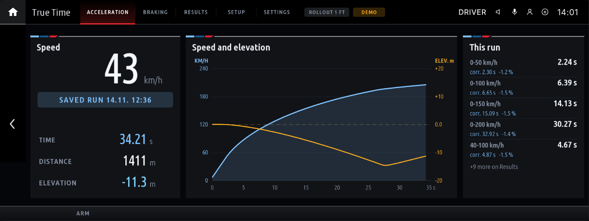
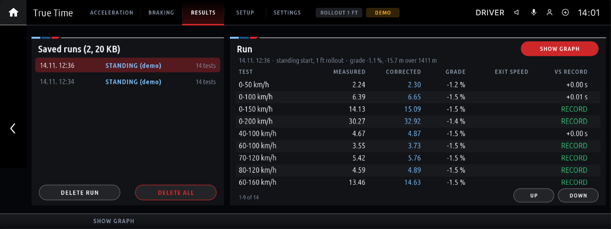

# True Time for iDrive 7

**Acceleration and braking times on the BMW iDrive 7 (MGU) head unit, measured and corrected for the road's slope.** Performance meters time a run on whatever road it was on: a 1 % downhill takes a tenth or more off a 0-100 km/h, and much more off a 100-200. True Time works out how much the road went up or down during the run, from the DSC's acceleration sensor, and shows every time twice: as measured, and as it would have been on level ground.



> **Status (1.0.0):** in use on a car (G31 520d, B47 DDE), installed from the MGU Store: runs, the DSC slope and the correction work. The engine unit's barometer is gone (the DDE's stayed put while driving), and with it Power on: the app reads only the car's own signals.

## What it does

Four pages, plus the kit's Settings (colour theme, screen layout, renderer, demo drive):

- **Acceleration.** Press **Arm**, then:
  - **standing start:** stop, then launch. The clock starts on the first movement, or after the first foot with the one-foot rollout (on by default, as on a drag strip).
  - **rolling start:** drive at a steady speed (say 80 km/h), then floor it. The run starts at the lowest speed once the speed has risen 3 km/h above it.

  One run times every test it covers: a launch to 200 km/h gives 0-50 ... 0-200, 40-100, 80-120, 100-200, 200 m, 400 m, 1000 m. The run ends by itself when the speed hasn't gained 1 km/h within a second (it has settled) or drops, and is timed up to the top speed.
  On screen: the speed, the time since the start, the distance and the elevation change, live; a chart of speed (left scale) and elevation in metres (right scale) over time; the run's tests as they come, then corrected.
- **Braking.** Press **Arm** while driving, then brake hard. The run starts when the speed falls 2.5 km/h within 0.3 s (about 0.24 g: coasting doesn't do that), and each test is timed from the moment the speed passes its start speed (100-0 starts at 100 km/h, so brake from a little above it). Time and braking distance, measured and corrected.
- **Results.** The saved runs, newest first. Pick one: a table of its tests, measured and corrected, with the grade and the gap to the record. The record is the best **corrected** time of each test; a standing start keeps one with and one without the rollout, and demo runs have records of their own. **Show graph** puts the run back on its page (Acceleration or Braking), with its chart and its tests, until the next Arm. Delete a run, or all of them (each asks for a second press).
- **Setup.** Units (metric / imperial), the one-foot rollout, the speedometer's error, slope correction on or off, ten custom speed ranges, and what the sensors are sending: the slope the DSC gives now, the DSC's acceleration, and the car's own road gradient signal (its number, in hex, and the whole message).



### The tests

| | Metric | Imperial |
|---|---|---|
| Standing start | 0-50, 0-100, 0-150, 0-200, 0-250 km/h | 0-30, 0-60, 0-100, 0-130 mph |
| Rolling | 40-100, 60-100, 70-120, 80-120, 60-160, 100-150, 100-200, 200-300 km/h | 30-70, 50-70, 40-80, 60-100, 60-130, 100-150 mph |
| Distance | 200 m, 400 m, 1000 m | 60 ft, 330 ft, 1/8 mile, 1000 ft, 1/4 mile, 1/2 mile |
| Braking | 100-0, 200-0 km/h | 60-0, 100-0 mph |

**Custom ranges** (Setup page, up to ten, in steps of 10): *from* below *to* is an acceleration test, *from* above *to* a braking test.

## How the correction works

1. **The grade, from the DSC.** The DSC's longitudinal sensor is fixed to the body: it reads the car's acceleration plus gravity's share along the road. The speed's change gives the acceleration alone, so grade ≈ (a_DSC − dv/dt) / g. dv/dt is a straight line through the last 0.8 s of speed, the sensor's mean over the same time; the result is smoothed (0.5 s), held while the acceleration changes faster than 1 g/s (a launch, a gear change, the brake going on: sensor and speed disagree for a moment there), and put back where the car was when it applied (the window and the smoothing make it late, some 50 m at 200 km/h). Summed over the distance it gives the height. Standing still, the sensor reads the grade itself.
   - **Pitch.** The value the car sends is the acceleration at the centre of gravity, worked out by the DSC, which takes the body's pitch out but leaves gravity's share of the road's slope in: on the car, runs read right with no pitch compensation, so there is none.
2. **The grade along the road.** At each point of the run a straight line is fitted through the heights within 60 m either side, which gives the grade there (a run over a downhill and into a rise is corrected for each part).
3. **The level run.** On a slope gravity adds g × grade to the car's acceleration or braking. The engine, gearbox, tyres and air work as a function of speed, so the run is worked out speed by speed: at each 0.5 km/h step the acceleration the car had there, minus gravity's share, gives the time that step would have taken on level ground. The corrected time is their sum; distance tests add up the distance too. Mass doesn't enter it, so there is no weight to set.
4. **The grade shown** for a test is a straight line through its whole length.

On a simulated car (`npm test`, a DSC sensor with noise and lag), corrected times come within a few hundredths of a second (0-100) to about 0.2 s (0-200) of the same car on level ground, on a 2 % slope and on a road that changes. The core also takes heights from any other source (the tests run it with a barometer too).

## Running it

Needs Node.js (14 or later) and git; Python 3 for the builds.

```bash
npm run setup      # once: the kit's emulator patch, app/ linked into the kit, an SDK placeholder
npm test           # the measuring core against the simulated car
npm run emu        # the live emulator: http://localhost:8077
```

In the emulator, set **Demo drive: Always** in the app's settings: the app then drives itself on a road with hills (a standing start down a 1.5 % slope into a 1 % rise, a hard stop, a rolling start from 80 km/h), with the speed and the DSC's acceleration simulated. Press **Arm** and watch the run.

## On a car

### From the MGU Store (the easy way)

True Time is one of the apps of [mgu-apps](https://github.com/giuseppesalatino-boop/mgu-apps), a Store source in the *repo tree* layout ([`mgu-repo.json`](../mgu-repo.json)): the head unit downloads it and builds the app itself, with the oap-sdk it takes from a BMW app already on the unit. No SDK, no PC, no cable.

1. In the [MGU Store](https://github.com/robertnisipeanu/mgu-store), on its phone page (the QR code on the car's screen), add the GitHub source **`giuseppesalatino-boop/mgu-apps`**, on **Tags** (each release of the collection) or on the branch **main** (every change). It lists every app of the collection.
2. Install **True Time** from it. Updates show up in the Store like the other apps'.
3. For the touch buttons (Setup page, Delete on Results) the app needs the GPU renderer: the idrive7-apps source installs it with its apps, or the Store's own Renderer. Without one the app draws in software and the buttons in the bar still work.

The build on the unit is [`tools/build_unit.py`](../tools/build_unit.py) (in the collection's root): it puts `app/` into the vendored kit and runs the kit's `build.py`.

### From a PC

1. **BMW's SDK:** copy the SDK you extracted from your head unit into the collection's `vendor/idrive7-apps/oap-sdk/` (the same one the idrive7-apps kit and ECU Live Data use).
2. **Build:** `npm run build:car` writes `dist/true_time@<version>.mgu`. It contains BMW's SDK: keep it for your own car and never publish it.
3. **Install** with the kit's installer in the collection's `vendor/idrive7-apps`: `deploy\make-car-kit.cmd true_time`, then `deploy\push-to-car.ps1 -Key <...\enrollments\<VIN>\id_rsa> -Ip <address>`. Run its `check` first: it changes nothing and lists what `install` would do.

### Data

Runs are saved one file each in `/var/opt/public/oap/oap_<uid>/data/runs/`, with the speed and elevation trace and, from the standstill before a standing start, the DSC's reading and the car's road gradient signal (raw), for calibrating that signal later. The log is `data/true_time.log`.

## What still needs a car

- **The car's road gradient signal** (`VehicleModel.LaneSlope`): it went 1872, 2128, 2384, 2640 (0x0750 to 0x0A50, always +256) during a drive: perhaps a counter or another byte of the message. The Setup page shows the number in hex and the whole message.
- The run start and end thresholds (3 km/h rise for a rolling start, 1 km/h in 1 s for the end, 0.24 g for braking) against more gear changes.

## Disclaimer

- **Not affiliated with BMW.** This is an independent, non-commercial project. It is not made, endorsed, supported or approved by BMW AG or any of its companies. BMW, iDrive and the names of BMW's models and control units are trademarks of BMW AG, used here only to say which cars and head units the software is for. No BMW logo, BMW software, BMW SDK or BMW data is part of this repository.
- **Read-only.** The apps only read values the car already provides; they never write to, code or flash a control unit, and they do not unlock or bypass any paid or protected function of the car.
- **At your own risk.** The software is provided "as is", without warranty of any kind (see LICENSE). Installing custom apps needs a modified head unit, which may affect the vehicle's warranty, and the values shown are estimates from the car's sensors. Use it only where it is legal and safe: performance runs only on closed courses, never on public roads, and don't operate the screen while driving.

## Credits

Built on [idrive7-apps](https://github.com/cauliflowermossgrape/idrive7-apps) by cauliflowermossgrape (MIT): the runtime, the GPU renderer, the emulator and the installer, vendored in `vendor/idrive7-apps` without the parts True Time doesn't use ([VENDORED.md](../vendor/idrive7-apps/VENDORED.md)). Not affiliated with or endorsed by BMW. All trademarks belong to their owners.

Values are estimates from the car's sensors: compare them with a proper tool before trusting them, and only drive like this on a closed course.
