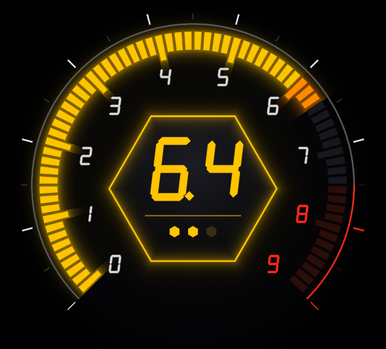

# Esagono — supercar-style cluster widget for BMW iDrive 8

A hexagon-themed rev ring for the middle of the iDrive 8 instrument cluster, installable from **MGU Store**.



- 72-segment rev ring with a redline zone and a shift flash
- Big angular digital rpm readout in a glowing centre hexagon
- Comfort (cyan), Sport (yellow) and Track (red) colours
- Its own **"Esagono"** entry in the cluster's widget menu, with BMW's middle artwork blacked out behind it
- Drawn entirely by one GPU shader: no textures, so almost none of cluster-render's shared upload budget is used

> **⚠️ Experimental: not yet tested on a car.** The package follows the documented MGU Store and cluster-render
> formats, and the shader compiles and renders under WebGL 1 / GLSL ES 1.00, but nobody has run it on a real
> iDrive 8 head unit yet. MGU Store's own iDrive 8 support is also marked untested. Install at your own risk, and
> keep an eye on the cluster's warning lights.

## What it is and what it isn't

On iDrive 8, cluster-render cannot redraw the whole cluster: there is no full-screen `panel` target like iDrive 7
has. What it can do is draw a **widget in the middle of the cluster, between BMW's own gauges**, which is what
Esagono does. BMW keeps drawing the speedometer, warning lights and driver-assist graphics.

The full-screen design (side panels, shift lights, lap timer) is in [`design/esagono_cluster.html`](design/esagono_cluster.html).
It works as a live preview and an asset exporter, ready for an iDrive 7 port or a future full-cluster renderer.

## Install (MGU Store)

1. Install **Cluster renderer** (`cluster-render`) 0.6.9 or newer from the official `robertnisipeanu/idrive-apps` source.
2. In MGU Store, go to **Settings → Add source**, enter `grabandrey/esagono-cluster`, and pick the `main` branch.
3. Install **Esagono Cluster** and **Esagono Settings**.
4. **Restart the head unit once.** cluster-render reads Esagono's widget entry only when it starts, and its README
   advises against restarting the service on its own on iDrive 8.
5. On the cluster, open the widget menu and pick **Esagono**.

Until the restart, Esagono draws on cluster-render's generic `widget` entry (listed as "Cluster renderer").

## Live rpm

Engine speed comes from SOME/IP (CDS `0xB513`, event `0x8019`, `statusEngineSpeed2`, u16 × 0.25 rpm). Esagono
**doesn't include its own SOME/IP client**. It uses an `hmictl serve` helper if one is installed, looking in:

- `/var/opt/iteriodev-overlays/current/hmictl` (IterioDev **Overlays** tool)
- `/var/opt/iteriodev-comfort/current/hmictl`
- or a path you set in the `ESAGONO_HMICTL` environment variable

Without one, the ring sits at 0. Set `"demo": true` to see a rev sweep instead.

## Settings

### Esagono Settings app

Install **Esagono Settings** from the same source. It adds an **Esagono** tile to the Apps menu with one list
screen:

| Row | A press… |
|---|---|
| Drive mode | cycles Comfort (cyan) → Sport (yellow) → Track (red) |
| Redline | steps up 250 rpm, wrapping from the scale's top back to 4 000 |
| Shift flash | steps up 100 rpm, from 500 under the redline to the scale's top |
| Scale | 6 000 → 7 000 → 8 000 → 9 000 → 10 000 rpm (moves the redline and flash with it) |
| Dark backdrop | On / Off |
| Demo sweep | On / Off (shows a rev sweep when there's no live rpm) |
| Reset to defaults | Sport, 9 000 / 7 500 / 7 800 rpm, backdrop on, demo off |

The status line at the top shows whether the renderer is connected, which widget entry is in use, and the
live rpm. Changes show on the cluster immediately.

The app talks to the Esagono service over `/run/esagono-cluster/ctl.sock`. The service checks every value
before saving it, so nothing the app sends can put the widget into a bad state.

### By hand

`/var/opt/esagono-cluster/settings.json` is created on first start, kept over updates, and reloaded within 2 s
when it changes:

```json
{
  "mode": "sport",
  "rpmMax": 9000,
  "redline": 7500,
  "flashRpm": 7800,
  "demo": false,
  "backdrop": true
}
```

| Key | Values |
|---|---|
| `mode` | `comfort`, `sport`, `track` |
| `rpmMax` | 4000–10000, rounded to 1000 (sets the numerals) |
| `redline` | where the red zone starts |
| `flashRpm` | where the shift flash starts |
| `demo` | `true` shows a rev sweep when there is no live rpm |
| `backdrop` | `false` drops the dark disc behind the ring |
| `x`, `y`, `w`, `h` | the layer's rect in the 2240×896 widget canvas (default `805,125,632,572`, covering both safe rects) |

Logs: `journalctl -u esagono-cluster`. Lines start with `esagono:`.

## Repository layout

```
mgu-repo.json                         MGU Store repo-tree manifest (the tool and the settings app)
tools/esagono-cluster/
  component.json                      tool kit: files, systemd unit, requirements, mguHmi ID8
  esagono.js                          the service (Node 8): settings, rpm source, cluster-render layer + uniforms
  shader.js                           the GLSL ES 1.00 fragment shader that draws everything
  esagono-cluster.service             systemd unit
  cluster-render.d/esagono.conf       cluster-render drop-in: the "Esagono" widget-menu entry
  preview.png                         widget-menu picture
apps/esagono_settings/                 the iDrive 8 settings app (source package, built on the head unit)
  mgu-app.json                        id, version, modules, the oap-sdk modules it uses
  src/                                esagono_settings.js (the app), ctl_client.js, settings_model.js
  package/                            the staged package tree: rhmiData (ID8 list screen), manifests
  tools/gen_package.js                writes package/ (keeps application.xml and uiDescription.json in step)
  tools/test_model.js                 tests the rows and the service's value checks
design/
  esagono_cluster.html                full 1920×720 cluster design: live preview + layered PNG export
  widget_preview.html                 compiles shader.js in WebGL and animates it (open in a browser)
```

## Develop

`node apps/esagono_settings/tools/test_model.js` tests the settings rows. After changing the screen, run `node apps/esagono_settings/tools/gen_package.js`.


Open `design/widget_preview.html` to see the exact shader the car runs. Its title reads `SHADER OK` or
`SHADER ERROR` along with the compiler log.

## Credits

Built on [cluster-render](https://github.com/robertnisipeanu/idrive-apps/tree/main/native/cluster-render) and
[MGU Store](https://github.com/robertnisipeanu/mgu-store). Not affiliated with BMW or Automobili Lamborghini.
No BMW or Lamborghini artwork, fonts or trademarks are used.

MIT licensed.
