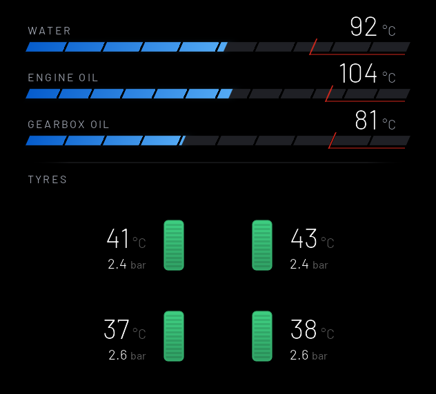

# iDrive apps

Apps and cluster widgets for BMW head units, installed from **MGU Store**. One source gives you every
package in this repository.

## Packages

| Package | What it is | Head unit | Components | Status |
|---|---|---|---|---|
| [**Vitals**](packages/vitals) | Water, engine oil and gearbox oil temperatures on M-style bars, and each tyre's temperature and pressure, in the middle of the cluster | iDrive 8 | `ida-vitals-cluster` (tool) · `ida_vitals` (app) | Experimental, untested on a car |
| [**Light Logger**](packages/lightlog) | Finds what switches the seat logos off (the lights that may be them, the body controller's lamp outputs, a finder), then **Keep on** holds that lamp output on while the car is on | iDrive 8 | `ida_lightlog` (app) | Experimental, untested on a car |
| [**Seat Lights**](packages/seatlights) | One switch that keeps the seat (headrest) logos lit with the car on, until you switch it off | iDrive 8 | `ida_seatlights` (app) | Experimental; the hold itself tested on a G87 M2 with Light Logger |



## Install

1. On the car, open **MGU Store**, go to **Settings → Add source**, enter `grabandrey/idrive-apps`, and pick the
   `main` branch.
2. Install the packages you want. Each package's README lists what it needs first (for example cluster-render)
   and any steps after installing.

The Store builds the apps on the head unit from source, against the car's own BMW SDK. This repository contains
no BMW code.

## Layout

```
mgu-repo.json             every component MGU Store offers from this repository
packages/<name>/          one product: its tool and/or app, its README, its design files
  tool/                   a root tool kit (component.json): services, renderer clients
  app/                    an iDrive app as a source package (mgu-app.json): screens, the car's data
  design/                 previews you open in a browser
shared/                   things packages share (fonts)
scripts/                  repository scripts: test_all.js (CI), bake_font.py
docs/                     how to add a package
```

## Develop

- `node scripts/test_all.js` checks `mgu-repo.json` against the packages and runs every package's tests. CI runs
  it on every push.
- [docs/ADDING_A_PACKAGE.md](docs/ADDING_A_PACKAGE.md) covers ids, versions, the manifest and tests for the next app.

## Disclaimer

Not affiliated with BMW. These packages change software on your car's head unit. Install them at your own risk,
and keep an eye on the cluster's warning lights. The packages draw only in the areas the head unit gives
third-party content. BMW keeps drawing the speedometer, warning lights and driver assistance.

MIT licensed. Fonts in `shared/fonts` keep their own licence (SIL OFL 1.1).
