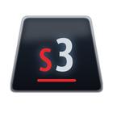

# GearHUD

La marcha engranada (**D3**, **S4**, **M2**…) en el **HUD**, en el **cuadro de instrumentos** o en los dos, para BMW con
iDrive 7 (unidad MGU), con el color que quieras. Se instala desde GitHub con la
[MGU Store](https://github.com/robertnisipeanu/mgu-store) y se compila en el propio coche: sin PC ni SSH.

*English: GearHUD shows the engaged gear (D3, S4, M2) on the head-up display, the instrument cluster or both, in a colour
of your choice (presets or custom hue / saturation / brightness, dimmer at night), with S and M in colours of their own
(red and orange by default). BMW iDrive 7, installed from the MGU Store; the app's screens are in Spanish.*

<p align="center"></p>

> **Sin probar todavía en un coche.** Todo está probado en el PC con un cluster-render simulado y la unidad simulada
> del kit (ver [Pruebas](#pruebas)). La primera prueba en el coche dirá si la posición de fábrica es buena; hasta
> entonces la app viene sin dibujar nada, solo registrando.

## Qué hace

- **Dónde:** HUD, cuadro, los dos o ninguno (solo registra). En el cuadro, **junto a la D** de serie o **en el centro**,
  sobre la zona del mapa.
- **Color en el HUD:** Blanco, **Gris suave** (el de fábrica), Gris, Blanco cálido, Ámbar, Naranja, Rojo M, Azul hielo,
  Azul M, Verde o **Personalizado** con tono, saturación y brillo. El cuadro tiene su propio color.
- **S y M de otro color:** con la palanca en S, **S3** en rojo; con las levas (M), **M3** en naranja. Se elige si se
  colorea la letra y la marcha, solo la letra o nada, y el color de cada una (las mismas muestras). Cambiar de D a S no
  sube píxeles: cada color tiene sus capas ya subidas.
- **Brillo de noche:** el HUD baja al porcentaje que elijas cuando el coche dice que es de noche.
- **Qué se ve:** letra y marcha (**D3**) o solo la marcha (**3**); en P, R y N la letra o nada.
- **Posición y tamaño en el HUD:** cinco posiciones dentro de la zona visible del cristal, ajuste fino horizontal y
  vertical y tamaño del 50 al 200 %.
- **En la pantalla central:** la marcha, de dónde sale y una **vista previa del HUD** con tu color, posición y tamaño,
  para ajustarlo sin estar mirando el parabrisas.

## Cómo se porta en el coche

- **Solo con el coche listo** (estado 10). Nada al encender ni al apagar: cluster-render tiene un guardián que cuenta
  un aviso cuando el cuadro se va justo después de mostrar el HUD, y con dos desactiva el HUD.
- **Cede el HUD:** si [Redline](https://github.com/cauliflowermossgrape/idrive7-apps) u otra app toma el HUD
  (`kit/hud_claim.js`), esta se aparta mientras lo tenga y vuelve después. cluster-render la quita por su cuenta cuando
  BMW enseña sus listas o sus avisos.
- **No quita el sitio a nadie:** sin `exclusive` ni `contend`. Si el HMI de serie ocupa un hueco, se le cede.
- **Ligera:** cada letra y cada número se sube una vez. Un cambio de marcha solo enseña y oculta capas, el tamaño y la
  posición solo las mueven y el brillo de noche es la opacidad de la capa. Solo un cambio de color vuelve a subir los
  píxeles.
- **Se instala aunque falten señales:** todas las del coche son opcionales. Si el catálogo del coche no tiene una
  interfaz, la instalación la quita en vez de fallar y la pantalla dice cuál falta. Sin la marcha del cambio, se estima
  con las rpm y la velocidad (solo con el motor tirando). Las rpm solo se piden si hace falta estimar.
- **En M**, junto a la D no se dibuja nada: el cuadro ya muestra el número. En el HUD sí (**M3**).
- **Los datos de demo** solo se ven en la pantalla central, nunca en el HUD ni en el cuadro.
- Registra lo que manda el coche en `data/senales.log` (como mucho unos 4 MB) para poder ajustar la app con datos reales.

## Instalar

Hace falta la [MGU Store](https://github.com/robertnisipeanu/mgu-store) en el coche y
[cluster-render](https://github.com/robertnisipeanu/idrive-apps) (el servicio que dibuja en el cuadro y en el HUD; se
instala con *Waze en el cuadro*). La app lo pide como requisito: con la fuente de robertnisipeanu/idrive-apps añadida,
la Store lo instala sola si falta.

1. En el coche: **Store → Ajustes / Fuentes → Añadir fuente → `rubenrios/gearhud`**, canal **rama `main`**.
2. Instala **GearHUD**. La unidad la compila (un par de minutos la primera vez) con el SDK de una app de BMW que ya
   tiene el coche: el repositorio no lleva código de BMW.
3. Abre la app y en **Ajustes → Dónde mostrar la marcha** elige HUD, Cuadro o los dos.

Cada commit en `main` es una actualización en la Store.

## Calibrar

Las posiciones del cuadro salen de fotos y la zona visible del HUD la midió Redline en un G21: con margen. Con el coche
**parado**, el botón **Calibrar** pone una rejilla con coordenadas (en el HUD, el borde amarillo es la zona visible del
cristal); otra pulsación, una marcha de prueba (D8) donde va la de verdad; otra, fin. Se apaga sola al moverse o a los
2 minutos.

Para ajustar sin recompilar, `data/posicion.json` en la carpeta de datos de la app (botón **Recargar posición**):

```json
{ "panel": { "big": { "x": 1518, "y": 337, "scale": 1 }, "small": { "x": 1414, "y": 652, "scale": 0.444 },
             "sport": { "x": 0, "y": 0, "scale": 1 } },
  "hud": { "right": [595, 235], "top": [400, 175] } }
```

`panel`: esquina de la celda del número junto a la D, en el lienzo de 1920 x 720 del cuadro; `sport` es la posición de
la D con el cuadro en Sport (sin ella, en Sport no se dibuja junto a la D). `hud`: centro de cada posición del HUD en la
escena de 800 x 480. Lo que no valga se ignora.

## Desarrollo

```
apps/rubenrios_gearhud/   la app: app.json, main.js, gear_state.js (la marcha), colors.js, glyphs.js (las capas),
                         outputs.js (cluster-render), rules.js, signal_log.js, cluster_render_client.js, icon.png
kit/                     el kit de idrive7-apps, recortado (kit/VENDORED.md)
tools/store_build.py     lo que ejecuta la Store en el coche (mgu-repo.json)
tools/test_*.js          pruebas; tools/fake_cluster.js, un cluster-render de mentira que habla su protocolo
tools/make_icon.py       el icono
```

### Pruebas

Node 8 como el coche (también valen versiones nuevas) y Python 3:

```sh
node tools/test_unit.js                                      # la marcha, los colores, el texto y las capas
python3 tools/store_build.py --preview-only rubenrios_gearhud # la app en dist/, sin SDK (no instalable)
node tools/test_e2e.js $PWD/dist/rubenrios_gearhud $PWD/kit/tools /tmp   # la app entera con cluster-render simulado
node kit/tools/preview.js dist/rubenrios_gearhud preview wait=6 render   # la pantalla central, en PNG
```

`test_e2e.js` usa `/dev/shm/cluster-render/render.sock`, la ruta real del servicio: ejecútalo donde no haya uno de verdad.

## Créditos

- [cauliflowermossgrape/idrive7-apps](https://github.com/cauliflowermossgrape/idrive7-apps): el kit (MIT), las reglas de
  las señales y del HUD que sigue esta app, y Redline, que midió la zona visible del cristal.
- [robertnisipeanu](https://github.com/robertnisipeanu): la MGU Store y cluster-render (MPL-2.0).
- La idea de la marcha en el cuadro como fuente de la Store, de
  [sergshamiryan/mgu-gear-cluster](https://github.com/sergshamiryan/mgu-gear-cluster); que todas las señales sean
  opcionales, de su versión resiliente.
- El icono es propio (`tools/make_icon.py`), dibujado con la fuente Ubuntu.

Licencia: MIT (`LICENSE`); el código de terceros, en `NOTICE.md`. No es una app de BMW ni está respaldada por BMW.
