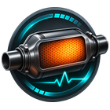

# DPF Monitor for BMW iDrive 7



**Read-only diesel particulate filter monitoring app for BMW MGU (ID7).**

A standalone app for monitoring DPF conditions directly on the iDrive display. Developed and tested on a BMW X5 G05 25d; other vehicles and DDE variants have not been validated. Feel free to open an issue to fix eventual issues.

## Features

- Overview with soot load and regeneration status.
- Live Data with recent trends and optional raw diagnostic replies.
- Regeneration history and demo mode.
- GPU rendering through the iDrive 7 Kit.
- Optional experimental Regeneration page, disabled by default. Its action button is a non-functional placeholder a the moment; no regeneration request is sent.

## Screenshots

### Overview


### Live Data


### Regeneration History


## Installation

Requires the Idrive unit to be rooted and [mgu-store](https://github.com/robertnisipeanu/mgu-store) to be installed, then add this line as a repo

```text
sas46/idrive7_dpf_app
```

The repository includes `mgu-repo.json` for source builds. The online repository installation has not yet been tested. The BMW OAP SDK is not distributed here.

## Local development (Windows)

Requirements: Python 3, Node.js and the OAP SDK obtained from your own MGU. Place the SDK in `oap-sdk/` at the project root (including `index.js` and `package.json`). Never commit it.

```cmd
python kit\tools\build.py idrive7_dpf_app
node kit\tools\preview.js dist\idrive7_dpf_app preview BTN_LIVE BTN_HISTORY
node tests\readonly-diag.test.js
```

The preview uses simulated data. The diagnostic test checks the read-only interface.

## WIP and experimental page and limitations

Enable the regeneration page in Settings > Experimental. It displays coolant temperature, exhaust temperature before the DPF, distance since last regeneration and regeneration lock status. Reference thresholds and lock-state interpretation remain unverified across DDE variants. They must not be treated as authorization to regenerate.

The observed DID 44BB mapping on the test vehicle is 4 = running and 6 = requested. Other variants may differ. Missing or incorrect readings should be reported with the vehicle model, engine and software version, without VIN or private diagnostic information.

**Use at your own risk. Forcing a regen is not recommended.** This version does not initiate regeneration, change diagnostic sessions or write to the DDE. Do not interact with the app while driving. It is not a substitute for professional diagnostics. Not affiliated with BMW.

I'm looking forward to implement a rendering for the Kombi (using its renderer) to notify the users about a requested/actual regeneration.

## Credits and licensing

See [third-party notices](THIRD_PARTY_NOTICES.md) and [changelog](CHANGELOG.md). The upstream Kit retains its MIT license and fonts retain their respective licenses. The DPF application is prepared for distribution under the [MIT license](LICENSE). Third-party components retain their respective licenses.

## Preview

Experimental page (development preview with simulated data; not an in-car screenshot):


